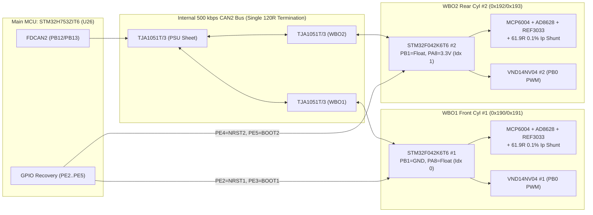

# `fome-mc`: Integrated FOME-Native Motorcycle ECU — Architecture & Design Document

- **Target Board / Project Name**: `fome-mc`
- **Primary Reference Vehicle**: 2007 Suzuki SV650 (K7, Gen 2 dual-plug 90° V-twin, `645 cc`)
- **Main Application Processor**: STMicroelectronics `STM32H753ZIT6` / `STM32H743ZIT6` (480 MHz Cortex-M7, 2 MB Flash, 1 MB RAM, LQFP-144)
- **Dual Onboard Wideband Co-Processors**: `2 × STM32F042K6T6` (48 MHz Cortex-M0, LQFP-32) running `fome-fw/firmware/ext/wideband_firmware` over internal 500 kbps `CAN2`
- **Sealed Harness Interface**: Dual 35-Pin TE Connectivity AMPSEAL Right-Angle PCB Headers (`J1` = `776163-1` Key 1 Black, `J2` = `776163-2` Key 2 Grey; 70 sealed `1.3 mm` contacts total, IP67/IP69K with integral wire-entry mat seal)

---

## 1. Executive Summary: Keep, Change, and Drop

This project adapts our earlier `fome-mc` brain-module work and combines it with the vehicle-facing circuitry of `Polygonus-Universal-112` and two complete `wideband_controller` Rev C circuits into a single, compact (`162.0 mm × 115.0 mm`), 4-layer pottable motorcycle ECU PCB (`fome-mc`).

The owner's planned `Atlas + Universal 112` installation remains a completely separate reference and bring-up path; `fome-mc` does not modify `/home/halbritt/git/Polygonus-Universal-112`, `/home/halbritt/git/Polygonus`, or `/home/halbritt/git/kicad-libraries`, and is not a prerequisite for bringing up the modular reference stack.

| Category | Item | Action (`Keep` / `Change` / `Drop`) | Engineering Rationale |
| :--- | :--- | :--- | :--- |
| **Processor & Core** | `STM32H753ZIT6` / `STM32H743ZIT6` (`U26`), 25 MHz HSE, 32.768 kHz LSE, `REF3033` `VREF+` (`U23`), `LPS25HBTR` baro (`U24`) | **Keep** | Proven FOME H7 architecture with 2 MB dual-bank Flash, hardware `ADC3` oversampling for DSP knock, 2× `FDCAN`, and `SDMMC1` IDMA. |
| **Power Supply** | `LM3481` boost pre-regulator (`VBOOST` ~13.5V) -> `LMR14020` 5V 2A buck -> 2× `TLS115D0E` tracked 5V sensor LDOs (`5V_SENSOR_1`, `5V_SENSOR_2`) + `BD3571` 3.3V LDO + `Keep_Alive` hold | **Keep** | Guarantees regulated `+5V`, `5V_SENSOR_1/2`, and `+3.3V` down to `3.5 V` battery cranking sags on a motorcycle starter while isolating external sensor shorts. |
| **Wideband O2** | `2 × f042_wideband_module` daughterboard headers on `Polygonus-Universal-112` | **Change (Integrate On-Board)** | Replaces the two 13-pin module headers with two complete onboard `wideband_controller` Rev C circuits (`2× STM32F042K6T6`, `2× MCP6004`, `2× AD8628`, `2× REF3033`, `2× XC6206P332MR`, `2× VND14NV04` heater FETs, `2× TJA1051T/3`) connected to internal `CAN2` (`PB12/PB13`). Retains unmodified proven wideband firmware. |
| **Wideband Addressing & Recovery** | Unstrapped `SEL_1`/`SEL_2` pins & unrouted `NRST`/`BOOT0` on Universal 112 WBO modules | **Change (Fix in Hardware)** | Hardware-straps `WBO1` (`PB1=GND, PA8=Float` -> `CanIndexOffset=0`, `0x190/0x191`) and `WBO2` (`PB1=Float, PA8=3.3V` -> `CanIndexOffset=1`, `0x192/0x193`) so broadcast `WB_MSG_SET_INDEX` (`0xEF40000`) cannot clobber both sensors to the same ID. Routes `PE2..PE5` from `STM32H753` to `WBO1/2_NRST` and `WBO1/2_BOOT0` for post-potting recovery. |
| **Ignition Outputs** | 8× IGBTs (`Q1..Q8`) + 12× logic channels across Polygonus + Universal 112 | **Change (Right-Size to 4 IGBT + 4 Logic)** | Provides 4× high-current `FGD3040G2-F085C` 400V IGBTs (`IGBT1..4` on `J1-6..9`, driven by `MIC4427` with `10 kΩ` MCU reset pull-downs) **and** 4× dedicated 5V push-pull `MIC4427` logic coil outputs (`IGN1_LOG..4_LOG` on `J2-23..26`) for 2-coil wasted-spark, 4-coil dual-plug twin (Primary + Trailing), or 4-cylinder motorcycles. |
| **Injector & Aux Low-Side** | 28× `VNL5090`/`VNLD5090` channels on Polygonus + Universal 112 | **Change (Right-Size to 4 INJ + 6 Aux LS)** | Provides 4× dedicated High-Z injector drivers (`INJ1..4` on `J1-1..4`), 4× Aux low-side outputs (`AUX_LS1..4` on `J1-10..13` with `2.2 kΩ` `+12V_MR` pull-up on `AUX_LS4` for SV650 tachometer), 1× `DASH_TECH` (`J2-27` with `2.2 kΩ` `+12V_MR` pull-up for SV650 7800-baud dash serial), and 1× internal `MAIN_RLY_LS` (`PE0`). |
| **Idle (`ISC`) & Secondary Throttle (`STVA`) Steppers** | Through-hole Pololu `A1` stepper carrier on Universal 112 + 2× `TLE9201SG` H-bridges on Polygonus | **Change (Integrate SMD `DRV8825PWPR` + Keep 2× `TLE9201SG`)** | Replaces the un-pottable Pololu daughterboard with an onboard SMD `DRV8825PWPR` (`U18`, `C81582`) driving `STEP_1A/1B/2A/2B` (`J1-19..22`) for the SV650 `ISC` 4-wire idle stepper, while keeping the 2× `TLE9201SG` 6A H-bridges (`U16`, `U17`) on `ETB1+/-` & `ETB2+/-` (`J1-15..18`) to drive the SV650 `STVA` 4-wire secondary throttle stepper (or dual DBW throttles). |
| **VR Conditioners** | Universal 112 `MAX9924` (`VR1`) + discrete 3-IC op-amp circuit (`vr_module_poly.kicad_sch` for `VR2`) | **Change (Dual `MAX9924UAUB+`)** | Uses two genuine `MAX9924UAUB+` adaptive differential VR conditioners (`U3`, `U4` from `triggers.kicad_sch`), fixing the Universal 112 Linux filename case bug (`VR Conditioner.kicad_sch`) and eliminating the 26-part discrete op-amp VR2 circuit. |
| **Onboard Logging Storage** | Mechanical spring-eject microSD slot (`J10`) only | **Change (Soldered SLC SDNAND + DNP microSD)** | Integrates a soldered `MKDV1GIL-AS` (`U25`, `C726726`, 1 Gbit / 128 MB Industrial SLC SDNAND in `6×8 mm` LGA-8) on 4-bit `SDMMC1` (`PC8..PC12, PD2`) for 100% pottable, vibration-proof logging, while retaining an optional DNP `J10` microSD footprint for unpotted bench boards. |
| **Board-to-Board & Molex 112 Headers** | 120-pin 2.54 mm board-to-board headers (`P1..P5`) + Molex CMC 112-pin header (`J2` `64333-0100`, 0 in stock at JLCPCB) | **Drop** | Eliminates all mezzanine headers and replaces the unobtainable 112-pin automotive header with Dual 35-pin TE AMPSEAL right-angle headers (`776163-1` Black `C412117` + `776163-2` Grey, 70 pins total). |

---

## 2. Mandatory Local Reference Repositories & Revision Ledger

All reference repositories were inspected in place and left completely unmodified:

| Repository Path | Git Commit Revision | Branch / Status | Role in `fome-mc` Design |
| :--- | :--- | :--- | :--- |
| `/home/halbritt/git/Polygonus-Universal-112` | `ddcf0f77fecf3ea7f093954ce1becb7c4a26e970` | `main` (clean; `fome-kicad-libs` submodule uninitialized upstream) | Primary electrical basis for carrier-side IGBT outputs (`FGD3040G2-F085C`), low-side protection (`SK310A`), dual wideband integration, and keep-alive power switching. |
| `/home/halbritt/git/kicad-libraries` | `ab9c5f8a1517a04b9cada6880d67d190bfd48c05` | `main` (clean) | Shared KiCad symbol (`Simon.kicad_sym`, `SamacSys_Parts.lib`, `fome_modules.kicad_sym`) and footprint (`Simon.pretty`, `SamacSys_Parts.pretty`, `fome_modules.pretty`, `project_footprints.pretty`, `mx120.pretty`) libraries mapped via `${KIPRJMOD}/../kicad-libraries`. |
| `/home/halbritt/git/Polygonus` | `b3176cb1de7d0f5b9380ecebc1d007e2f365a6de` | `master` (clean) | Source for processor core (`mcu.kicad_sch`), power supply (`psu.kicad_sch`), analog conditioning (`quad_analog*.kicad_sch`), dual `MAX9924` triggers (`triggers.kicad_sch`), dual `TLE9201SG` H-bridges (`etb-9201.kicad_sch`), and `ampseal.pretty`. |
| `/home/halbritt/git/fome-fw` | `6b31ebaec865d7ea856b20a3211c7a0310e29ef2` | `master` (modified with `fome-mc` board target + 2 bug fixes + unit tests) | FOME ECU firmware source tree. |
| `/home/halbritt/git/fome-fw/firmware/ext/wideband_firmware` | `ca2adce4aaea1deee66e459cc8949296763a0ad0` | Submodule (`https://github.com/mck1117/wideband`) | Source for the actual `wideband_controller` Rev C schematic, PCB, BOM (`hardware/board_module/`), and `STM32F042K6T6` wideband firmware (`firmware/`). |
| `/home/halbritt/git/fome-mc` | Checkpointed at `c43ad7bafc9a8e3be337f1342ae0cb259918882a` | Branch `atlas-brain-module-checkpoint` preserved; `master` holds `fome-mc` | Active design workspace for `fome-mc`. |

---

## 3. Circuit-Reuse, Adaptation & Upstream Bug Resolution Table

| Functional Block | Source Repo, File & Revision | Destination Sheet in `fome-mc` | What is Preserved | What Changes & Why (Including Upstream Bug Fixes) | Library Dependencies | Required Revalidation |
| :--- | :--- | :--- | :--- | :--- | :--- | :--- |
| **Power Supply, Boost Pre-Regulator & Dual CAN Transceivers** | `Polygonus` (`b3176cb`) `psu.kicad_sch` + `Polygonus-Universal-112` (`ddcf0f7`) `Keep_Alive.kicad_sch`, `wbo-can-trans.kicad_sch` | `psu.kicad_sch` & `Keep_Alive.kicad_sch` | `SMBJ24CA` TVS, reverse-polarity PMOS, `LM3481` `VBOOST` (~13.5V) pre-regulator, `LMR14020` 5V 2A buck, 2× `TLS115D0E` tracked 5V sensor LDOs (`5V_SENSOR_1`, `5V_SENSOR_2`), `BD3571` 3.3V LDO, 2× `TJA1051T/3` CAN transceivers, `Keep_Alive` diode-OR. | **Fixes Upstream Bugs**: (1) Replaces OOS `C1518237` THT caps with in-stock SMD `C134739` (`47 µF` 50V Panasonic); (2) Replaces OOS `C152727` CAN ESD diode with in-stock `C907839` (`PESD1CAN`); (3) **Fixes Universal 112 Triple 120Ω CAN2 Termination Bug** (`R36` + `R37` + `R10` = `40 Ω` overload) by keeping a single `120 Ω` termination across the internal `CAN2` bus. | `lmr14020`, `infineon_psu`, `polygonus-cache`, `Simon.pretty`, `tsdso24.pretty` | Verify `VBOOST` (~13.5V), `+5V`, `5V_SENSOR_1/2` (`5.00V ± 1%`), `+3.3V`, and `CAN1`/`CAN2` `60–120 Ω` bus resistance on bench. |
| **STM32H753 MCU Core, SDNAND, Baro & USB DFU Recovery** | `Polygonus` (`b3176cb`) `mcu.kicad_sch` + `fome-mc` (`c43ad7b`) `mcu.kicad_sch` | `mcu.kicad_sch` | `STM32H753ZIT6` (`U26`), 25 MHz HSE, 32.768 kHz LSE, `REF3033` `VREF+` (`U23`), `LPS25HBTR` (`U24`, `C87898`), `USBLC6-2SC6` (`U22`). | (1) Adds soldered `MKDV1GIL-AS` (`U25`, `C726726` LGA-8 1Gbit SLC SDNAND) on 4-bit `SDMMC1` (`PC8..PC12, PD2`) in parallel with DNP bench microSD `J10`; (2) Routes `PE2..PE5` to `WBO1_NRST`, `WBO1_BOOT0`, `WBO2_NRST`, `WBO2_BOOT0`; (3) Adds `J1-35` dual-threshold (`+5V` `USB_VBUS` / `+12V` `6.8V`-Zener `BOOT0` override) for potted DFU recovery; (4) Substitutes in-stock KENTO LEDs (`C2287`, `C2288`, `C12624`). | `polygonus-cache`, `Simon`, `Simon.pretty` | Verify USB DFU enumeration (`0483:df11`), `SDMMC1` FATFS mount/logging, `LPS25HBTR` I2C2 read (`PB10/PB11`), and `PE2..PE5` WBO reset control. |
| **Dual Onboard LSU 4.9 Wideband Controllers (`WBO1` & `WBO2`)** | `wideband_firmware` (`ca2adce`) `hardware/board_module/wideband_controller.kicad_sch` Rev C + `Polygonus-Universal-112` (`ddcf0f7`) `wbo-can-trans.kicad_sch` | `wbo1.kicad_sch` & `wbo2.kicad_sch` | Complete Rev C analog front-end (`MCP6004` `U1`, `AD8628` `U5`, `REF3033` `U3` `3.30V` reference, `61.9 Ω` 0.1% `Ip` sense shunt, `10 kΩ` `Nernst` ESR injection, `XC6206P332MR` 3.3V LDO, `STM32F042K6T6` `U2`, `VND14NV04` `Q1` protected low-side heater FET, `TJA1051T/3` CAN transceiver). | (1) Integrates both WBO circuits directly onto the main PCB (eliminating the two 13-pin module headers); (2) **Hardware-straps `SEL1`/`SEL2`**: `WBO1` straps `PB1=GND, PA8=Float` (`case 1` -> `CanIndexOffset=0`, `0x190/0x191`) and `WBO2` straps `PB1=Float, PA8=3.3V` (`case 5` -> `CanIndexOffset=1`, `0x192/0x193`); (3) Removes duplicate `120 Ω` termination resistors from the WBO transceivers; (4) Connects `NRST` and `BOOT0` to H7 `PE2..PE5`. | `Simon`, `SamacSys_Parts`, `Simon.pretty` | Verify `1.65V` `Vm` virtual ground, `4.9 kHz` Nernst AC ESR waveform, `500 kbps` `CAN2` telemetry at `0x190..0x193`, and `VND14NV04` heater PWM under `VBatt` CAN control. |
| **4-Ch High-Current Ignition IGBTs + 4-Ch 5V Logic Ignition** | `Polygonus-Universal-112` (`ddcf0f7`) `IGBT outputs.kicad_sch` + `Polygonus` (`b3176cb`) `ign4.kicad_sch` | `ign_igbt.kicad_sch` (and `ign4.kicad_sch`) | `MIC4427` 1.5A push-pull gate drivers (`U4..U7`), `10 kΩ` pull-downs at MCU pins (`PB3, PG15, PG14, PG13` and `PG12..PG9`) so coils cannot dwell during MCU reset/DFU, `20 Ω` gate resistors + `10 kΩ` gate-emitter bleeders, and `FGD3040G2-F085C` (`C471989`, 400V, 30A, 250 mJ SCIS) automotive ignition IGBTs (`Q1..Q4`). | Right-sizes from 8 IGBTs + 12 logic channels to **4× `FGD3040G2-F085C` IGBT channels (`IGBT1..4` on `J1-6..9`)** + **4× 5V push-pull `MIC4427` logic channels (`IGN1_LOG..4_LOG` on `J2-23..26` via `100 Ω` series resistors)**, supporting stock SV650 2-coil wasted-spark, 4-coil independent Primary/Trailing inductive coils, or 4× smart COP coils with zero hardware jumpers. | `Simon`, `polygonus-cache`, `Simon.pretty` | Verify `0V` gate voltage during MCU reset (`BOOT0=1`), `400V` IGBT avalanche clamp on inductive coil turn-off, and independent primary + trailing spark timing. |
| **4-Ch High-Z Injector + 6-Ch Aux Low-Side & High-Side Drivers** | `Polygonus` (`b3176cb`) `lowside_quad.kicad_sch`, `highside_quad.kicad_sch` + `Polygonus-Universal-112` (`ddcf0f7`) `Lowside Adder.kicad_sch` | `lowside_quad.kicad_sch` & `highside_quad.kicad_sch` | Dual protected `VNLD5090TR-E` (`C222209`, 42V active clamp, current limit, thermal shutdown) low-side drivers with `10 kΩ` pull-downs + `SK310A` (`C14868`) Schottky freewheeling diodes to `+12V_MR`; `VNQ7140AJ` high-side switch. | **Fixes Upstream Universal 112 BOM MPN Bug** (`C2680415` was `VNL5050` instead of `VNL5090`). Adds onboard `2.2 kΩ` pull-ups to `+12V_MR` on `AUX_LS4` (`PD3`, `J1-13` SV650 `0–12V` Tachometer) and `DASH_TECH` (`PB9`, `J2-27` SV650 `7800-baud` single-wire dash serial). | `vnld5090`, `vnq7140aj`, `Simon.pretty`, `tsdso24.pretty` | Verify `42V` active Zener flyback clamp on `INJ1..4` (`12 Ω` injector load) and `0–12V` square-wave levels on `AUX_LS4` (Tach) and `DASH_TECH`. |
| **Dual H-Bridge (`STVA`) + Onboard `DRV8825` (`ISC`) Stepper Drivers** | `Polygonus` (`b3176cb`) `etb-9201.kicad_sch` + `Polygonus-Universal-112` (`ddcf0f7`) `A1` Pololu stepper header | `stepper_etb.kicad_sch` & `etb-9201.kicad_sch` | 2× `TLE9201SG` (`IFX9201SG` `C112633`, 6A peak, PG-DSO-12 exposed thermal pad) H-bridges (`U16`, `U17`) driving `ETB1_OUT+/-` (`J1-15,16`) and `ETB2_OUT+/-` (`J1-17,18`). | Replaces the un-pottable through-hole Pololu module (`A1`) with an onboard SMD **`DRV8825PWPR` (`U18`, `C81582`, HTSSOP-28 exposed pad)** + `0.20 Ω` sense resistors (`VREF = 0.38V` -> `0.75A` current limit) on `STEP_1A/1B/2A/2B` (`J1-19..22`) for the SV650 `ISC` idle valve (`30 Ω/phase`), while the 2× `TLE9201SG` H-bridges drive the SV650 `STVA` secondary throttle stepper (`7 Ω/phase`) or dual DBW motors. | `tle9201_2`, `Simon`, `powersso.pretty` | Verify `DRV8825` `0.75A` winding chopper current on `ISC` (`PB4/PB7/PB8`) and `TLE9201SG` bipolar stepping on `STVA` with `STPS` feedback (`PA3`). |
| **Dual Adaptive VR Conditioners + 4× Hall / Switch Inputs** | `Polygonus` (`b3176cb`) `triggers.kicad_sch` + `Polygonus-Universal-112` (`ddcf0f7`) `VR conditioner.kicad_sch` | `triggers.kicad_sch` | 2× `MAX9924UAUB+` (`U3`, `U4`, `C89779`) differential VR conditioners in Mode A1 (adaptive peak threshold + zero-crossing hysteresis) with `10 kΩ` input resistors and `1 nF` differential filters; 4× protected Hall/Digital inputs (`PG1, PG0, PE11, PE10`) with `4.7 kΩ` pull-ups to `5V_SENSOR_2`. | **Fixes Upstream Universal 112 Linux Case Bug** (`VR Conditioner.kicad_sch` vs `VR conditioner.kicad_sch`) and replaces the discrete 26-part op-amp VR2 block (`vr_module_poly.kicad_sch`) with a second genuine `MAX9924UAUB+` (`U4`). | `max9924`, `polygonus-cache`, `Simon.pretty` | Verify clean `0–3.3V` output edges on `PE14` (`VR1`) and `PE15` (`VR2`) from `50 mVpp` cranking up to `100 Vpp` at `11,000 RPM` (`24-2` wheel = `4.4 kHz`). |
| **Analog, Thermistor & Knock Conditioning** | `Polygonus` (`b3176cb`) `quad_analog.kicad_sch`, `quad_analog_pullup.kicad_sch`, `knock.kicad_sch` | `quad_analog.kicad_sch`, `quad_analog_pullup.kicad_sch`, `knock.kicad_sch` | `MCP6004` unity-gain op-amp buffers (`U1, U2`) preceded by `5.6 kΩ / 10 kΩ` dividers (`1.56×` ratio) and RC low-pass filters; `2.7 kΩ` `0.1%` thermistor pull-ups on `AT1..AT4`; 2-channel active bandpass knock amplifier (`knock.kicad_sch`) into `PF4` (`ADC3_INP9`) & `PF5` (`ADC3_INP4`). | (1) Adds `1.5 kΩ` `1%` pull-up to `5V_SENSOR_1` on `AV6_GEAR` (`PA5`, `J2-8`) to bias the SV650 K7 6-speed resistor ladder (`560 Ω..15 kΩ`); (2) Replaces OOS `C53175` `3.3 nF` knock capacitors with in-stock `C472819` (`CL21B332KB6WPNC` `3.3 nF` 50V X7R 0805, 86,271 in stock). | `polygonus-cache`, `Simon.pretty` | Verify ADC linearity across `0–5.00V`, SV650 Gear Position voltage steps (`1.36V..4.55V`), and `ADC3` 250 kSPS knock sampling on `PF4`/`PF5`. |

---

## 4. 2007 Suzuki SV650 (K7 Dual-Plug) Vehicle Interface & Adapter Harness Architecture

All 2007 Suzuki SV650 (K7, California/49-state non-ABS and ABS models) electrical parameters were verified against the **Suzuki SV650/S/A/SA K7 Factory Service Manual (`99501-36140-01E`)** and OEM parts fiche (`MODEL K7`, `E02/E03/E24/E28/E33`).

### 4.1 Critical Finding: K7 Dual-Plug Ignition Coils & Independent Primary/Trailing Spark

1. **Stock K7 OEM Ignition Hardware**:
   - In 2007 (`K7`), Suzuki transitioned the SV650 cylinder heads from 1 spark plug per cylinder (`K3–K6`) to **2 spark plugs per cylinder (`4 spark plugs total`)**: a **Center (Primary)** plug (`33510-17G00` cap) and a **Side (Trailing)** plug (`33510-20E00` cap) in each cylinder head.
   - However, the stock K7 motorcycle uses **two 2-wire, dual-tower (wasted-spark secondary) dumb inductive ignition coils**:
     - Front Cylinder (#1) Dual-Tower Coil: `33410-17GA0` / `33410-44H02` (qty 1; Primary resistance `1.0–5.0 Ω` between `+` and `-`; Secondary resistance `25–40 kΩ` cap-to-cap; wired to stock ECM Pin `l` `W/Bl`).
     - Rear Cylinder (#2) Dual-Tower Coil: `33420-17GA0` / `33420-44H02` (qty 1; Primary resistance `1.0–5.0 Ω`; Secondary resistance `25–40 kΩ` cap-to-cap; wired to stock ECM Pin `c` `B`).
   - Because both high-tension leads on each stock K7 coil share a single magnetic core and secondary winding in series, **the stock 2-coil setup physically fires the Center and Side plugs of a cylinder at the exact same instant**.
2. **How `fome-mc` Supports Both Stock 2-Coil Mode AND True 4-Coil Independent Primary/Trailing Timing**:
   - **`fome-mc` Hardware Capability (Zero PCB Changes Required)**:
     - `fome-mc` provides **4 independent high-current 400V/30A IGBT coil drivers (`IGBT1..4` on `J1-6..9`)** AND **4 independent 5V 1.5A push-pull logic coil drivers (`IGN1_LOG..4_LOG` on `J2-23..26`)**:
       - `IGBT1` (`PB3`, `J1-6`) / `IGN1_LOG` (`PG12`, `J2-23`): `ignitionPins[0]` — **Front Cylinder (#1) Primary (Center Plug)**
       - `IGBT2` (`PG15`, `J1-7`) / `IGN2_LOG` (`PG11`, `J2-24`): `ignitionPins[1]` — **Rear Cylinder (#2) Primary (Center Plug)**
       - `IGBT3` (`PG14`, `J1-8`) / `IGN3_LOG` (`PG10`, `J2-25`): `trailingCoilPins[0]` — **Front Cylinder (#1) Trailing (Side Plug)**
       - `IGBT4` (`PG13`, `J1-9`) / `IGN4_LOG` (`PG9`, `J2-26`): `trailingCoilPins[1]` — **Rear Cylinder (#2) Trailing (Side Plug)**
   - **Mode A — Plug-and-Play Stock K7 Harness (`enableTrailingSpark = false`)**:
     - `J1-6` (`IGBT1`) drives stock ECM Pin `l` (`W/Bl`, Front dual-tower coil) and `J1-7` (`IGBT2`) drives stock ECM Pin `c` (`B`, Rear dual-tower coil). Both plugs in each cylinder fire simultaneously with zero modifications to the motorcycle's coils or main harness.
   - **Mode B — True Independent Primary/Trailing Timing (`enableTrailingSpark = true`)**:
     - Replace the 2 dual-tower coils with **4 single-output coils** (either 4× `K3–K6` SV650 single-tower 2-wire inductive coils driven by `IGBT1..4` on `J1-6..9`, or 4× GSX-R / Hayabusa Denso stick coils / 3-wire smart coils driven by `IGBT1..4` or `IGN1_LOG..4_LOG` on `J2-23..26`) and route a 2-wire trailing-coil sub-harness from `J1-8` (`IGBT3`) and `J1-9` (`IGBT4`) to the Front and Rear Side plug coils.
     - FOME schedules `ignitionPins[0..1]` at the main ignition advance angle and independently schedules `trailingCoilPins[0..1]` retarded by `trailingSparkAngle` (with full overdwell and engine-stop protection fixed in `spark_logic.cpp`).

### 4.2 Crankshaft Trigger (`24-2` VR) & Camless Phase Sync (`VVT_MAP_V_TWIN`)

- **Crankshaft Position Sensor (`CKP`)**: 2-wire Variable Reluctance (`VR`) sensor (`130–240 Ω` coil resistance, `≥ 3.7 Vpp` cranking, up to `80+ Vpp` at `10,500 RPM`) reading a **`24-2` crank rotor** (24 evenly spaced teeth every `15°`, with 2 missing teeth). Wired differentially to `VR1+` (`J2-11`, ECM Pin `R` `G`) and `VR1-` (`J2-12`, ECM Pin `8` `Bl`) feeding `MAX9924UAUB+` #1 (`U3` -> `PE14`).
- **Camless 720° Phase Synchronization**: The 2007 SV650 has **no physical camshaft position sensor (`CMP`)**. Because the 90° V-twin has an uneven `270° / 450°` firing interval, full sequential fuel injection and per-cylinder odd-fire ignition (`timing_offset_cylinder[0] = 0°`, `timing_offset_cylinder[1] = -90°`) require 720° cycle phase identification. `fome-mc` uses FOME's native **`VVT_MAP_V_TWIN`** algorithm (`trigger_central.cpp:469-507`), which samples the Front Cylinder Intake Air Pressure (`MAP1_FRONT` on `J2-5` / `PA0`, wired to stock ECM Pin `3` `G/B`) at `mapCamDetectionAnglePosition = 50°` ATDC to detect the intake stroke vacuum dip and lock 720° engine phase within the first revolution.

### 4.3 Dual 4-Wire Bipolar Steppers (`ISC` Idle Valve & `STVA` Secondary Throttles)

The K7 SV650 throttle body assembly incorporates **two independent 4-wire bipolar stepper motors**:

1. **Idle Speed Control (`ISC`) Stepper Valve (`~30 Ω/phase`, `~400 mA/phase` at `12V`)**:
   - Stock K7 ECM Pins: `g` (`Br/B`, Coil A+), `^` (`Br/W`, Coil A-), `i` (`G/W`, Coil B+), `\` (`G/B`, Coil B-).
   - Driven on `fome-mc` by the onboard SMD **`DRV8825PWPR`** (`U18`, `J1-19..22` `STEP_1A/1B/2A/2B`) controlled by FOME's hardware stepper idle thread (`STEP = PB4`, `DIR = PB7`, `~EN = PB8`, `VREF = 0.38 V` -> `0.75 A` chopper limit).
2. **Secondary Throttle Valve Actuator (`STVA`) Stepper (`~7.0 Ω/phase`, closed-loop with `STPS` pot)**:
   - Stock K7 ECM Pins: `[` (`W/R`, Coil A+), `f` (`R`, Coil A-), `Y` (`P/W`, Coil B+), `d` (`P`, Coil B-), with 0–5V position feedback from the Secondary TPS (`STPS`, ECM Pin `4` `W`, `~4.6 kΩ` total, `0.58 V` closed / `4.38 V` wide open) on `J2-4` (`TPS2_STPS` / `PA3`).
   - Driven on `fome-mc` by the **2× `TLE9201SG` (`IFX9201SG`) 6A H-Bridge drivers** (`U16` `ETB1_OUT+/-` on `J1-15,16` and `U17` `ETB2_OUT+/-` on `J1-17,18`), which can either hold the secondary butterflies wide-open after warm-up, run FOME's dual-H-bridge bipolar stepper controller (`stepper_dual_hbridge.cpp` with our `idle_hardware.cpp` `etb_use_two_wires` fix), or drive dual DC motor electronic throttle bodies on DBW motorcycles.

### 4.4 Gear Position Ladder, Tip-Over Sensor, Tachometer & `7800-Baud` Dash Serial (`TECH`)

- **Gear Position Switch (`GP`, Stock ECM Pin `1` `P` -> `J2-8` `AV6_GEAR` `PA5`)**:
  - 6-speed resistor ladder to ground (`1st = 560 Ω`, `2nd = 820 Ω`, `3rd = 1.5 kΩ`, `4th = 2.7 kΩ`, `5th = 6.8 kΩ`, `6th = 15 kΩ`, `Neutral = Open`).
  - `fome-mc` populates a **`1.5 kΩ` `1%` pull-up to `5V_SENSOR_1`** on `AV6_GEAR` (`PA5`), producing distinct voltages at the sensor pin (`1.36 V`, `1.77 V`, `2.50 V`, `3.21 V`, `4.10 V`, `4.55 V`, and `5.00 V` in Neutral).
- **Tip-Over Sensor (`TO`, Stock ECM Pin `J` `Br/W` -> `J2-7` `AV5_TIPOVER` `PA4`)**:
  - Internal `19.4 kΩ` resistor + magnetic pendulum (`0.4–1.4 V` normal upright; `3.7–4.4 V` when leaned `> 65°`), used for automatic fuel/ignition safety cutoff.
- **Tachometer Output (Stock ECM Pin `Z` `Y/Bl` -> `J1-13` `AUX_LS4` `PD3`)**:
  - `VNLD5090` low-side switch (`PD3`) with an onboard **`2.2 kΩ` pull-up resistor to `+12V_MR`**, generating the crisp `0–12 V` square wave required by the Suzuki instrument cluster.
- **Instrument Cluster Single-Wire Serial (`TECH`, Stock ECM Pin `U` `B/G` -> `J2-27` `DASH_TECH` `PB9`)**:
  - The K7 SV650 routes the ECT thermistor (`Pin 6` `B/L`) only to the ECU; the ECU transmits coolant temperature and FI warning status to the dash over a single-wire `0–12 V` open-collector `7800 baud` 8-byte serial link (`Pin U` `B/G`). `J2-27` (`PB9`) provides a dedicated low-side driver with an onboard **`2.2 kΩ` pull-up to `+12V_MR`** so a FOME Lua script or serial driver can drive the factory SV650 temperature display and FI lamp directly.

---

## 5. Dual Integrated Wideband Controller Architecture (`WBO1` & `WBO2`)

Both wideband channels are physically integrated onto the `fome-mc` PCB using the proven `wideband_controller` Rev C circuit (`fome-fw/firmware/ext/wideband_firmware/hardware/board_module/wideband_controller.kicad_sch` @ `ca2adce4aaea1deee66e459cc8949296763a0ad0`):

1. **Hardware CAN Index Strapping (Immune to Broadcast Clobbering)**:
   - In `wideband_firmware/firmware/boards/f0_module/port.cpp:84-152`, each `STM32F042K6T6` reads `PB1` (`SEL_1`) and `PA8` (`SEL_2`) at startup using a ternary (`0 = GND`, `1 = Float`, `2 = +3.3V`) decoder (`val = sel1 * 3 + sel2`).
   - If both pins float (`case 4`), the controller falls back to `cfg.CanIndexOffset` in Flash, which is overwritten on **both** controllers simultaneously if the user clicks "Set WBO Index" in TunerStudio (`sendWidebandInfo()` broadcasts `WB_MSG_SET_INDEX = 0xEF40000`).
   - On `fome-mc`, we strap:
     - **WBO1 (Front Cylinder #1)**: `PB1` tied to `GND` (`0`), `PA8` floating (`1`) -> `val = 1` (`case 1: CanIndexOffset = 0`) -> fixed at **`0x190` (Standard) / `0x191` (Diag)**.
     - **WBO2 (Rear Cylinder #2)**: `PB1` floating (`1`), `PA8` tied to `+3.3V` (`2`) -> `val = 5` (`case 5: CanIndexOffset = 1`) -> fixed at **`0x192` (Standard) / `0x193` (Diag)**.
2. **Heater Power & Battery Voltage Sensing**:
   - The `STM32H753` transmits `WB_MSG_ECU_STATUS` (`0xEF50000` Extended ID) at `10 Hz` on `CAN2` containing `VBatt` (`Byte 0` in `0.1 V/LSB`) and `HeaterAllow` (`Byte 1 bit 0`, enabled only when `+12V_MR > 11.0 V` and engine is running). Each `STM32F042K6T6` also monitors `+12V_MR` locally on `PA0` via a `47 kΩ / 10 kΩ` divider and drives its `VND14NV04` (`C62077`) protected Omnifet II low-side heater switch (`WBO1_HTR-` on `J1-23`, `WBO2_HTR-` on `J1-25`) referenced to the dedicated `PGND_HEATER` plane (`J1-33`).
3. **Sequential OpenBLT CAN Firmware Updates & Post-Potting Recovery**:
   - Because `PE2` (`WBO1_NRST`) and `PE4` (`WBO2_NRST`) are independently controlled by the `STM32H753`, the main MCU can hold `WBO2` in reset (`PE4 = LOW`) while updating `WBO1` via FOME's built-in OpenBLT CAN wideband updater (`updateWidebandFirmware()` in `wideband_can.cpp`), and then hold `WBO1` in reset (`PE2 = LOW`) while updating `WBO2` — solving the OpenBLT broadcast address collision when two WBO controllers share `CAN2`!

---

## 6. FOME Firmware Target (`fome-mc`) & Upstream Firmware Bug Fixes

### 6.1 Upstream FOME Bugs Discovered & Fixed in `/home/halbritt/git/fome-fw`

1. **Bug Fix #1 — Trailing Spark Overdwell & Engine-Stop Coil Burnout (`firmware/controllers/engine_cycle/spark_logic.cpp:69-103`)**:
   - **Defect**: In `onIgnitionEvent()`, when `ctx.isOverdwellProtect` was true (`spark_logic.cpp:69-74`) or when `isnan(dwell)` occurred on engine stop (`spark_logic.cpp:80-86`), FOME cancelled `event.sparkCharge` and pulled `enginePins.coils[event.cylinderNumber]` LOW, **but never cancelled `event.trailingSparkCharge` / `event.trailingSparkFire` or pulled `enginePins.trailingCoils[event.cylinderNumber]` LOW**. If an engine stalled while a trailing coil was dwelling, the trailing IGBT/coil remained stuck HIGH indefinitely.
   - **Fix**: Added `event.trailingSparkCharge.Cancel()`, `event.trailingSparkFire.Cancel()`, and `enginePins.trailingCoils[event.cylinderNumber].setLow()` in both the `ctx.isOverdwellProtect` and `isnan(dwell)` paths.
2. **Bug Fix #2 — Dual H-Bridge Bipolar Stepper `etb_use_two_wires` Hardcode (`firmware/controllers/actuators/idle_hardware.cpp:96-114`)**:
   - **Defect**: When `useHbridgesToDriveIdleStepper` was enabled, `initIdleHardware()` called `initDcMotor(..., /*useTwoWires*/ true)` with a hardcoded `true` instead of `engineConfiguration->etb_use_two_wires`. Because `TLE9201SG` (`IFX9201SG`) uses `ThreeWirePwm` (`PWM + DIR + DIS`, `etb_use_two_wires = false`), `TwoWire` mode left the `DIR` pin unclocked.
   - **Fix**: Replaced hardcoded `true` with `engineConfiguration->etb_use_two_wires`.
3. **Unit Tests Added (`unit_tests/tests/ignition_injection/test_ignition_scheduling.cpp`)**:
   - Added `trailingSparkTwoCylinderOddFireSV650` (verifies independent primary and trailing spark dwell/fire scheduling across both cylinders of an odd-fire 2-cylinder engine when `enableTrailingSpark = true` and transition from cranking to running) and `trailingSparkOverdwellProtection` (verifies `trailingCoils` is forced LOW on overdwell protection).

### 6.2 `fome-mc` Board Configuration (`firmware/config/boards/fome-mc/`)

- Created dedicated board directory `/home/halbritt/git/fome-fw/firmware/config/boards/fome-mc/` (`board.mk`, `compile_fome-mc.sh`, `board_configuration.cpp`, `knock_config.h`, `trigger_scope_config.h`, `prepend.txt`, and `connectors/{analog,digital_in,outputs,can}.yaml`).
- Pre-configured defaults in `setBoardDefaultConfiguration()` target the 2007 Suzuki SV650 (`cylindersCount = 2`, `FO_1_2`, `timing_offset_cylinder[1] = -90.0f`, `TT_TOOTHED_WHEEL` `24-2`, `VVT_MAP_V_TWIN`, `useStepperIdle = true` on `PB4/PB7/PB8`, and dual internal `FOMEInternal` CAN widebands on `CAN2` Bus 1 Indices 0 and 1).

---

## 7. Packaging, Connector System, Thermal Budget, Storage, Baro & Potting Strategy

### 7.1 Sealed Connector System: Dual 35-Pin TE AMPSEAL (`70 Pins Total`)

| Component Role | Manufacturer & Part Number | LCSC Code & Stock (2026-10-16) | Notes |
| :--- | :--- | :--- | :--- |
| **`J1` PCB Header (Power, Drivers, Steppers, WBO Heaters)** | TE Connectivity `776163-1` (35-Pos Right-Angle Header, Key 1 **Black**) | `C412117` (282 in stock at JLCPCB) | Footprint `ampseal:TE_776163-1` (`77.6 mm` width, `50.2 mm` total combined width for `J1 + J2` on `135 mm` board edge). |
| **`J2` PCB Header (Sensors, Triggers, WBO Cells, Logic Coils, CAN, USB)** | TE Connectivity `776163-2` (35-Pos Right-Angle Header, Key 2 **Grey**) | Mouser `571-776163-2` / DigiKey `A114205-ND` (or `C412117` Key 1 with colour label) | Mechanical key polarization prevents swapping `J1` and `J2` plugs during installation. |
| **Mating Plug Housings** | TE `776164-1` (35-Pos Plug, Key 1 Black) + TE `776164-2` (35-Pos Plug, Key 2 Grey) | Mouser `571-776164-1` / `571-776164-2` | Integral silicone wire-entry mat seal (`1.7–2.7 mm` insulation OD, IP67/IP69K) — no individual wire seals required! |
| **Crimp Socket Terminals (`1.3 mm`, `16–20 AWG`)** | TE `770520-1` (Tin) or `770520-3` (Gold — recommended for VR, Analog, and LSU 4.9 cell signals) | Mouser `571-770520-1` / `571-770520-3` | Rated `17 A` max (`8–11 A` continuous in 35-pos housing). |
| **Unused Cavity Sealing Plugs** | TE `770678-1` (`1.3 mm` white nylon sealing plug) | Mouser `571-770678-1` | Inserts into any unpopulated harness cavities to preserve IP67 seal. |
| **Crimp Tooling** | TE `58529-1` Pro-Crimper III or Rennsteig `624 071 3 0` / IWISS `IWD-1620` | Standard `1.3 mm` AMPSEAL die | Standard F-crimp for `16–20 AWG` TXL/GXL automotive wire. |

### 7.2 Worst-Case & Continuous Thermal Dissipation Budget

| Subsystem | Active Devices | Continuous Operating Power (`W`) | Cold-Start Peak Power (`W`, `< 20 s`) | Thermal Mitigation on `fome-mc` PCB |
| :--- | :--- | :--- | :--- | :--- |
| **Dual LSU 4.9 Heaters** | `2 × VND14NV04` (`Rds(on) ≈ 50 mΩ` hot) + `2 × SK310A` PWM freewheeling | `0.80 W` (`1.6 A` RMS/ch @ 50% duty) | `4.10 W` (`5.5 A` peak/ch @ 90% duty) | DPAK drain tab on `400 mm²` `2 oz`/`1 oz` copper pour + `16 × Ø0.3 mm` thermal vias per FET to inner `PGND_HEATER` plane. |
| **4-Channel Ignition IGBTs** | `4 × FGD3040G2-F085C` (`Vce(sat) ≈ 1.55 V` @ `6.5 A`, `3.2 ms` dwell @ `10,500 RPM`) + `MIC4427` | `4.25 W` (`1.06 W` per IGBT at `10,500 RPM` redline; `1.4 W` total at cruise) | `1.60 W` (cranking RPM) | Each DPAK IGBT has `12 × Ø0.3 mm` thermal vias + collector copper island isolated by `≥ 1.0 mm` clearance (`400 V` peak). |
| **4× Injectors + 4× Aux Low-Sides** | `4 × VNLD5090TR-E` + `SK310A` flyback diodes | `0.78 W` | `0.90 W` | SOIC-8 substrate ground pins stitched directly to `PGND_INJ` plane. |
| **`ISC` & `STVA` Stepper Bridges** | `1 × DRV8825PWPR` (`ISC`) + `2 × TLE9201SG` (`STVA`) | `1.12 W` | `2.35 W` | Exposed bottom thermal pads (`EP`) soldered to `PGND` via `5×5` (`25`) `Ø0.3 mm` via arrays. |
| **Power Supply (`VBOOST` + `5V` Buck + LDOs)** | `LM3481` + `LMR14020` + `2 × TLS115D0E` + `BD3571` + `2 × XC6206P332MR` | `2.83 W` | `10.90 W` (only during `< 5 s` `6 V` cranking sag when `LM3481` boosts) | Exposed pads on `LMR14020`, `TLS115D0E`, and `BD3571` stitched to `GND` plane with `9+` thermal vias each. |
| **3× MCUs & CAN/Analog ICs** | `STM32H753ZIT6` (480 MHz) + `2 × STM32F042K6T6` (48 MHz) + `3 × TJA1051T/3` | `1.34 W` | `1.34 W` | Distributed across `162.0 mm × 115.0 mm` 4-layer board with continuous `L2` ground plane. |
| **TOTAL ECU DISSIPATION** | **All Subsystems Combined** | **`11.12 W` Continuous (Redline)** (`~7.5 W` Cruise) | **`21.19 W` Transient (`< 15 s`)** | Conducted through thermally conductive soft polyurethane potting (`k ≥ 0.85 W/m·K`, e.g., Electrolube `UR5634` or MG Chemicals `832TC`) into the aluminum enclosure (`ΔT_internal < +9 °C`). |

### 7.3 Barometric Sensing: Vented Unpotted Pocket, External Analog Fallback & FOME Pre-Cranking MAP Behavior

1. **Primary Design — Onboard `LPS25HBTR` (`U24`) in Vented Unpotted Chimney Pocket**:
   - **Sensor**: STMicroelectronics **`LPS25HBTR`** (`U24`, LCSC `C87898`, `260–1260 hPa` absolute range, `±0.2 hPa` relative / `±1.0 hPa` absolute accuracy, `-40 °C to +105 °C`, HLGA-10L `2.5 × 2.5 × 0.76 mm` with top dust-resistant lid and pressure port), connected to `STM32H753` `I2C2` (`PB10 = SCL`, `PB11 = SDA` at `121.62, 100.61 mm` on the PCB) and initialized by `lps25.cpp` (`board_configuration.cpp:190-191`).
   - **Chimney Dam & Enclosure Vent**: A `F.Fab` keep-out ring (`ID 8.0 mm × OD 11.0 mm` centered at `121.62, 100.61 mm` on `fome-mc.kicad_pcb`) defines the unpotted barometer pocket. Before potting, a machined ABS/silicone cylindrical chimney dam (`ID 8.0 mm, OD 11.0 mm, height 14.0 mm`, sealed to the solder mask with neutral-cure alkoxy silicone RTV `Dow Dowsil 3145`) surrounds `U24` and seals against the underside of a threaded **hydrophobic/oleophobic ePTFE membrane vent** in the enclosure lid (**`Amphenol LTW VE80410`** `M12×1.5` PA66 body with Viton O-ring, or **`Gore PMF100321`** adhesive ePTFE vent).
   - **Pressure Equalization & Ingress Limits**: With an enclosed pocket volume of `V ≈ 0.70 cm³` (`π × (0.4 cm)² × 1.4 cm`) and an ePTFE membrane airflow of `≥ 350 mL/min` at `7 kPa` (`≥ 0.83 cm³/s` per `kPa`), the pneumatic RC time constant is **`τ < 2 ms`**, guaranteeing instantaneous ambient pressure tracking during rapid elevation changes without sensing trapped internal enclosure air. The ePTFE membrane provides **IP67/IP68 immersion protection (`1 m / 30 min`) and oil/fuel splash rejection (AATCC 118 rating 8)**, but **does not by itself confer an IP69K close-range high-pressure steam-jet wash rating**; the ECU must be mounted under the seat/undertail cowling shielded from direct pressure-washer lances.
2. **Verified External Analog Barometric Sensor Fallback (`J2-6` `MAP2_REAR` / `PA2`)**:
   - If an operator builds a 100% solid-potted unvented unit, `fome-mc` supports a dedicated external automotive 0–5V absolute barometric sensor on `J2-6` (`MAP2_REAR` -> `PA2`, powered by `5V_SENSOR_1` on `J1-29` and `SGND` on `J1-31`, buffered through a `10 kΩ / 100 nF` RC filter and unity-gain `MCP6004` op-amp with `> 1 MΩ` input impedance):
     - **Selected Part A (Direct FOME Built-In Enum `MT_GM_1_BAR`)**: **GM / ACDelco `12614970` (Delphi `PS10150`)** 1-Bar Absolute Pressure Sensor (`10–105 kPa`, `5.00 V ± 0.25 V` ratiometric supply, `< 10 mA` supply current, `≥ 51 kΩ` minimum load impedance). Verified against `fome-fw/firmware/init/sensor/init_map.cpp:62-63` (`case MT_GM_1_BAR: return { 0.0, 10, 5.0, 105 };` -> `10.0 kPa` at `0.00 V`, `105.0 kPa` at `5.00 V`, `19.0 kPa/V` slope).
     - **Selected Part B (Custom Linear `MT_CUSTOM`)**: **Bosch `0 261 230 146`** 1-Bar Barometric Pressure Sensor (`15–115 kPa`, `0.40 V @ 15 kPa` to `4.65 V @ 115 kPa`, `23.53 kPa/V`, `5.0 V` supply, `≥ 50 kΩ` load impedance).
3. **Actual FOME Pre-Cranking MAP Barometric Fallback Behavior (`firmware/controllers/sensors/impl/map.cpp:24-39`)**:
   - Inspection of `initMap()` in `fome-fw/firmware/controllers/sensors/impl/map.cpp:24-39` establishes the exact firmware behavior when `useFixedBaroCorrFromMap = true`:
     - Only if `!Sensor::hasSensor(SensorType::BarometricPressure)` is true at boot does `initMap()` read `Sensor::get(SensorType::MapSlow)` **once** during `initMap()` startup (`storedInitialBaroPressure`).
     - If `validateBaroMap(storedInitialBaroPressure)` passes (`!cisnan(map) && map >= 60 && map <= 110`, `map.cpp:17-22`), FOME calls `Sensor::setMockValue(SensorType::BarometricPressure, storedInitialBaroPressure)`.
     - **Consequences**: (a) The value is **never updated after `initMap()`**—climbing from sea level (`101.3 kPa`) to a `2,500 m` mountain pass (`~74.7 kPa`) without keying off leaves barometric compensation frozen at `101.3 kPa` (`~26%` barometric error); (b) if the rider stalls and re-keys while cranking or while residual intake vacuum (`< 60 kPa`) is present, `validateBaroMap()` either rejects the reading (leaving no baro sensor) or captures a depressed manifold pressure as ambient baro. Therefore, pre-cranking MAP sampling is treated strictly as a last-resort fallback, and continuous live barometric measurement (`LPS25HBTR` `U24` or external `MT_GM_1_BAR` on `J2-6`) is preserved by default.

### 7.4 Soldered Onboard Logging Storage (`XTSD04GLGEAG` / `MKDV4GIL-AST` LGA-8 SD NAND)

1. **Selected Part & Footprint (`U25` in `mcu.kicad_sch`, `ampseal:LGA-8_6x8mm_P1.25mm`)**:
   - **Primary Part**: **XTX `XTSD04GLGEAG`** (`LCSC C558840`, 4 Gbit = `512 MB` raw / **`~480 MiB` (`503 MB`) usable FAT32**, SLC NAND with integrated SD 2.0 controller, `-40 °C to +85 °C`, `100,000` program/erase cycles with hardware bad-block management and wear leveling, `6.0 × 8.0 × 0.8 mm` LGA-8).
   - **Pin-for-Pin Drop-In Alternatives**: **MK Founder `MKDV4GIL-AST`** (`LCSC C726727`, 4 Gbit = `512 MB` Industrial SLC) and **`MKDV1GIL-AS`** (`LCSC C726726`, 1 Gbit = `128 MB` raw / `~118 MiB` usable FAT32, 92 in stock at JLCPCB).
   - **Datasheet Pinout & Bus Termination (`mcu.kicad_sch` `U25`)**:
     - `Pin 1 (DAT2)` -> `SD_D2` (`PC10`, `47 kΩ` pull-up to `+3.3V`)
     - `Pin 2 (CD/DAT3)` -> `SD_D3` (`PC11`, `47 kΩ` pull-up to `+3.3V`)
     - `Pin 3 (CMD)` -> `SD_CMD` (`PD2`, `47 kΩ` pull-up to `+3.3V`)
     - `Pin 4 (VDD)` -> `+3.3V` (`2.7–3.6 V`, `4.7 µF` + `100 nF` X7R decoupling `< 2 mm` from `Pin 4`)
     - `Pin 5 (CLK)` -> `SD_CLK` (`PC12`, `22 Ω` series damping resistor)
     - `Pin 6 (VSS)` & `Pad 9 (EP)` -> `GND`
     - `Pin 7 (DAT0)` -> `SD_D0` (`PC8`, `47 kΩ` pull-up to `+3.3V`)
     - `Pin 8 (DAT1)` -> `SD_D1` (`PC9`, `47 kΩ` pull-up to `+3.3V`)
2. **Card-Detect Verification & Recording Duration at Actual FOME `.mlg` Frame Size**:
   - **Zero `SD_CD` Pin Dependency**: Verified in `fome-fw/firmware/hw_layer/mmc_card_attach.cpp:88-104` that when `STM32_SDC_USE_SDMMC1 == TRUE`, FOME calls `sdcStart(&SDCD1, &sdccfg)` and `sdcConnect(&SDCD1)` directly over the 4-bit SDMMC peripheral with **no hardware card-detect GPIO pin**. A permanently soldered LGA-8 SD NAND initializes identically to a removable card.
   - **Recording Duration (`TS_TOTAL_OUTPUT_SIZE = 1380 B` + `4 B` record header = `1,384 B/frame` in `sd_file_log.cpp`)**:
     - At `10 Hz` (`13.84 KB/s` = `49.8 MB/hr`): **`~101 hours`** on `4 Gbit` (`XTSD04GLGEAG`/`MKDV4GIL-AST`) / **`~24.8 hours`** on `1 Gbit` (`MKDV1GIL-AS`).
     - At `50 Hz` (`69.20 KB/s` = `249.1 MB/hr`): **`~20.2 hours`** on `4 Gbit` / **`~5.0 hours`** on `1 Gbit`.
     - At `100 Hz` (`138.4 KB/s` = `498.2 MB/hr`): **`~10.1 hours`** on `4 Gbit` / **`~2.5 hours`** on `1 Gbit`.
     - At `250 Hz` (`346.0 KB/s` = `1.25 GB/hr`): **`~4.0 hours`** on `4 Gbit` / **`~1.0 hour`** on `1 Gbit`.
   - **Power-Interruption Resilience**: `fome-mc`'s `Keep_Alive` circuit (`+12V_BATT_KEEPALIVE` `J1-28` + `PE0` `MAIN_RLY_LS`) holds main power during normal ignition key-off, and `sd_file_log.cpp:43` (`F_SYNC_PERIOD_SEC = 2`) executes `f_sync(&logFile)` every `2 seconds`, bounding worst-case un-flushed data loss on a sudden battery terminal disconnect to `< 2 seconds` while preserving prior committed FAT32 clusters.

### 7.5 Log Retrieval, Single-Owner Filesystem Handoff & Post-Potting Firmware Recovery

1. **Controlled Engine-Stopped `FatFs` -> `USB Mass Storage` Handoff (`mmc_card_mount.cpp` & `sd_file_log.cpp`)**:
   - **Upstream Concurrency Hazard Fixed**: In upstream FOME (`mmc_card_mount.cpp:179-189`), `mountMmc()` called `usb_msd_driver_start(&USBMSD1, ...)` unconditionally right after `f_mount(&MMC_FS, "/", 1)`, allowing a USB host (`WRITE_10` / FAT table cache) and the ECU's `FatFs` logger (`writeSdLogLine()`) to concurrently access `SDCD1`.
   - **Implemented Single-Owner State Machine**:
     - If USB VBUS (`PA9` `isUsbVoltageDetected()`) is present at boot while the engine is stopped (`rpm == 0`), `mountMmc()` attaches `SDCD1` exclusively to `USBMSD1` (`SD_STATE_PC_CONNECTED`) and skips `f_mount()`.
     - Otherwise, `mountMmc()` mounts `FatFs` (`SD_STATE_MOUNTED`) **without** starting `USBMSD1`.
     - When a laptop USB cable is plugged in later while the engine is stopped (`rpm == 0`), `onUsbConnectedNotifyMmc()` sets an atomic `usbHandOffRequested` flag (`mmc_card_mount.cpp:69-101`). On the next logger iteration (`sd_file_log.cpp:200-217`), `tryHandOffActiveLogToUsb()` flushes and closes the active `.mlg` file (`closeLogFile()`), unmounts `FatFs` (`f_mount(nullptr, "", 0)`), and attaches `SDCD1` to `USBMSD1` (`SD_STATE_PC_CONNECTED`). While `SD_STATE_PC_CONNECTED` is active, `writeSdLogLine()` is a no-op, preventing dual-mount corruption.
2. **Post-Potting Firmware Recovery for All 3 MCUs**:
   - **Main `STM32H753ZIT6` (`U26`)**:
     - *Primary Updates*: OpenBLT over `CAN1` (`J2-28/29`) or `USB` (`J2-34/35`).
     - *Hardware ROM DFU Recovery (`0483:df11`)*: `J1-35` (`USB_VBUS_DFU`) provides a dual-threshold circuit: normal `+5.0V` USB VBUS asserts `PA9` (`USB_VBUS` sense) while keeping `BOOT0 = 0V` (`10 kΩ` pull-down); applying `+12V` to `J1-35` on a bench recovery adapter conducts the `6.8V` Zener + `R209` (`10 kΩ` in `stepper_etb.kicad_sch`) to drive `BOOT0 = 3.3V` (`HIGH`), forcing the STM32H7 hardware ROM DFU bootloader over `J2-34/35` (`USB_D+/D-`) even if Flash is blank or bricked.
   - **Both Onboard `STM32F042K6T6` Wideband MCUs (`U302` & `U402`)**:
     - `STM32H753` pins `PE2` (`WBO1_NRST`), `PE3` (`WBO1_BOOT0`), `PE4` (`WBO2_NRST`), and `PE5` (`WBO2_BOOT0`) are routed directly to `U302` and `U402` (`wbo1.kicad_sch` / `wbo2.kicad_sch`). Holding `PE4 = LOW` resets `WBO2` off `CAN2` while `updateWidebandFirmware()` flashes `WBO1` via OpenBLT (`0x7E0`/`0x7E8`), and holding `PE2 = LOW` resets `WBO1` while flashing `WBO2`.

### 7.6 Encapsulation, Enclosure & Pre-/Post-Potting Verification Gate

1. **Selected Encapsulation Strategy — Conformal-Coated PCB + Selective Soft Polyurethane Potting in Vented Aluminum Tub**:
   - **Why Rigid Epoxy Full-Potting Is Rejected**: High-modulus rigid epoxy (`Shore D > 75`, `CTE ≈ 55–70 ppm/°C` vs FR-4 `14–17 ppm/°C`) exerts severe shear stress on fine-pitch `0.5 mm` `LQFP-144` gull-wing leads (`U26`) and `0402` MLCCs across `-40 °C .. +105 °C` thermal cycling, and blocks the `LPS25HBTR` barometer port.
   - **Selected Material System**:
     - *Base Layer*: Acrylic conformal coat (**`Electrolube HPA`** or **`Humiseal 1B31`**, `25–50 µm` thickness) over the entire PCBA (keeping `U24` barometer port masked) to provide a compliant strain-relief barrier around `LQFP-144` leads.
     - *Encapsulant*: 2-part thermally conductive, low-hardness polyurethane (**`Electrolube UR5634`** or **`MG Chemicals 832TC`**, `Shore A 55–65`, thermal conductivity `k ≥ 0.85 W/m·K`, `Tg < -40 °C`) potted to a `10 mm` depth inside a single-ended anodized aluminum enclosure (`166 × 120 × 32 mm`), leaving the `ID 8.0 mm × OD 11.0 mm` chimney pocket around `U24` (`LPS25HBTR`) unpotted and vented through the lid's `Amphenol LTW VE80410` ePTFE breather.
     - *Connector Flange Sealing*: Both `J1` and `J2` TE AMPSEAL 35-pin right-angle headers sit along the North edge (`x = 68.0` and `148.0, y = 43.0`) and seal against the front faceplate with peripheral silicone gaskets (`TE 776163` flange + `Dow Dowsil 3145`).
2. **Pre-Encapsulation vs Post-Encapsulation Test Sequence**:
   - **Pre-Encapsulation Bench Gate (Mandatory Before Applying Potting Resin)**:
     1. Power-rail & current check (`+12V_IGN_SW` + `+12V_BATT_KEEPALIVE` at `13.8V` and `6.0V` cranking sag: verify `VBOOST ≈ 13.5V`, `+5V = 5.00V ± 2%`, `5V_SENSOR_1/2 = 5.00V ± 1%`, `+3.3V = 3.30V ± 1%`, quiescent current `< 250 mA`).
     2. Flash `deliver/fome.bin` (`OpenBLT` + `fome-mc` application) onto `U26` and `wideband_firmware` onto `U302` (`WBO1`) and `U402` (`WBO2`); verify `CAN2` telemetry at `0x190/0x191` (`WBO1`) and `0x192/0x193` (`WBO2`).
     3. Verify `LPS25HBTR` (`U24`) live barometer reading (`95–103 kPa` ambient + gentle syringe/straw pressure delta response) and `U25` (`XTSD04GLGEAG`) `SDMMC1` mount + `.mlg` write + engine-stopped USB MSD handoff (`J2-34/35` + `J1-35`).
     4. Verify `J1-35` `+12V` `BOOT0` Zener override enters STM32H7 ROM DFU (`0483:df11`).
     5. Verify all 4 IGBT coil channels (`J1-6..9`), 4 logic coil channels (`J2-23..26`), 4 injector channels (`J1-1..4`), `DRV8825` stepper (`J1-19..22`), and 2× `TLE9201SG` H-bridges (`J1-15..18`).
   - **Post-Encapsulation Acceptance Gate (After Cure)**:
     1. Repeat `LPS25HBTR` (`U24`) ambient response test through the external `VE80410` ePTFE vent (`τ < 10 ms`, confirming zero resin wicking into the chimney pocket).
     2. Repeat `SDMMC1` `.mlg` logging + engine-stopped USB MSD log retrieval + `CAN1`/`USB` OpenBLT ping.
     3. Run a 30-minute thermal soak with dual LSU 4.9 heaters and 4× coil dummy loads (`~11.1 W`), verifying internal MCU/board temperature rise `< +15 °C` above enclosure ambient.

---

## 8. Prototype BOM & Cost Model (2-Unit and 5-Unit Builds, Verified 2026-10-16)

All active and passive SMT components were verified against live JLCPCB / LCSC stock on **2026-10-16** (full line-by-line BOM in [`export/BOM-fome-mc.csv`](file:///home/halbritt/git/fome-mc/export/BOM-fome-mc.csv)).

| Cost Category | 2-Unit Build (Total / Per-ECU) | 5-Unit Build (Total / Per-ECU) | Notes & Sourcing Breakdown |
| :--- | :--- | :--- | :--- |
| **4-Layer PCB Fabrication (`162 × 115 mm`, ENIG, 2 oz outer / 1 oz inner)** | `$46.00` (`$23.00` / ECU) | `$54.00` (`$10.80` / ECU) | JLCPCB 4-layer controlled-impedance stackup (`JLC04161H-7628`). |
| **Main MCU (`STM32H753ZIT6` / `STM32H743ZIT6` `C404073` / `C114329`)** | `$46.20` (`$23.10` / ECU) | `$115.50` (`$23.10` / ECU) | 19 units of `STM32H743ZIT6` (`C114329`) + 10 units of `STM32H753ZIT6` (`C404073`) in stock at JLCPCB (`$22.25–$23.90`). |
| **Dual WBO Subsystem (`2× STM32F042K6T6` `C81000`, `2× VND14NV04` `C62077`, `2× AD8628` `C528629`, `2× MCP6004`, `2× REF3033`, `2× TJA1051T/3`)** | `$41.60` (`$20.80` / ECU) | `$98.50` (`$19.70` / ECU) | 100% in stock at JLCPCB (`C81000` 8,857 in stock; `C62077` 1,861 in stock; `C528629` 75 in stock). |
| **Power, Triggers, Stepper & Output Drivers (`LM3481`, `LMR14020`, `2× TLS115D0E`, `BD3571`, `2× MAX9924` `C89779`, `4× FGD3040G2` `C471989`, `4× VNLD5090` `C222209`, `2× TLE9201SG` `C112633`, `DRV8825` `C81582`, `XTSD04GLGEAG`/`MKDV1GIL-AS` `C558840`/`C726726`, `LPS25HBTR` `C87898`)** | `$118.40` (`$59.20` / ECU) | `$276.00` (`$55.20` / ECU) | 100% in stock at JLCPCB (`MAX9924` 1,038 in stock; `FGD3040G2` 1,734 in stock; `VNLD5090` 403 in stock; `DRV8825` 14,170 in stock; `MKDV1GIL-AS` 92 in stock). |
| **Passives, Protection, Crystals & Attrition (`0603`/`0805`/`1206` R/C/D/L)** | `$34.00` (`$17.00` / ECU) | `$46.00` (`$9.20` / ECU) | Includes JLCPCB ~20-pc attrition minimums on extended passives; uses in-stock `C472819` (`3.3nF`), `C907839` (`PESD1CAN`), and KENTO LEDs (`C2287`/`C2288`/`C12624`). |
| **Sealed Connectors (`J1` `776163-1` `C412117` + `J2` `776163-2` + Mating Plugs `776164-1/2` + `70×` `770520-3` Terminals)** | `$74.00` (`$37.00` / ECU) | `$175.00` (`$35.00` / ECU) | `J1` in stock at JLCPCB (`C412117`, `$8.39`); `J2` and mating harness plugs/terminals from Mouser/DigiKey (`~$28.60`/set). |
| **JLCPCB PCBA Setup, Stencil, Extended Part Loading Fees & DHL Shipping** | `$98.00` (`$49.00` / ECU) | `$112.00` (`$22.40` / ECU) | ~26 extended feeder fees (`$3.00` ea) amortized across the batch + `$1.50` stencil + shipping. |
| **Enclosure, Gore-Tex Vent (`VE80410`) & Potting Resin (`UR5634` / `832TC`, Optional)** | `$56.00` (`$28.00` / ECU) | `$125.00` (`$25.00` / ECU) | Potting resin (`~$14`/ECU for `200 mL`) + CNC/extruded aluminum tub & breather vent. |
| **TOTAL ASSEMBLED PROTOTYPE COST** | **`$514.20` (`$257.10` / ECU)** | **`$1,002.00` (`$200.40` / ECU)** | Compares against `~$1,100–$1,650` for commercial motorsport ECUs with dual internal LSU 4.9 wideband controllers. |
