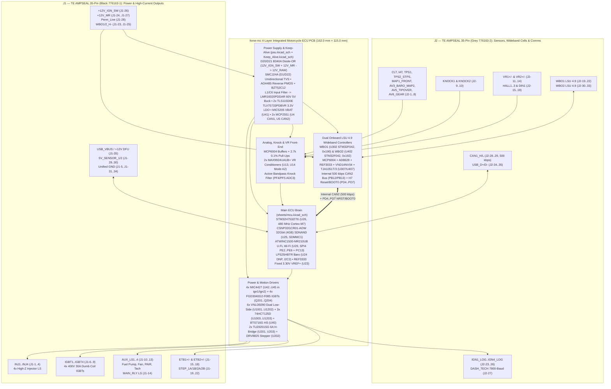
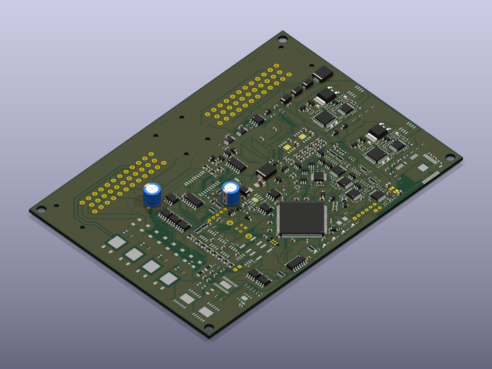

# `fome-mc` — Integrated FOME-Native Motorcycle ECU

**`fome-mc`** is a single-PCB, 4-layer (`162.0 mm × 115.0 mm`), pottable motorcycle engine control unit running [FOME (`fome-fw`)](https://github.com/halbritt/fome-fw) on an `STM32H753ZIT6` / `STM32H743ZIT6` paired with **two onboard `STM32F042K6T6` Bosch LSU 4.9 wideband controllers**, **four 400 V / 30 A ignition IGBTs**, **four 5 V logic ignition outputs**, **four high-Z injector drivers**, **dual 4-wire stepper drivers (`DRV8825` + `2× TLE9201SG`)**, **dual `MAX9924` adaptive VR conditioners**, **soldered 4 GB industrial SDNAND logging (`CSNP32GCR01-AOW`)**, **onboard `ATWINC1500-MR210UB` U.FL Wi-Fi**, and **dual 35-pin TE Connectivity AMPSEAL (`776163-1` Black & `776163-2` Grey) sealed harness headers**.

The primary reference application is the **2007 Suzuki SV650 (K7)** (`645 cc` 90° V-twin, odd-fire `270° / 450°`, dual spark plugs per cylinder = 4 plugs total, `24-2` crank VR trigger, camless `VVT_MAP_V_TWIN` intake-MAP phase sync, dual 4-wire steppers for `ISC` idle and `STVA` secondary throttle blades, and dual Bosch LSU 4.9 wideband O2 sensors).


---

## Documentation & Visual Index

| Document / Artifact | Description |
| :--- | :--- |
| [**`docs/WIRING_SV650_K7.md`**](docs/WIRING_SV650_K7.md) | Complete 2007 Suzuki SV650 (K7) adapter harness build guide, stock 2×34-pin ECM cavity key, mating TE AMPSEAL connector BOM, pin-by-pin `J1`/`J2` cross-reference, 2-coil vs. 4-coil Primary+Trailing ignition wiring, and dual Bosch LSU 4.9 pinouts |
| [**`docs/POTTING_AND_ENCLOSURE.md`**](docs/POTTING_AND_ENCLOSURE.md) | CNC enclosure stackup, faceplate/bulkhead cutouts, `10.44 W` continuous / `12.74 W` peak thermal dissipation budget, thermal gap-pad coupling, single-pour flood potting (external GM/Delphi 1-bar baro, `FOMEMC-1`), `U29` U.FL RF shield sealing (`FOMEMC-2`), and post-potting DFU recovery |
| [**`docs/TELEMETRY_AND_RACECHRONO.md`**](docs/TELEMETRY_AND_RACECHRONO.md) | `CAN1` motorsport telemetry pod (`ESP32-S3` + `25 Hz` GPS + `Bosch MM5.10` / `BMI088` 6-axis IMU + brake/suspension ADC), `FOME_CAN_verbose.dbc` (`0x200..0x207` @ 50 Hz), RaceChrono Pro BLE DIY integration, and Insta360 / DJI Action camera sync (`FOMEMC-4`) |
| [**`docs/DESIGN.md`**](docs/DESIGN.md) | Complete electrical architecture, circuit-block reuse/adaptation ledger, power tree, and STM32H753 resource mapping |
| [**`docs/VALIDATION.md`**](docs/VALIDATION.md) | Automated ERC/DRC/Parity/Gerber/JLCPCB DFM verification ledger and pre-engine hardware bring-up checklist |
| [**`docs/SHEET_CONTRACTS.md`**](docs/SHEET_CONTRACTS.md) | Per-sheet hierarchical pin contracts (`contracts/*.interface.json`, `633` invariants across 15 sheets / 21 instances) and cross-block coupling resolution (`FOMEMC-22`) |
| [**`docs/BLOCK_LIBRARY.md`**](docs/BLOCK_LIBRARY.md) | Reference circuit-block library capture plan and provenance inventory across `fome-mc` subsheets |
| [**`docs/SEEDED_DEFECT_BENCHMARK.md`**](docs/SEEDED_DEFECT_BENCHMARK.md) | Seeded hardware defect benchmark catalog derived from `FOMEMC-1..27` design and layout remediations |
| [**`toolchain/README.md`**](toolchain/README.md) & [**`toolchain/ROUTING.md`**](toolchain/ROUTING.md) | Reproducible KiCad 10 / `kicad-happy` / `ngspice` check runner and `kicad-route` PCB routing workflow |
| [**`docs/schematics/fome-mc-schematics.pdf`**](docs/schematics/fome-mc-schematics.pdf) | Full 21-sheet hierarchical schematic PDF (plus individual sheet SVGs in [`docs/schematics/`](docs/schematics/)) |
| [**`docs/renders/fome-mc-pcb-layers.pdf`**](docs/renders/fome-mc-pcb-layers.pdf) | Multi-page PCB layer plot PDF (`F.Cu`, `In1.Cu`, `In2.Cu`, `B.Cu`, `F.Silkscreen`, `B.Silkscreen`, `F.Fab`, `Edge.Cuts`) |
| [**3D board renderings**](docs/renders/3d/fome-mc-3d-isometric.png) | High-resolution [top](docs/renders/3d/fome-mc-3d-top.png), [bottom](docs/renders/3d/fome-mc-3d-bottom.png) and [isometric](docs/renders/3d/fome-mc-3d-isometric.png) views, with [source and model provenance](docs/renders/3d/render-manifest.json) |
| [**`io-map.csv`**](io-map.csv) | Machine-verified 92-row master pinout CSV (`J1-1..35`, `J2-1..35`, and 22 internal MCU/WBO/SDNAND/Wi-Fi/power buses) |
| [**`export/BOM-fome-mc.csv`**](export/BOM-fome-mc.csv), [**`export/CPL-fome-mc.csv`**](export/CPL-fome-mc.csv) & [**`fab-manifest.json`**](reports/toolchain/fab-manifest.json) | JLCPCB PCBA Bill of Materials (`494` populated parts across `102` lines), component placement centroids, and SHA-256 fabrication package manifest (`FOMEMC-21`, `FOMEMC-24`) |
| [**`CHANGELOG.md`**](CHANGELOG.md) | Engineering decision history, schematic/PCB integration milestones, and upstream bug fixes |

---

## System Architecture



---

## Hardware Capabilities at a Glance

| Subsystem | Hardware Implementation | Connectors / MCU Pins | Key Ratings & Notes |
| :--- | :--- | :--- | :--- |
| **Main MCU** | `STM32H753ZIT6` (`U26`, LQFP-144, `C730207`) | 8 MHz HSE (`Y1`, `C115962`), `REF3333AIDBZR` (`REF3033`-class) fixed `3.30 V` `VREF+` (`U23`, `C130016`) | 480 MHz Cortex-M7, 2 MB Dual-Bank Flash, 1 MB RAM. Fixed `3.30 V` `VREF+` means ADC inputs are not ratiometric to `5V_SENSOR_x`; scale by `5V_SENSE_DIVIDED` (`U26.50` / `PF12` / `EFI_ADC_17`, fed by `R118 = 10 kΩ / R119 = 10 kΩ` from `/5V_SENSOR_1`) during cranking sag |
| **Onboard Logging (`FOMEMC-3`, `FOMEMC-19`)** | `CSNP32GCR01-AOW` (`U25`, `6×8 mm` LGA-8, `C2841139`) + `C113` (`4.7 µF` `C19666`) & `C114` (`100 nF` `C161115`) `< 2.0 mm` from Pin 4 (`VDD`) | `SDMMC1` 4-bit bus (`PC8..PC12, PD2`) | 4 GB (32 Gbit) soldered pottable SD NAND (`~161 hrs` @ 50 Hz / `~80 hrs` @ 100 Hz) with automatic oldest-`.mlg` ring-buffer pruning; pin-compatible with `MKDV32GCL-STH` (`C5199868`) / `XTSD32GLGEAG` |
| **Onboard Wi-Fi (`U.FL`, `FOMEMC-2`, `FOMEMC-18`, `FOMEMC-27`)** | `ATWINC1500-MR210UB` (`U29`, `C1558703` at `(166.0, 131.5 mm, 90°)`, `14.73 × 21.72 mm` `DS70005304F` footprint + `C111 = 10 µF` `C96446` & `C112 = 10 nF` `C344025` on Pin 24 `1P3V_TP`) | `SPI4` (`PE2=SCK`, `PE5=MISO`, `PE6=MOSI`, `PE4=CS`, `PE3=IRQ`, `PC13=RST`) | Enables wireless TunerStudio TCP server (`port 29000`) and built-in HTTP port `80` web server for browsing/downloading `.mlg` logs & streaming `.zip` archives; `3.7 × 3.7 mm` `Pad 29` GND paddle with 2×2 thermal/GND vias; U.FL pigtail exits aluminum enclosure |
| **`CAN1` Motorsport Telemetry (`FOMEMC-4`)** | `MCP2551-I-SN` (`U4`, `C7376`) + `PESD1CAN-UX` (`D4`, `C907839`) + `120 Ω` (`R9`, `C22787`) + `10 Ω` (`R7`, `C22859`) | `J2-28` (`CAN1_H`), `J2-29` (`CAN1_L`), `PD1` (`FDCAN1_TX`), `PD0` (`FDCAN1_RX`) | `500 kbps` external CAN1 bus: broadcasts `FOME_CAN_verbose.dbc` (`0x200..0x207`) at **`50 Hz` (`20 ms`, `canSleepPeriodMs = 20`)** and ingests **Bosch `MM5.10` 6-axis IMU** frames (`0x174`, `0x178`, `0x17C`; RaceChrono Pro decodes all 6 axes, while FOME `can_imu.cpp` logs `YawRate` and `Accel{Lat,Lon,Vert}` into `.mlg`) |
| **Wideband O2 #1 & #2 (`FOMEMC-26`)** | `2× STM32F042K6T6` (`U302`, `U402`, `C69216`) + `2× MCP6004` (`C50282`) + `2× AD8628` (`C29309`) + `2× REF3033` (`C36658`) + `2× VND14NV04` (`Q301`, `Q401`, `C2649436`) + `2× TJA1051T/3` (`U307`, `U407`, `C38695`) | `J1-23` (`WBO1_H-`), `J1-24` (`+12V_MR`), `J1-25` (`WBO2_H-`), `J2-19..22` (`WBO1`), `J2-30..33` (`WBO2`) | Internal `CAN2` (`PB12/PB13` @ 500 kbps via `U5` `MCP2551-I-SN` to `U307/U407` `TJA1051T/3`). Strapped addresses: `WBO1` = `0x190/0x191`, `WBO2` = `0x192/0x193`. H7 controls `NRST`/`BOOT0` via `PD4..PD7`. `/WBO1_H-` (`Q301` Pad 2 -> `J1-23`) and `/WBO2_H-` (`Q401` Pad 2 -> `J1-25`) use wide (`>= 1.50 mm`) low-resistance copper buses (`<= 0.05 Ω` trace resistance/ch, `< 0.13 W` loss @ `1.6 A RMS`, `< 0.45 W` @ `3.0 A` cold-start peak) |
| **High-Current Ignition (`FOMEMC-16`, `FOMEMC-19`)** | `4× FGD3040G2-F085` IGBTs (`Q201..Q204`, TO-252, `C606124` in `/ign_igbt/`) driven by `2× MIC4427` (`U42, U43`, `C171845` in `/ign1/`) | `J1-6..9` (`PB3`, `PG15`, `PG14`, `PG13`) | `380–400 V` internal collector-gate SCIS clamp, `30 A`, `250 mJ`; dedicated `HV_IGN` netclass (`0.50 mm` min copper clearance, `1.20 mm` nominal track width across all 4 copper layers `F.Cu`, `In1.Cu`, `In2.Cu`, `B.Cu`); `10 kΩ` (`R205..R208`) gate-emitter bleeders |
| **5V Logic Ignition** | `2× MIC4427` (`U44, U45`, `C171845` in `/ign2/`) 1.5 A dual push-pull buffers + `100 Ω` (`R112..R115`, `C17408`) series protection | `J2-23..26` (`PG12`, `PG11`, `PG10`, `PG9`) | Drives 4 channels (`IGN1_LOG..IGN4_LOG` on `/IGN5../IGN8`) for 3/4-wire smart coils or external igniters; `IGBT3/4` and `IGN3/4_LOG` support independent **Trailing Spark** |
| **Fuel Injectors (`FOMEMC-13`, `FOMEMC-17`)** | `2× VNLD5090TR-E` dual protected low-side (`U1001`, `U1002`, `C222209`) + `74HCT125D` (`U1003`, `C5947`) `+5V` CMOS buffer (`D201..D204` **DNP**) | `J1-1..4` (`PG5`, `PG6`, `PG7`, `PG8`) | 4 channels (`INJ1..4`), `4.9 V` gate drive (`U1003`); `D201..D204` (`B340A-13-F`, `C64982`) marked **DNP** (`exclude_from_bom`, `dnp`) so `VNLD5090TR-E` demagnetizes high-Z injectors via its internal **`42 V` active Zener clamp** (`~0.83 ms` turn-off vs `~4.8 ms` with a `14 V` Schottky clamp, preventing nonlinear fuel delivery & AFR skew at `10,500 RPM`) |
| **Aux Low-Side, Main Relay & High-Side (`FOMEMC-13`, `FOMEMC-14`, `FOMEMC-17`, `FOMEMC-25`)** | `4× VNLD5090TR-E` (`U1101..U1202`, `C222209`) + `2× 74HCT125D` (`U1103`, `U1203`, `C5947`) `+5V` CMOS buffers + `D205..D209` (`B340A-13-F`, `C64982`) + `BTS716G` (`U40`, `C85135`, spare) | `J1-10..13` (`LS5..LS8`: `PC6, PC7, PA15, PD3`), `J1-14` (`MAIN_RLY` via `PE0` -> `U1203` -> `U1202.6` + `D209` flyback), `J2-27` (`LS14` / `DASH_TECH` via `PB9` -> `U1203` -> `U1201.8`) | `D205..D209` (`B340A-13-F`, `C64982`) populated for inductive solenoids/relays (`/LS5../LS8`, `/MAIN_RLY` on `J1-14`); `J1-13` (`/LS8` / `AUX_LS4` Tach) includes `R212 = 2.2 kΩ` (`C22976`) pull-up to `/12V_MR` (`J2-27` `DASH_TECH` is open-drain low-side; uses cluster/harness pull-up) |
| **Idle Stepper (`ISC`)** | `DRV8825PWPR` (`U202`, HTSSOP-28, `C50506`) bipolar microstepping driver | `J1-19..22` (`STEP_1A/1B/2A/2B`), `PB4` (`STEP`), `PB7` (`DIR`), `PB8` (`~EN`) | Regulated `0.77 A` chopper limit (`R213, R214 = 0.20 Ω` `1206` sense `C25335`, `VREF = 0.767 V` via `R215 = 33 kΩ` `C25779` / `R216 = 10 kΩ` `C25744` from `+3V3`) for SV650 4-wire `ISC` idle valve |
| **Secondary Throttle (`STVA`) / Dual ETB** | `2× TLE9201SG` (`U201` in `/etb1/`, `U203` inline in `/stepper_etb/`, PG-DSO-12, `C112633`) 6 A H-bridges | `J1-15..18` (`ETB1_OUT+/-`, `ETB2_OUT+/-`), `PD12/PD10/PD11` (`ETB1` `PWM/DIR/DIS`), `PD13/PD9/PD8` (`ETB2` `PWM/DIR/DIS`) | Drives SV650 4-wire `STVA` secondary throttle stepper or dual DC drive-by-wire throttles |
| **Crank/Cam VR & Hall (`FOMEMC-25`)** | `2× MAX9924UAUB+` (`U13, U14`, `LCSC C143633`) differential adaptive VR conditioners + `SN74LVC2G17DB` (`U8, U9, U10`, `C10429`) +3V3 Hall buffers + `SRV05-4` (`U11, U12`, `C85364`) ESD arrays | `J2-11..14` (`VR1+`/`VR1-` -> `PE14`, `VR2+`/`VR2-` -> `PE15`), `J2-15..18` (`DIGITAL_1..4` -> `PG1, PG0, PE11, PE10`) | Wired in **Mode A2 (Internal Adaptive Peak Threshold + Internal Bias + Zero-Crossing Watchdog Enabled)**: Pin 6 (`ZERO_EN`) = `GND`, Pin 9 (`INT_THRS`) = `GND`, Pin 4 (`BIAS`) = `GND` (`2.5 V` internal bias via `R35..R38 = 10 kΩ`), Pin 8 (`EXT`) = `NC`; `C38, C39` (`100 nF` `0603` `C161115`) `< 2 mm` from Pin 10 (`VCC = /5V_SENSOR_1`) in parallel with `C109, C110`; `R23..R28 = 2.7 kΩ` (`C13167`) pull-ups to `/5V_SENSOR_1` and `R29..R34 = 2.7 kΩ` (`C13167`) series input resistors on `DIGITAL_1..6` |
| **Analog, Baro (`FOMEMC-1`), Gear (`FOMEMC-14`), Temp & Knock** | `MCP6004` buffers (`U7, U15, U17, U19, U21`, `C50282`) + `SRV05-4` TVS arrays (`U16, U18, U20, U22`, `C85364`) | `J2-1..8` (`PC1, PC2, PA1, PA3, PA0, PA2, PA4, PA5`), `J2-9..10` (`PF4, PF5` `ADC3`) | `2.7 kΩ 0.1%` (`C13167`) bias to `/5V_SENSOR_1` on `AT1`/`AT2` (`CLT`/`IAT`); **`R219 = 1.5 kΩ 1%` (`C22843`) pull-up to `/5V_SENSOR_1` on `AV6_GEAR` (`J2-8`, `PA5`)** (`0.87–3.19 V` at `PA5` after `+5V` `U19` buffer and `5.6 kΩ / 10 kΩ` divider); **`J2-6` (`PA2` / `EFI_ADC_2`) defaults to external `MT_GM_1_BAR` (`GM 12614970` / `Delphi PS10150` `10–105 kPa`) barometer** for single-pour flood potting (`U24` `LPS25HBTR` DNP); active bandpass knock filter (`U7`) on `PF4`/`PF5` |
| **Power Supply, Brownout & `VBAT` `BKPSRAM` Keep-Alive (`FOMEMC-15`, `FOMEMC-17`, `FOMEMC-25`)** | `D20/D21` (`B340A-13-F`, `C64982`) diode-OR + `SMCJ24A` (`D1, D22`, `C224045`) TVS + `AO4485` (`Q1`, `C51499`) PMOS reverse block + `C4` (`4.7 µF 50 V X7R 1210` `C417122`) + `L1/C6` (`47 µF` polymer `C454346`) filter + `LMR16020PDDAR` (`U3`, `C190006`, 60 V 2 A 5V buck) + `C2, C5, C7` (`1 µF 50 V X7R 0805` `C354368`) + `C12` (`10 µF 25 V X5R 0603` `C96446`) + `2× TLS115D0E` (`U1, U2`, `C3747428`) + `TLV75733PDBVR` (`U6`, `C485517`, 3.3 V 1 A LDO) + `MIC5205-3.3YM5` (`U41`, `C5370979` `VBAT` via `D16/D17` + `D6/D7/D8` `B5819W` `C8598` + `BT1` DNP) | `J1-26` (`+12V_IGN_SW`), `J1-24/27` (`+12V_MR`), `J1-28` (`Perm_Live`), `J1-29..30` (`5V_SENSOR_1/2`), `J1-5, 31..34` (`GND`) | Boots on `J1-26` (`+12V_IGN_SW`, sensed on `PC5`) and latches `/12V_MR` (`J1-27`) via `PE0` -> `J1-14` (`MAIN_RLY`). `U3` (`LMR16020`) has a `4.30 V` minimum operating `VIN`, and `U6` (`TLV75733`, `0.25 V` max dropout) regulates `+3V3` down to `VIN = 4.30 V` (**`V_BATT ≈ 4.8 V` steady-state floor** across `D20/D21 + Q1 + L1`, with `C1 + C6 = 2 × 47 µF` riding through sub-ms cranking dips). `PC14/PC15` on `U26` are `no_connect` (no LSE crystal), so `VBAT` (`U41` -> `D17` -> `D7` into `U26.6`) retains the **`4 KB BKPSRAM` and 32 `RTC_BKPxR` registers** across key-off |
| **PCB Mechanical & Mounting (`FOMEMC-27`)** | `162.0 mm × 115.0 mm` 4-layer FR-4 TG170 (`Edge.Cuts` `X = 26..188`, `Y = 25..140`) + **`4× M4` (`Ø 4.3 mm` NPTH) corner mounting holes `H1..H4`** | `H1` `(30.0, 29.0)`, `H2` `(184.0, 29.0)`, `H3` `(30.0, 136.0)`, `H4` `(184.0, 136.0)` | `154.0 mm × 107.0 mm` hole centers (`4.0 mm` inset from board corners) for `M4×10` enclosure baseplate bosses; `514` total board footprints (`494` populated SMT + `16` DNP + `4` `H1..H4` mounting holes) |
| **Post-Potting Recovery** | Dual-threshold `J1-35` (`USB_VBUS_BOOT0`) + `PD4..PD7` | `J1-35`, `J2-34` (`USB_D+`), `J2-35` (`USB_D-`), `J2-28..29` (`CAN1`) | `+5 V` on `J1-35` = normal USB/RusEFI/MSD (`R217 = 10 kΩ / R218 = 12 kΩ` + `D211 = B5819W` `C8598` into `PA9`); `+12 V` on `J1-35` conducts `D210` (`BZT52C6V8` `C173404`, `6.8 V` Zener) + `R209 = 12 kΩ` (`C25752`) override to assert `STM32H753 BOOT0 = 1` (`0483:df11` ROM DFU) through the sealed harness |

---

## Dual 35-Pin TE AMPSEAL Connector Pinout (`J1` & `J2`)


For full pin-by-pin wiring tables, wire gauges, crimp terminal part numbers, and 2007 Suzuki SV650 (K7) ECM (`34-pin` + `34-pin`) cross-references, see [**`docs/WIRING_SV650_K7.md`**](docs/WIRING_SV650_K7.md) and [**`io-map.csv`**](io-map.csv).

---

## PCB Layout & Layer Renderings

````carousel

<!-- slide -->

<!-- slide -->

<!-- slide -->

<!-- slide -->

````

### 3D Board Views

[Top](docs/renders/3d/fome-mc-3d-top.png) · [Bottom](docs/renders/3d/fome-mc-3d-bottom.png) · [Isometric](docs/renders/3d/fome-mc-3d-isometric.png)



These 4064 × 3056 PNGs use KiCad 10.0.7's high-quality ray tracer, orthographic
views, native materials and saved copper fill. They were rendered from a
snapshot without refilling or saving the source design.

The 3D assembly is incomplete: 46 of 514 footprints have no model reference (42
components including the J1/J2 connector housings, plus the 4 M4 mounting holes
H1..H4), and 12 referenced model files are unavailable.
The [render manifest](docs/renders/3d/render-manifest.json) records the board hash,
camera settings, commands, image hashes and model coverage. These images document
appearance; they do not establish mechanical clearance or electrical acceptance.

---

## Hierarchical Schematic Renderings

All 21 schematic sheets are exported as vector SVGs in [`docs/schematics/`](docs/schematics/) and compiled into a single searchable PDF at [**`docs/schematics/fome-mc-schematics.pdf`**](docs/schematics/fome-mc-schematics.pdf).

````carousel

<!-- slide -->

<!-- slide -->

<!-- slide -->

<!-- slide -->

````

---

## Repository Structure

```text
fome-mc/
├── fome-mc.kicad_pro                # KiCad 10 project configuration
├── fome-mc.kicad_sch                # Root hierarchical schematic (J1/J2 AMPSEAL headers + C1 + R219 + 20 subsheet blocks)
├── fome-mc.kicad_pcb                # 4-layer PCB layout (162.0 mm × 115.0 mm, 514 footprints incl. 4x M4 H1..H4 at 154.0 × 107.0 mm centers)
├── sym-lib-table                    # Project symbol library table (-> libs/symbols/)
├── fp-lib-table                     # Project footprint library table (-> libs/footprints/)
├── io-map.csv                       # Authoritative 70-pin J1/J2 + 22 internal net cross-reference table
├── Makefile                         # Reproducible verification & manufacturing export targets
├── README.md                        # Project overview, architecture diagrams & visual gallery
├── CHANGELOG.md                     # Detailed engineering changelog & bug-fix history
├── sheets/                          # 15 hierarchical child schematic sheets (20 child instances + root = 21 sheet instances)
│   ├── mcu.kicad_sch                # STM32H753ZIT6, 8 MHz HSE, REF3333, LPS25HB (DNP), CSNP32GCR01-AOW 4GB SDNAND (C113/C114), ATWINC1500-MR210UB Wi-Fi (C111/C112)
│   ├── psu.kicad_sch                # SMCJ24A TVS, AO4485 PMOS, C4 4.7uF 50V X7R 1210, L1/C6 filter, LMR16020 5V buck, 2x TLS115D0E, TLV75733, 2x MCP2551
│   ├── Keep_Alive.kicad_sch         # D20/D21 (B340A-13-F C64982) 12V_IGN_SW + 12V_MR diode-OR + D22 (SMCJ24A) TVS + MIC5205 (U41) VBAT 4 KB BKPSRAM keep-alive
│   ├── wbo1.kicad_sch               # Onboard Bosch LSU 4.9 Wideband Controller #1 (STM32F042 + VND14NV04 + >=1.50mm WBO1_H- bus + TJA1051T/3)
│   ├── wbo2.kicad_sch               # Onboard Bosch LSU 4.9 Wideband Controller #2 (STM32F042 + VND14NV04 + >=1.50mm WBO2_H- bus + TJA1051T/3)
│   ├── ign_igbt.kicad_sch           # 4x FGD3040G2-F085 400V 30A ignition IGBTs (Q201..Q204, HV_IGN 0.50mm clearance netclass) + 15R/10k gate network
│   ├── ign4.kicad_sch               # Dual MIC4427 4-ch driver subsheet (instantiated twice: ign1 U42/U43 for Q201..Q204 gates, ign2 U44/U45 + 100R for IGN5..8)
│   ├── stepper_etb.kicad_sch        # DRV8825PWPR stepper (U202, 0.77A) + 2nd TLE9201SG (U203 inline) + D201..D204 (DNP) & D205..D209 clamps + R212 tach pull-up + J1-35 BOOT0
│   ├── etb-9201.kicad_sch           # TLE9201SG 6A H-bridge subsheet (instantiated once: etb1 U201)
│   ├── lowside_quad.kicad_sch       # Dual VNLD5090 + 74HCT125D (C5947) 5V CMOS buffer low-side subsheet (instantiated 3x: INJ1..4, LS5..8, MAIN_RLY/DASH_TECH)
│   ├── highside_quad.kicad_sch      # BTS716G (U40 C85135) protected high-side driver
│   ├── triggers.kicad_sch           # 2x MAX9924UAUB+ (U13, U14) Mode A2 differential VR conditioners (C38/C39 + C109/C110) + SN74LVC2G17DB (U8..U10) Hall inputs
│   ├── quad_analog.kicad_sch        # MCP6004 (U17, U19, U21) buffered 0-5V analog input conditioning + SRV05-4 (U18, U20, U22) ESD (instantiated 3x)
│   ├── quad_analog_pullup.kicad_sch # Precision 2.7k 0.1% thermistor bias to 5V_SENSOR_1 & 0-5V analog inputs (MCP6004 U15 + SRV05-4 U16)
│   └── knock.kicad_sch              # 2-channel active bandpass knock conditioning (PF4/PF5 ADC3)
├── libs/
│   ├── symbols/                     # Project-local KiCad symbol libraries (.lib, .dcm)
│   └── footprints/                  # Project-local KiCad footprint libraries (.pretty)
├── docs/
│   ├── DESIGN.md                    # Complete electrical & firmware architecture specification
│   ├── VALIDATION.md                # Verification ledger, DFM/stock audit & bench bring-up procedure
│   ├── WIRING_SV650_K7.md           # 2007 Suzuki SV650 (K7) wiring harness & connector guide
│   ├── POTTING_AND_ENCLOSURE.md     # Enclosure stackup, thermal gap pads & potting guide (incl. FOMEMC-1, FOMEMC-2, FOMEMC-27)
│   ├── TELEMETRY_AND_RACECHRONO.md  # CAN1 motorsport telemetry pod, RaceChrono Pro & camera integration (FOMEMC-4)
│   ├── BLOCK_LIBRARY.md             # Reference block library capture plan & per-sheet inventory
│   ├── SHEET_CONTRACTS.md           # Per-sheet boundary contracts (FOMEMC-22)
│   ├── SEEDED_DEFECT_BENCHMARK.md   # Seeded defect benchmark catalog from FOMEMC-1..27
│   ├── renders/                     # High-resolution PNG/SVG/PDF PCB layer, floorplan & pinout renders
│   └── schematics/                  # All 21 schematic sheets in SVG + compiled fome-mc-schematics.pdf
├── export/
│   ├── fome-mc.net                  # Tracked KiCad schematic netlist (510 schematic components)
│   ├── BOM-fome-mc.csv              # JLCPCB PCBA Bill of Materials (494 populated components across 102 BOM lines with 100% LCSC coverage; 16 DNP excluded)
│   ├── CPL-fome-mc.csv              # JLCPCB PCBA Component Placement / Centroid file (494 populated components; 16 DNP + 4x M4 H1..H4 excluded)
│   └── gerbers/                     # Reproducible 4-layer Gerbers, Excellon drill files & job file (verified by reports/toolchain/fab-manifest.json)
├── scripts/
│   ├── verify_io_map.py             # Cross-checks io-map.csv against schematics, netlist, contracts, and FOME firmware
│   ├── render_docs.py               # Regenerates all schematic SVGs/PDF, PCB renders, floorplan & pinout diagrams
│   ├── export_bom_cpl.py            # Generates and validates export/BOM-fome-mc.csv and export/CPL-fome-mc.csv (FOMEMC-24)
│   └── generate_fab_package.py      # Generates and verifies export/gerbers/ and reports/toolchain/fab-manifest.json (FOMEMC-21)
├── telemetry-pod/                   # CAN1 telemetry pod KiCad project skeleton (placeholders until agent-ee generates it; FOMEMC-28)
└── toolchain/                       # Automated KiCad 10 ERC, DRC, netlist parity, Gerber & DFM check suite
```

---

## Reproducible Verification & Rendering Commands

All hardware checks and documentation renders run locally using KiCad 10 CLI (`kicad-cli`), Python 3, and `rsvg-convert`:

```bash
# 1. Verify local EDA toolchain (KiCad 10, kicad-cli, pcbnew, ngspice, freecad)
make doctor

# 2. Verify 100% pinout and sheet-contract parity across io-map.csv, schematics, netlist, contracts, and fome-fw
make verify-io

# 3. Run schematic ERC, PCB DRC, netlist extraction, manufacturing exports, and analysis
make check

# 4. Verify reproducible Gerbers, Excellon drills, netlist, BOM/CPL, and SHA-256 fab manifest against HEAD
make verify-fab-package REV=HEAD

# 5. Regenerate all 2D schematic SVGs/PDF, PCB layer plots, floorplan, and J1/J2 pinout diagrams
make renders
```

### Current Verification Status

| Gate | Result | Details |
| :--- | :--- | :--- |
| **`verify_io_map.py` (`make verify-io`)** | **PASS** | `70 / 70` `J1`/`J2` pins + `22` internal buses + `510` netlist components (`494` populated in BOM/CPL with 100% LCSC coverage after excluding `16` DNP footprints: `BT1`, `D201..D204`, `J8`, `J9`, `J11..J16`, `JP1`, `JP2`, `U24`; plus `4× M4` mounting holes `H1..H4` = `514` total board footprints) + `15` `contracts/*.interface.json` (`633` invariants) verified across `io-map.csv`, `export/fome-mc.net`, and `fome-fw` |
| **Schematic ERC (`make erc`, `FOMEMC-20`, `FOMEMC-25`)** | **PASS** | **`0` violations (`0` errors, `0` warnings)** across all 21 hierarchical schematic sheets (`U13, U14` `MAX9924UAUB+` in Mode A2; `VBAT` `4 KB BKPSRAM` keep-alive with `PC14/PC15` `no_connect`) |
| **PCB DRC (`make drc`, `FOMEMC-18`, `FOMEMC-19`, `FOMEMC-26`, `FOMEMC-27`)** | **PASS** | **`0` violations (`0` errors, `0` warnings)**, **`0` `unconnected_items`**, **`0` `schematic_parity`**, **`0` `starved_thermal`** (`min_resolved_spokes: 2`), `0` `silk_overlap`, `0` `track_dangling`, `0` `via_dangling`, `HV_IGN` `0.50 mm` clearance across all 4 copper layers (`F.Cu`, `In1.Cu`, `In2.Cu`, `B.Cu`), wide (`>= 1.50 mm`, `<= 0.05 Ω`) `/WBO1_H-` & `/WBO2_H-` heater copper buses, and `4× M4` (`Ø 4.3 mm` NPTH) corner mounting holes `H1..H4` at `(30.0, 29.0)`, `(184.0, 29.0)`, `(30.0, 136.0)`, `(184.0, 136.0)` |
| **Netlist & Analysis (`make netlist`, `make analyze`)** | **PASS** | `510` schematic components (`494` populated SMT/THT components + `16` DNP footprints + `4` `H1..H4` mounting holes = `514` board footprints), `routing_complete: true` |
| **Exports (`make export`, `make verify-fab-package`, `FOMEMC-21`, `FOMEMC-24`)** | **PASS** | Tracked `export/fome-mc.net`, `export/BOM-fome-mc.csv` (`494` populated components across `102` BOM lines with 100% LCSC coverage and 1-to-1 `(value, package) -> LCSC` mapping), `export/CPL-fome-mc.csv` (`494` populated components), `export/gerbers/` (`14` Gerber/Excellon/job files), and `reports/toolchain/fab-manifest.json` (`22` verified artifacts) |


