# `fome-mc` — Integrated FOME-Native Motorcycle ECU

**`fome-mc`** is a single-PCB, 4-layer (`162.0 mm × 115.0 mm`), pottable motorcycle engine control unit running [FOME (`fome-fw`)](https://github.com/halbritt/fome-fw) on an `STM32H753ZIT6` / `STM32H743ZIT6` paired with **two onboard `STM32F042K6T6` Bosch LSU 4.9 wideband controllers**, **four 400 V / 30 A ignition IGBTs**, **four 5 V logic ignition outputs**, **four high-Z injector drivers**, **dual 4-wire stepper drivers (`DRV8825` + `2× TLE9201SG`)**, **dual `MAX9924` adaptive VR conditioners**, **soldered 4 GB industrial SDNAND logging (`CSNP32GCR01-AOW`)**, **onboard `ATWINC1500-MR210UB` U.FL Wi-Fi**, and **dual 35-pin TE Connectivity AMPSEAL (`776163-1` Black & `776163-2` Grey) sealed harness headers**.

The primary reference application is the **2007 Suzuki SV650 (K7)** (`645 cc` 90° V-twin, odd-fire `270° / 450°`, dual spark plugs per cylinder = 4 plugs total, `24-2` crank VR trigger, camless `VVT_MAP_V_TWIN` intake-MAP phase sync, dual 4-wire steppers for `ISC` idle and `STVA` secondary throttle blades, and dual Bosch LSU 4.9 wideband O2 sensors).


---

## Documentation & Visual Index

| Document / Artifact | Description |
| :--- | :--- |
| [**`docs/WIRING_SV650_K7.md`**](docs/WIRING_SV650_K7.md) | Complete 2007 Suzuki SV650 (K7) adapter harness build guide, mating TE AMPSEAL connector BOM, pin-by-pin `J1`/`J2` cross-reference, 2-coil vs. 4-coil Primary+Trailing ignition wiring, and dual Bosch LSU 4.9 pinouts |
| [**`docs/POTTING_AND_ENCLOSURE.md`**](docs/POTTING_AND_ENCLOSURE.md) | CNC enclosure stackup, `10.44 W` continuous / `12.74 W` peak thermal dissipation budget, thermal gap-pad coupling, single-pour flood potting (external GM/Delphi 1-bar baro, `FOMEMC-1`), `U29` U.FL RF shield sealing (`FOMEMC-2`), and post-potting DFU recovery |
| [**`docs/TELEMETRY_AND_RACECHRONO.md`**](docs/TELEMETRY_AND_RACECHRONO.md) | `CAN1` motorsport telemetry pod (`ESP32-S3` + `25 Hz` GPS + `Bosch MM5.10` / `BMI088` 6-axis IMU + brake/suspension ADC), `FOME_CAN_verbose.dbc` (`0x200..0x207` @ 50 Hz), RaceChrono Pro BLE DIY integration, and Insta360 / DJI Action camera sync (`FOMEMC-4`) |
| [**`docs/DESIGN.md`**](docs/DESIGN.md) | Complete electrical architecture, circuit-block reuse/adaptation ledger, power tree, and STM32H753 resource mapping |
| [**`docs/VALIDATION.md`**](docs/VALIDATION.md) | Automated ERC/DRC/Parity/Gerber/JLCPCB DFM verification ledger and pre-engine hardware bring-up checklist |
| [**`docs/schematics/fome-mc-schematics.pdf`**](docs/schematics/fome-mc-schematics.pdf) | Full 21-sheet hierarchical schematic PDF (plus individual sheet SVGs in [`docs/schematics/`](docs/schematics/)) |
| [**`docs/renders/fome-mc-pcb-layers.pdf`**](docs/renders/fome-mc-pcb-layers.pdf) | Multi-page PCB layer plot PDF (`F.Cu`, `In1.Cu`, `In2.Cu`, `B.Cu`, `F.Silkscreen`, `B.Silkscreen`, `F.Fab`, `Edge.Cuts`) |
| [**`io-map.csv`**](io-map.csv) | Machine-verified 92-row master pinout CSV (`J1-1..35`, `J2-1..35`, and 22 internal MCU/WBO/SDNAND/Wi-Fi/power buses) |
| [**`CHANGELOG.md`**](CHANGELOG.md) | Engineering decision history, schematic/PCB integration milestones, and upstream bug fixes |

---

## System Architecture

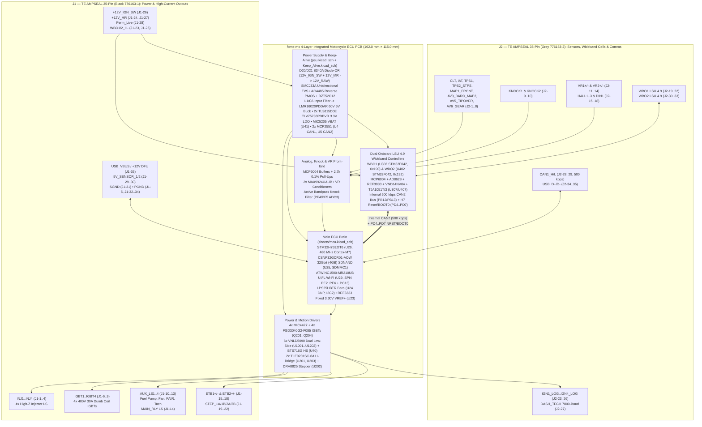

---

## Hardware Capabilities at a Glance

| Subsystem | Hardware Implementation | Connectors / MCU Pins | Key Ratings & Notes |
| :--- | :--- | :--- | :--- |
| **Main MCU** | `STM32H753ZIT6` (`U26`, LQFP-144) | 8 MHz HSE (`Y1`), `REF3333` (`REF3033`-class) fixed `3.30 V` `VREF+` (`U23`) | 480 MHz Cortex-M7, 2 MB Dual-Bank Flash, 1 MB RAM. Fixed `3.30 V` `VREF+` means ADC inputs are not ratiometric to `5V_SENSOR_x`; scale by `5V_SENSE_DIVIDED` (`U26.50` / `PA6`) during cranking sag |
| **Onboard Logging (`FOMEMC-3`)** | `CSNP32GCR01-AOW` (`U25`, `6×8 mm` LGA-8, `C2841139`) | `SDMMC1` 4-bit bus (`PC8..PC12, PD2`) | 4 GB (32 Gbit) soldered pottable SD NAND (`~161 hrs` @ 50 Hz / `~80 hrs` @ 100 Hz) with automatic oldest-`.mlg` ring-buffer pruning; pin-compatible with `MKDV32GCL-STH` (`C5199868`) / `XTSD32GLGEAG` |
| **Onboard Wi-Fi (`U.FL`, `FOMEMC-2`)** | `ATWINC1500-MR210UB` (`U29`, `C1558703`, 2.4 GHz 802.11b/g/n with U.FL external antenna) | `SPI4` (`PE2=SCK`, `PE5=MISO`, `PE6=MOSI`, `PE4=CS`, `PE3=IRQ`, `PC13=RST`) | Enables wireless TunerStudio TCP server (`port 29000`) and built-in HTTP port `80` web server for browsing/downloading `.mlg` logs & streaming `.zip` archives; U.FL pigtail exits aluminum enclosure |
| **`CAN1` Motorsport Telemetry (`FOMEMC-4`)** | `MCP2551-I-SN` (`U4`, `C7376`) + `PESD1CAN-UX` (`D4`) + `120 Ω` (`R9`) | `J2-28` (`CAN1_H`), `J2-29` (`CAN1_L`), `PD1` (`FDCAN1_TX`), `PD0` (`FDCAN1_RX`) | `500 kbps` external CAN1 bus: broadcasts `FOME_CAN_verbose.dbc` (`0x200..0x207`) at **`50 Hz` (`20 ms`)** and ingests **Bosch `MM5.10` 5-axis IMU** (`0x174`, `0x178`, `0x17C`) into `accelerometer.{lat,lon,vert,yawRate,rollRate}` for `.mlg` logging and RaceChrono Pro BLE pod |
| **Wideband O2 #1 & #2** | `2× STM32F042K6T6` (`U302`, `U402`) + `2× MCP6004` + `2× AD8628` + `2× REF3033` + `2× VND14NV04` (`Q301`, `Q401`) + `2× TJA1051T/3` (`U307`, `U407`) | `J1-23` (`WBO1_H-`), `J1-24` (`+12V_MR`), `J1-25` (`WBO2_H-`), `J2-19..22` (`WBO1`), `J2-30..33` (`WBO2`) | Internal `CAN2` (`PB12/PB13` @ 500 kbps via `U5` `MCP2551-I-SN` to `U307/U407` `TJA1051T/3`). Strapped addresses: `WBO1` = `0x190/0x191`, `WBO2` = `0x192/0x193`. H7 controls `NRST`/`BOOT0` via `PD4..PD7` |
| **High-Current Ignition** | `4× FGD3040G2-F085` IGBTs (`Q201..Q204`, TO-252) driven by `MIC4427` (`U42..U45`) | `J1-6..9` (`PB3`, `PG15`, `PG14`, `PG13`) | `400 V` internal collector-gate SCIS clamp, `30 A`, `250 mJ`; `10 kΩ` MCU reset pull-downs prevent coil dwell during reset/DFU |
| **5V Logic Ignition** | `4× MIC4427` (`U9, U10`) 1.5 A push-pull buffers + `100 Ω` series protection | `J2-23..26` (`PG12`, `PG11`, `PG10`, `PG9`) | Drives 3/4-wire smart coils or external igniters; `IGBT3/4` and `IGN3/4_LOG` support independent **Trailing Spark** |
| **Fuel Injectors** | `2× VNLD5090TR-E` dual protected low-side (`U1001`, `U1002`) | `J1-1..4` (`PG5`, `PG6`, `PG7`, `PG8`) | 4 channels (`INJ1..4`), `42 V` active clamp + `B340A-13-F` (`D201..D204`) Schottky flyback diodes to `/12V_MR` |
| **Aux Low-Side, Main Relay & High-Side** | `4× VNLD5090TR-E` (`U1101..U1202`) + `BTS716G` (`U40`, spare) | `J1-10..13` (`LS5..LS8`), `J1-14` (`MAIN_RLY` via `PE0` -> `U1202.6` + `D209` flyback), `J2-27` (`LS14` / `DASH_TECH`) | `MAIN_RLY` (`PE0`) drives external main relay coil on `J1-14` with `D209` (`B340A-13-F`) flyback to `/12V_MR`; `J2-27` includes `R212` `2.2 kΩ` pull-up to `/12V_MR` |
| **Idle Stepper (`ISC`)** | `DRV8825PWPR` (`U202`, HTSSOP-28) bipolar microstepping driver | `J1-19..22` (`STEP_1A/1B/2A/2B`), `PB4` (`STEP`), `PB7` (`DIR`), `PB8` (`~EN`) | Regulated `0.75 A` chopper limit (`0.20 Ω` sense, `VREF = 0.38 V`) for SV650 4-wire `ISC` idle valve |
| **Secondary Throttle (`STVA`) / Dual ETB** | `2× TLE9201SG` (`U201`, `U203`, PG-DSO-12) 6 A H-bridges | `J1-15..18` (`ETB1_OUT+/-`, `ETB2_OUT+/-`), `PC6/PA8/PC7`, `PC9/PD14/PD13` | Drives SV650 4-wire `STVA` secondary throttle stepper or dual DC drive-by-wire throttles |
| **Crank/Cam VR & Hall** | `2× MAX9924UAUB+` (`U12, U13`) differential adaptive VR conditioners + `SN74LVC2G17` (`U11, U14`) Hall buffers | `J2-11..14` (`VR1+`/`GND` -> `PE14`, `VR2+`/`GND` -> `PE15`), `J2-15..18` (`DIGITAL_1..4` -> `PG1, PG0, PE11, PE10`) | Mode A1 adaptive peak threshold (`50 mVpp` cranking to `100 Vpp` redline) |
| **Analog, Baro (`FOMEMC-1`), Temp & Knock** | `MCP6004` buffers (`U7, U15, U17, U19, U21`) + `SRV05-4` TVS arrays (`U16, U18, U20, U22`) | `J2-1..8` (`PC4, PC5, PA7, PA3, PA0, PA2, PA4, PA5`), `J2-9..10` (`PF4, PF5` `ADC3`) | `2.7 kΩ 0.1%` bias on `AT1`/`AT2` (`CLT`/`IAT`); **`J2-6` (`PA2` / `EFI_ADC_2`) defaults to external `MT_GM_1_BAR` (`GM 12614970` / `Delphi PS10150` `10–105 kPa`) barometer** for single-pour flood potting (`U24` `LPS25HBTR` DNP); active bandpass knock filter (`U7`) on `/knock/FILTERED_1` (`PF4`) & `/knock/FILTERED_2` (`PF5`) |
| **Power Supply & Keep-Alive** | `D20/D21` (`B340A-13-F`) diode-OR + `SMCJ33A` (`D1`) unidirectional TVS + `AO4485` (`Q1`) P-MOSFET reverse block + `L1/C6` input filter (no boost) + `LMR16020PDDAR` (`U3`, 60 V 2 A buck) + `2× TLS115D0E` (`U1, U2`) + `TLV75733PDBVR` (`U6`, 3.3 V 1 A LDO) + `MIC5205-3.3YM5` (`U41` `VBAT`) + `EEHZC1H470P` hybrid polymer (`C1, C6`) & Murata `GCJ` soft-term 50 V X7R MLCCs | `J1-26` (`+12V_IGN_SW`), `J1-24/27` (`+12V_MR`), `J1-28` (`Perm_Live`), `J1-29..30` (`5V_SENSOR_1/2`), `J1-5, 31..34` (`GND`) | Boots on `J1-26` (`+12V_IGN_SW`, sensed by `R96/R97` into `U26.45` `12V_DIVIDED`) and latches `/12V_MR` (`J1-27`) via `PE0` -> `J1-14` (`MAIN_RLY`). Connector brownout floor is **`~4.0–4.2 V`** (set by `LMR16020` UVLO + `D20/D21` drop) |
| **Post-Potting Recovery** | Dual-threshold `J1-35` (`RC2` / `USB_VBUS_DFU`) + `PD4..PD7` | `J1-35`, `J2-34` (`USB_D+`), `J2-35` (`USB_D-`), `J2-28..29` (`CAN1`) | `+5 V` on `J1-35` = normal USB/RusEFI/MSD; `+12 V` on `J1-35` biases `R209` override to assert `STM32H753 BOOT0 = 1` (`0483:df11` ROM DFU) through the sealed harness |

---

## Dual 35-Pin TE AMPSEAL Connector Pinout (`J1` & `J2`)

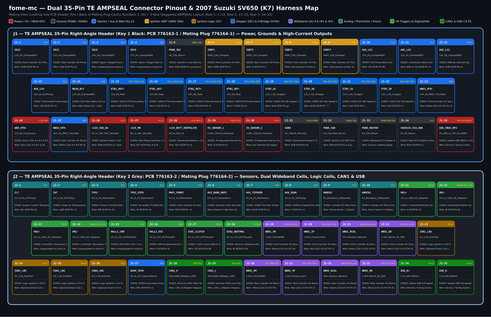

For full pin-by-pin wiring tables, wire gauges, crimp terminal part numbers, and 2007 Suzuki SV650 (K7) ECM (`34-pin` + `34-pin`) cross-references, see [**`docs/WIRING_SV650_K7.md`**](docs/WIRING_SV650_K7.md) and [**`io-map.csv`**](io-map.csv).

---

## PCB Layout & Layer Renderings

````carousel
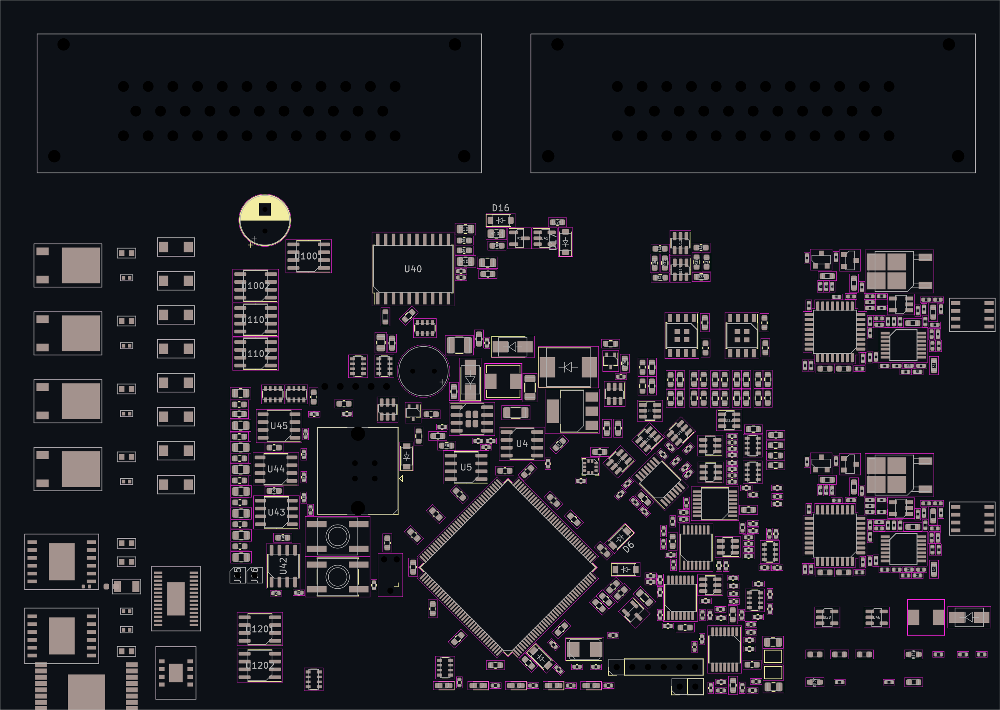
<!-- slide -->
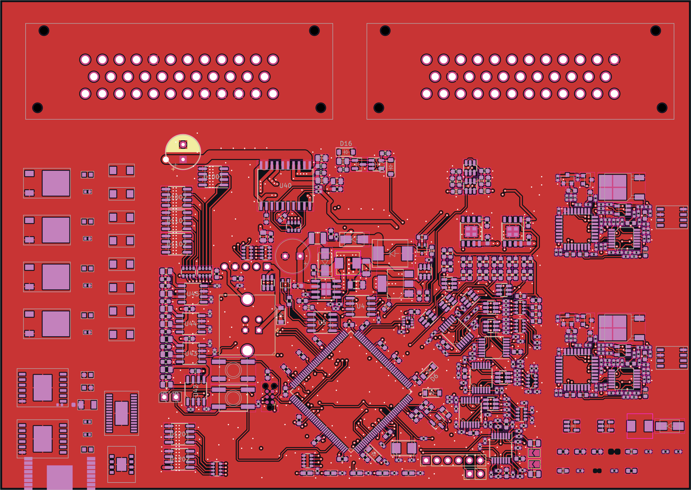
<!-- slide -->
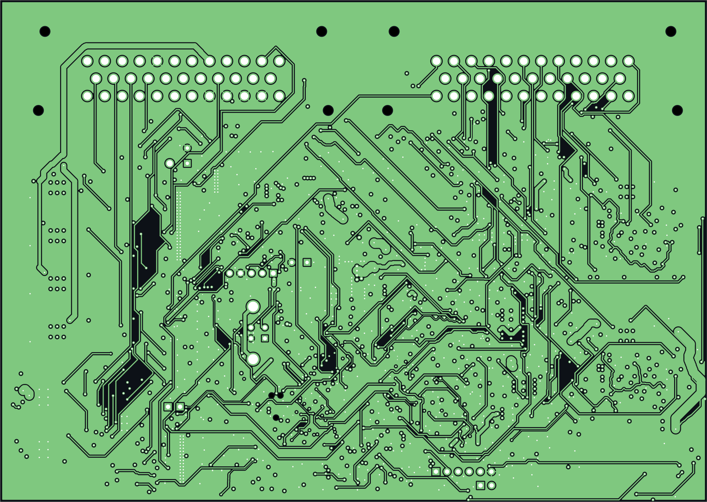
<!-- slide -->
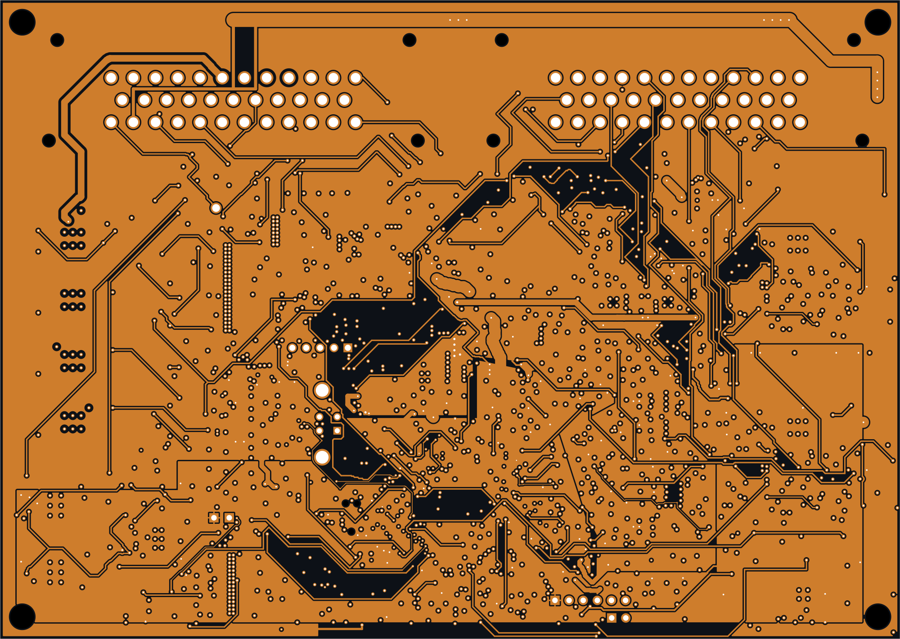
<!-- slide -->
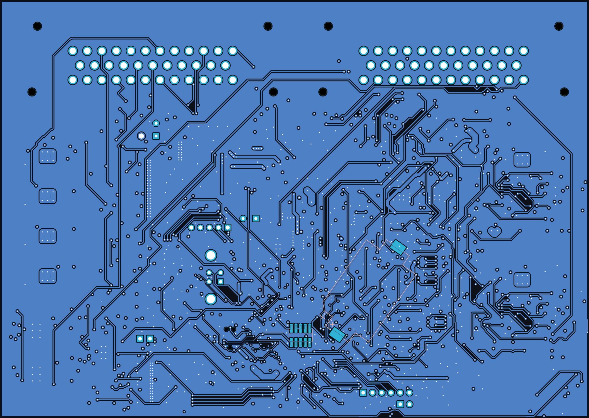
````

---

## Hierarchical Schematic Renderings

All 21 schematic sheets are exported as vector SVGs in [`docs/schematics/`](docs/schematics/) and compiled into a single searchable PDF at [**`docs/schematics/fome-mc-schematics.pdf`**](docs/schematics/fome-mc-schematics.pdf).

````carousel
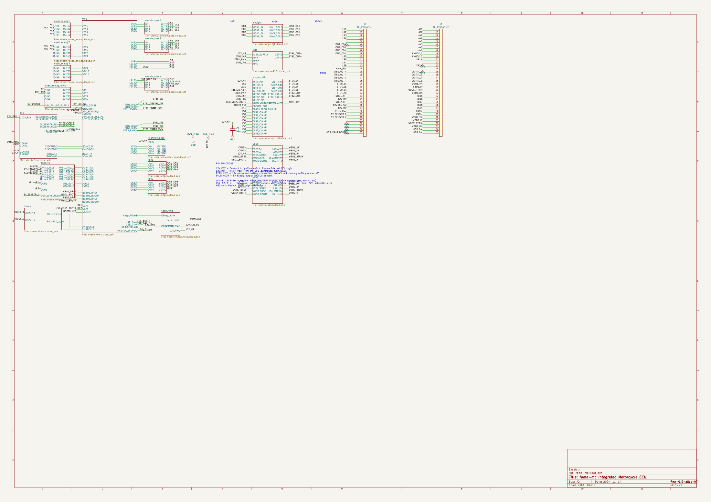
<!-- slide -->
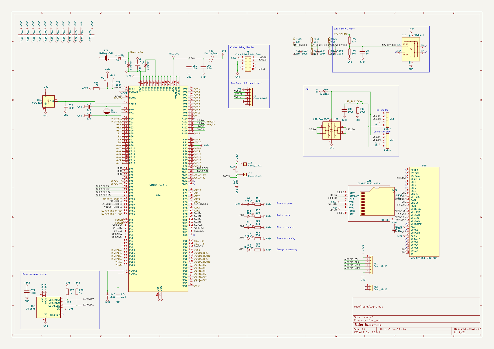
<!-- slide -->
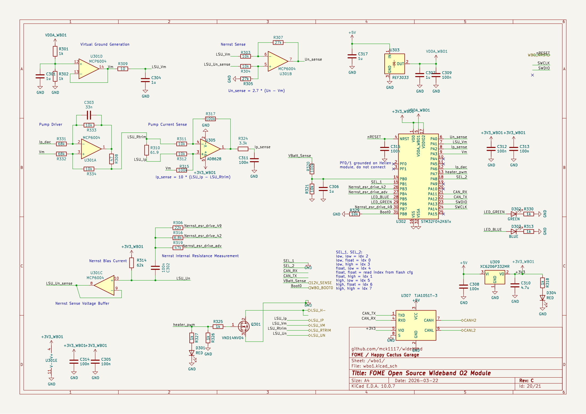
<!-- slide -->
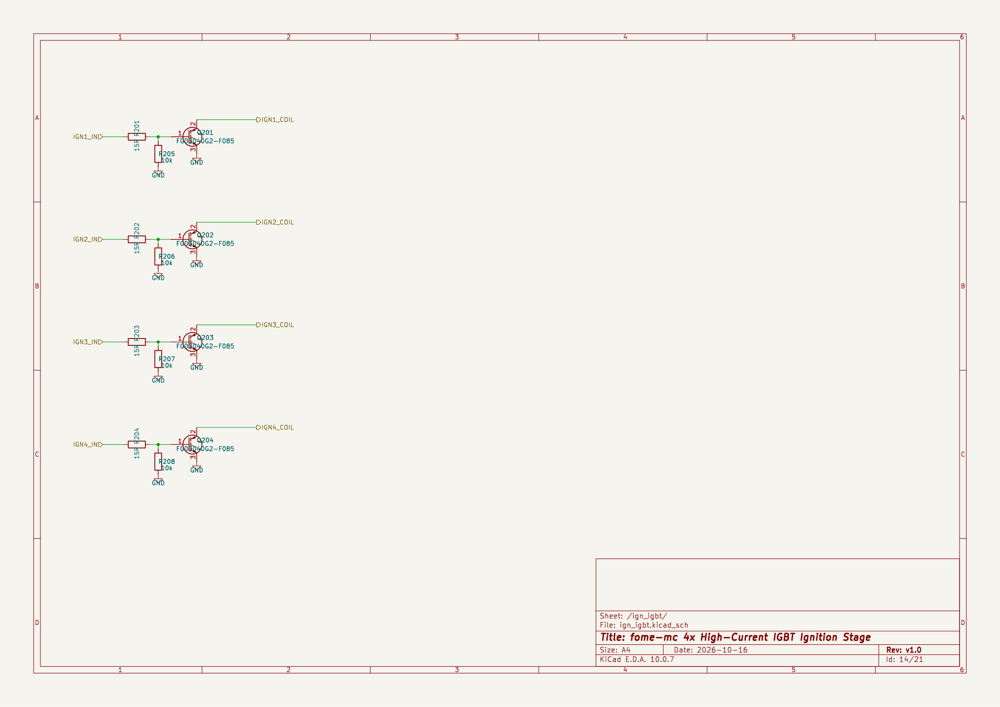
<!-- slide -->
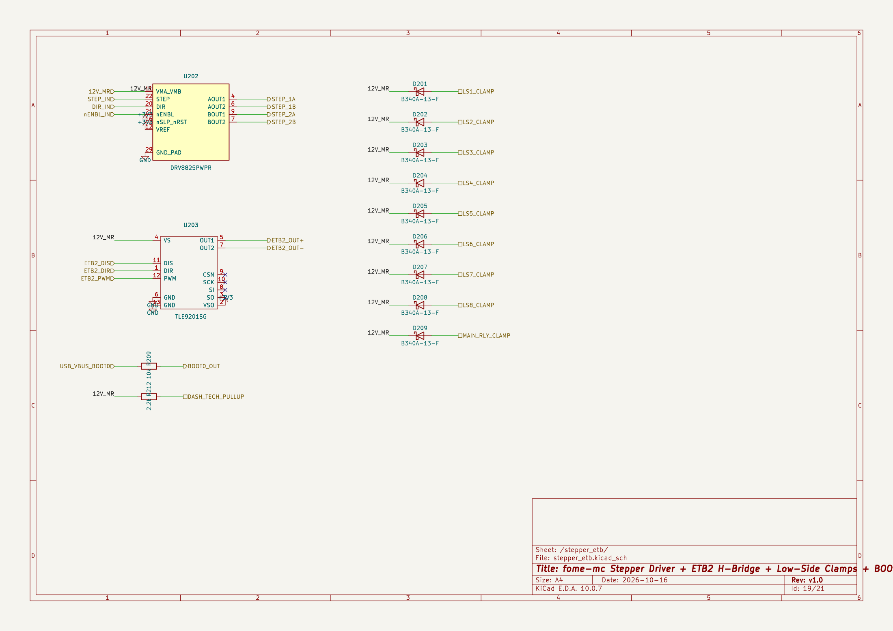
````

---

## Repository Structure

```text
fome-mc/
├── fome-mc.kicad_pro                # KiCad 10 project configuration
├── fome-mc.kicad_sch                # Root hierarchical schematic (J1/J2 AMPSEAL headers + 20 subsheet blocks)
├── fome-mc.kicad_pcb                # 4-layer PCB layout (162.0 mm × 115.0 mm)
├── sym-lib-table                    # Project symbol library table (-> libs/symbols/)
├── fp-lib-table                     # Project footprint library table (-> libs/footprints/)
├── io-map.csv                       # Authoritative 70-pin J1/J2 + 22 internal net cross-reference table
├── Makefile                         # Reproducible verification & manufacturing export targets
├── README.md                        # Project overview, architecture diagrams & visual gallery
├── CHANGELOG.md                     # Detailed engineering changelog & bug-fix history
├── sheets/                          # 15 hierarchical child schematic sheets
│   ├── mcu.kicad_sch                # STM32H753ZIT6, 8 MHz HSE, REF3333, LPS25HB (DNP), CSNP32GCR01-AOW 4GB SDNAND, ATWINC1500-MR210UB Wi-Fi
│   ├── psu.kicad_sch                # SMCJ33A TVS, AO4485 PMOS, L1/C6 filter, LMR16020 5V buck, 2x TLS115D0E, TLV75733, 2x MCP2551
│   ├── Keep_Alive.kicad_sch         # D20/D21 (B340A-13-F) 12V_IGN_SW + 12V_MR diode-OR + MIC5205 (U41) RTC VBAT backup
│   ├── wbo1.kicad_sch               # Onboard Bosch LSU 4.9 Wideband Controller #1 (STM32F042 + VND14NV04 + TJA1051T/3)
│   ├── wbo2.kicad_sch               # Onboard Bosch LSU 4.9 Wideband Controller #2 (STM32F042 + VND14NV04 + TJA1051T/3)
│   ├── ign_igbt.kicad_sch           # 4x FGD3040G2-F085 400V 30A ignition IGBTs + MIC4427 gate drivers
│   ├── ign4.kicad_sch               # 4x 5V logic-level push-pull coil drivers (MIC4427 + 100R)
│   ├── stepper_etb.kicad_sch        # DRV8825PWPR stepper + dual TLE9201SG parent + D201..D209 low-side & MAIN_RLY clamps
│   ├── etb-9201.kicad_sch           # TLE9201SG 6A H-bridge subsheet (instantiated twice: etb1, etb2)
│   ├── lowside_quad.kicad_sch       # Dual VNLD5090 protected low-side driver subsheet (INJ1..4, LS5..8, MAIN_RLY, DASH_TECH)
│   ├── highside_quad.kicad_sch      # BTS716G protected high-side driver
│   ├── triggers.kicad_sch           # 2x MAX9924UAUB+ differential VR conditioners + 4x Hall/digital inputs
│   ├── quad_analog.kicad_sch        # MCP6004 buffered 0-5V analog input conditioning + SRV05-4 ESD
│   ├── quad_analog_pullup.kicad_sch # Precision 2.7k 0.1% thermistor bias & 0-5V analog inputs
│   └── knock.kicad_sch              # 2-channel active bandpass knock conditioning (PF4/PF5 ADC3)
├── libs/
│   ├── symbols/                     # Project-local KiCad symbol libraries (.lib, .dcm)
│   └── footprints/                  # Project-local KiCad footprint libraries (.pretty)
├── docs/
│   ├── DESIGN.md                    # Complete electrical & firmware architecture specification
│   ├── VALIDATION.md                # Verification ledger, DFM/stock audit & bench bring-up procedure
│   ├── WIRING_SV650_K7.md           # 2007 Suzuki SV650 (K7) wiring harness & connector guide
│   ├── POTTING_AND_ENCLOSURE.md     # Enclosure stackup, thermal gap pads & potting guide (incl. FOMEMC-1 & FOMEMC-2)
│   ├── TELEMETRY_AND_RACECHRONO.md  # CAN1 motorsport telemetry pod, RaceChrono Pro & camera integration (FOMEMC-4)
│   ├── renders/                     # High-resolution PNG/SVG/PDF PCB layer, floorplan & pinout renders
│   └── schematics/                  # All 21 schematic sheets in SVG + compiled fome-mc-schematics.pdf
├── export/
│   ├── BOM-fome-mc.csv              # JLCPCB PCBA Bill of Materials (106 grouped lines, 475 schematic parts, LCSC part numbers)
│   ├── CPL-fome-mc.csv              # JLCPCB PCBA Component Placement / Centroid file
│   └── gerbers/                     # 4-layer Gerbers, Excellon drill files, job file & fome-mc-gerbers.zip
├── scripts/
│   ├── verify_io_map.py             # Cross-checks io-map.csv against schematics, netlist, and FOME firmware
│   ├── render_docs.py               # Regenerates all schematic SVGs/PDF, PCB renders, floorplan & pinout diagrams
│   └── integrate_fome_mc.py         # Schematic/PCB integration utility
└── toolchain/                       # Automated KiCad 10 ERC, DRC, netlist parity, Gerber & DFM check suite
```

---

## Reproducible Verification & Rendering Commands

All hardware checks and documentation renders run locally using KiCad 10 CLI (`kicad-cli`), Python 3, and `rsvg-convert`:

```bash
# 1. Verify local EDA toolchain (KiCad 10, kicad-cli, pcbnew, ngspice, freecad)
make doctor

# 2. Verify 100% pinout parity across io-map.csv, schematics, netlist, and fome-fw
python3 scripts/verify_io_map.py

# 3. Run schematic ERC, netlist extraction, and manufacturing exports
make erc
make netlist
make export
```

### Current Verification Status

| Gate | Result | Details |
| :--- | :--- | :--- |
| **`verify_io_map.py`** | **PASS** | `70 / 70` `J1`/`J2` pins + `22` internal buses + `475` netlist components verified across `io-map.csv`, `export/fome-mc.net`, and `fome-fw` |
| **Schematic ERC (`make erc`)** | **PASS** | **`0` errors** and `2,115` warnings across all 21 hierarchical schematic sheets (remediated from `HEAD` `f5abd10` baseline of `60` errors / `2,580` warnings; historical `reports/toolchain/baseline/` snapshot had `35` errors / `1,446` warnings) |
| **Netlist (`make netlist`)** | **PASS** | `475` components, `0` unannotated, `0` duplicate references; `/knock/FILTERED_1` (`U26.14`) and `/knock/FILTERED_2` (`U26.15`) isolated from `/12V_MR` and `/5V_SENSOR_1`; `/MAIN_RLY` (`PE0` -> `U1202.6` + `D209` -> `J1-14`), `D20/D21` diode-OR (`12V_IGN_SW` + `12V_MR` -> `12V_RAW`), and `SPI4` Wi-Fi (`U29` `ATWINC1500-MR210UB`) verified |
| **Exports (`make export`)** | **PASS** | Regenerated `export/fome-mc.net`, `export/BOM-fome-mc.csv` (`106` grouped lines, `475` parts, 100% in-stock LCSC part numbers), schematic PDF/SVGs, and KiBot outputs |


