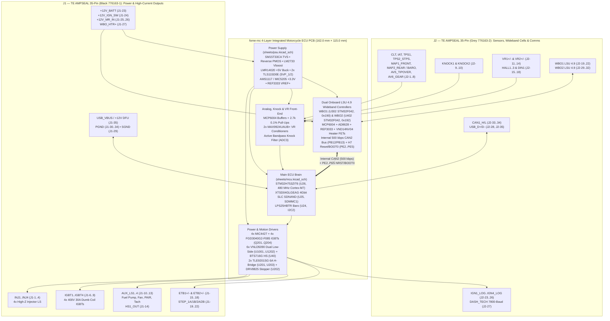

# `fome-mc` — Integrated FOME-Native Motorcycle ECU

**`fome-mc`** is a single-PCB, 4-layer (`162.0 mm × 115.0 mm`), pottable motorcycle engine control unit running [FOME (`fome-fw`)](https://github.com/halbritt/fome-fw) on an `STM32H753ZIT6` / `STM32H743ZIT6` paired with **two onboard `STM32F042K6T6` Bosch LSU 4.9 wideband controllers**, **four 400 V / 30 A ignition IGBTs**, **four 5 V logic ignition outputs**, **four high-Z injector drivers**, **dual 4-wire stepper drivers (`DRV8825` + `2× TLE9201SG`)**, **dual `MAX9924` adaptive VR conditioners**, **soldered industrial SLC SDNAND logging**, and **dual 35-pin TE Connectivity AMPSEAL (`776163-1` Black & `776163-2` Grey) sealed harness headers**.

The primary reference application is the **2007 Suzuki SV650 (K7)** (`645 cc` 90° V-twin, odd-fire `270° / 450°`, dual spark plugs per cylinder = 4 plugs total, `24-2` crank VR trigger, camless `VVT_MAP_V_TWIN` intake-MAP phase sync, dual 4-wire steppers for `ISC` idle and `STVA` secondary throttle blades, and dual Bosch LSU 4.9 wideband O2 sensors).


---

## Documentation & Visual Index

| Document / Artifact | Description |
| :--- | :--- |
| [**`docs/WIRING_SV650_K7.md`**](docs/WIRING_SV650_K7.md) | Complete 2007 Suzuki SV650 (K7) adapter harness build guide, mating TE AMPSEAL connector BOM, pin-by-pin `J1`/`J2` cross-reference, 2-coil vs. 4-coil Primary+Trailing ignition wiring, and dual Bosch LSU 4.9 pinouts |
| [**`docs/POTTING_AND_ENCLOSURE.md`**](docs/POTTING_AND_ENCLOSURE.md) | CNC enclosure stackup, `13.4 W` thermal dissipation budget, thermal gap-pad coupling, single-pour flood potting (external GM/Delphi 1-bar baro, `FOMEMC-1`) vs. vented onboard baro, and post-potting DFU recovery |
| [**`docs/DESIGN.md`**](docs/DESIGN.md) | Complete electrical architecture, circuit-block reuse/adaptation ledger, power tree, and STM32H753 resource mapping |
| [**`docs/VALIDATION.md`**](docs/VALIDATION.md) | Automated ERC/DRC/Parity/Gerber/JLCPCB DFM verification ledger and 12-step pre-engine hardware bring-up checklist |
| [**`docs/schematics/fome-mc-schematics.pdf`**](docs/schematics/fome-mc-schematics.pdf) | Full 21-sheet hierarchical schematic PDF (plus individual sheet SVGs in [`docs/schematics/`](docs/schematics/)) |
| [**`docs/renders/fome-mc-pcb-layers.pdf`**](docs/renders/fome-mc-pcb-layers.pdf) | Multi-page PCB layer plot PDF (`F.Cu`, `In1.Cu`, `In2.Cu`, `B.Cu`, `F.Silkscreen`, `B.Silkscreen`, `F.Fab`, `Edge.Cuts`) |
| [**`io-map.csv`**](io-map.csv) | Machine-verified 87-row master pinout CSV (`J1-1..35`, `J2-1..35`, and 17 internal MCU/WBO/SDNAND buses) |
| [**`CHANGELOG.md`**](CHANGELOG.md) | Engineering decision history, schematic/PCB integration milestones, and upstream bug fixes |

---

## System Architecture



---

## Hardware Capabilities at a Glance

| Subsystem | Hardware Implementation | Connectors / MCU Pins | Key Ratings & Notes |
| :--- | :--- | :--- | :--- |
| **Main MCU** | `STM32H753ZIT6` (`U26`, LQFP-144) | 8 MHz HSE (`Y1`), 32.768 kHz LSE (`U28`), `REF3333` `3.30 V` `VREF+` (`U23`) | 480 MHz Cortex-M7, 2 MB Dual-Bank Flash, 1 MB RAM |
| **Onboard Logging** | `XTSD04GLGEAG` (`U25`, `6×8 mm` LGA-8) | `SDMMC1` 4-bit bus (`PC8..PC12, PD2`) | 512 MB soldered industrial SLC SDNAND; 100% pottable and vibration-proof |
| **Wideband O2 #1 & #2** | `2× STM32F042K6T6` (`U302`, `U402`) + `2× MCP6004` + `2× AD8628` + `2× REF3033` + `2× VND14NV04` (`Q301`, `Q401`) | `J1-5` (`WBO1_HTR-`), `J1-27` (`WBO_HTR+`), `J1-28` (`WBO2_HTR-`), `J2-19..22` (`WBO1`), `J2-29..32` (`WBO2`) | Internal `CAN2` (`PB12/PB13` @ 500 kbps). Hardware-strapped addresses: `WBO1` = `0x190/0x191`, `WBO2` = `0x192/0x193`. H7 controls `NRST`/`BOOT0` via `PE2..PE5` |
| **High-Current Ignition** | `4× FGD3040G2-F085` IGBTs (`Q201..Q204`, TO-252) driven by `MIC4427` | `J1-6..9` (`PB3`, `PG15`, `PG14`, `PG13`) | `400 V` internal collector-gate SCIS clamp, `30 A`, `250 mJ`; `10 kΩ` MCU reset pull-downs prevent coil dwell during reset/DFU |
| **5V Logic Ignition** | `4× MIC4427` 1.5 A push-pull buffers + `100 Ω` series protection | `J2-23..26` (`PG12`, `PG11`, `PG10`, `PG9`) | Drives 3/4-wire smart coils or external igniters; `IGBT3/4` and `IGN3/4_LOG` support independent **Trailing Spark** |
| **Fuel Injectors** | `2× VNLD5090TR-E` dual protected low-side (`U1001`, `U1002`) | `J1-1..4` (`PG7`, `PG8`, `PD11`, `PD10`) | 4 channels (`INJ1..4`), `42 V` active clamp + `B340A` Schottky flyback diodes |
| **Aux Low-Side & High-Side** | `4× VNLD5090TR-E` (`U1101..U1202`) + `BTS716G` / `VNQ7140AJ` (`U40`) | `J1-10..13` (`AUX_LS1..4`), `J1-14` (`HS1_OUT`), `J2-27` (`DASH_TECH`), internal `PE0` (`MAIN_RLY`) | `AUX_LS4` (`PD3`) and `DASH_TECH` (`PB9`) include `2.2 kΩ` pull-ups to `+12V_MR` for SV650 12 V tach and 7800-baud dash serial |
| **Idle Stepper (`ISC`)** | `DRV8825PWPR` (`U202`, HTSSOP-28) bipolar microstepping driver | `J1-19..22` (`STEP_1A/1B/2A/2B`), `PB4` (`STEP`), `PB7` (`DIR`), `PB8` (`~EN`) | Regulated `0.75 A` chopper limit (`0.20 Ω` sense, `VREF = 0.38 V`) for SV650 4-wire `ISC` idle valve |
| **Secondary Throttle (`STVA`) / Dual ETB** | `2× TLE9201SG` (`U201`, `U203`, PG-DSO-12) 6 A H-bridges | `J1-15..18` (`ETB1_OUT+/-`, `ETB2_OUT+/-`), `PC6/PA8/PC7`, `PC9/PD14/PD13` | Drives SV650 4-wire `STVA` secondary throttle stepper or dual DC drive-by-wire throttles |
| **Crank/Cam VR & Hall** | `2× MAX9924UAUB+` differential adaptive VR conditioners + `SN74LVC2G17` Hall buffers | `J2-11..14` (`VR1+/-` -> `PE14`, `VR2+/-` -> `PE15`), `J2-15..18` (`HALL1..3`, `DIN1` -> `PG1, PG0, PE11, PE10`) | Mode A1 adaptive peak threshold (`50 mVpp` cranking to `100 Vpp` redline) |
| **Analog, Temp & Knock** | `MCP6004` buffers (`U7, U15, U17, U19, U21`) + `SRV05-4` TVS arrays | `J2-1..8` (`PC4, PC5, PA7, PA3, PA0, PA1, PA4, PA5`), `J2-9..10` (`PF4, PF5` `ADC3`) | `2.7 kΩ 0.1%` bias on `CLT`/`IAT`; `1.5 kΩ 1%` bias on `AV6_GEAR` (`J2-8`) for SV650 6-speed resistor ladder; external GM/Delphi 1-bar Baro supported on `J2-6` (`PA1`, `FOMEMC-1`) |
| **Power Supply** | `SM15T33CA` TVS + reverse PMOS + `LM2733` boost + `LMR14020` 5V buck + `2× TLS115D0E` (`U1, U2`) | `J1-23..26` (`+12V`), `J1-29..34` (`GND`), `J2-1..2` (`5V_SENSOR_1/2`) | Operates down to `3.5 V` battery cranking sag; dual independent tracked `5.00 V ± 0.2%` short-circuit-protected external sensor supplies |
| **Post-Potting Recovery** | Dual-threshold `J1-35` (`USB_VBUS / BOOT0_OVR`) + `PE2..PE5` | `J1-35`, `J2-28` (`USB_D+`), `J2-35` (`USB_D-`), `J2-33..34` (`CAN1`) | `+5 V` on `J1-35` = normal USB/RusEFI/MSD; `+12 V` on `J1-35` biases `6.8 V` Zener override to assert `STM32H753 BOOT0 = 1` (`0483:df11` ROM DFU) through the sealed harness |

---

## Dual 35-Pin TE AMPSEAL Connector Pinout (`J1` & `J2`)


For full pin-by-pin wiring tables, wire gauges, crimp terminal part numbers, and 2007 Suzuki SV650 (K7) ECM (`34-pin` + `34-pin`) cross-references, see [**`docs/WIRING_SV650_K7.md`**](docs/WIRING_SV650_K7.md) and [**`io-map.csv`**](io-map.csv).

---

## PCB Layout & Layer Renderings

````carousel

<!-- slide -->

<!-- slide -->

<!-- slide -->

<!-- slide -->

````

---

## Hierarchical Schematic Renderings

All 21 schematic sheets are exported as vector SVGs in [`docs/schematics/`](docs/schematics/) and compiled into a single searchable PDF at [**`docs/schematics/fome-mc-schematics.pdf`**](docs/schematics/fome-mc-schematics.pdf).

````carousel

<!-- slide -->

<!-- slide -->

<!-- slide -->

<!-- slide -->

````

---

## Repository Structure

```text
fome-mc/
├── fome-mc.kicad_pro                # KiCad 10 project configuration
├── fome-mc.kicad_sch                # Root hierarchical schematic (J1/J2 AMPSEAL headers + 20 subsheet blocks)
├── fome-mc.kicad_pcb                # 4-layer routed PCB layout (162.0 mm × 115.0 mm, 474 footprints, 0 DRC errors)
├── sym-lib-table                    # Project symbol library table (-> libs/symbols/)
├── fp-lib-table                     # Project footprint library table (-> libs/footprints/)
├── io-map.csv                       # Authoritative 70-pin J1/J2 + 17 internal net cross-reference table
├── Makefile                         # Reproducible verification & manufacturing export targets
├── README.md                        # Project overview, architecture diagrams & visual gallery
├── CHANGELOG.md                     # Detailed engineering changelog & bug-fix history
├── sheets/                          # 15 hierarchical child schematic sheets
│   ├── mcu.kicad_sch                # STM32H753ZIT6, 8 MHz HSE, REF3333, LPS25HB, XTSD04GLGEAG SDNAND
│   ├── psu.kicad_sch                # TVS, Reverse-PMOS, LM2733 boost, LMR14020 5V buck, 2x TLS115D0E, CAN1/2
│   ├── Keep_Alive.kicad_sch         # Main relay keep-alive power hold circuit
│   ├── wbo1.kicad_sch               # Onboard Bosch LSU 4.9 Wideband Controller #1 (STM32F042 + VND14NV04)
│   ├── wbo2.kicad_sch               # Onboard Bosch LSU 4.9 Wideband Controller #2 (STM32F042 + VND14NV04)
│   ├── ign_igbt.kicad_sch           # 4x FGD3040G2-F085 400V 30A ignition IGBTs + MIC4427 gate drivers
│   ├── ign4.kicad_sch               # 4x 5V logic-level push-pull coil drivers (MIC4427 + 100R)
│   ├── stepper_etb.kicad_sch        # DRV8825PWPR 4-wire stepper driver + dual TLE9201SG H-bridge parent
│   ├── etb-9201.kicad_sch           # TLE9201SG 6A H-bridge subsheet (instantiated twice: etb1, etb2)
│   ├── lowside_quad.kicad_sch       # Dual VNLD5090 protected low-side driver subsheet (INJ1..4, AUX_LS1..8)
│   ├── highside_quad.kicad_sch      # BTS716G / VNQ7140AJ protected high-side driver
│   ├── triggers.kicad_sch           # 2x MAX9924UAUB+ differential VR conditioners + 4x Hall/digital inputs
│   ├── quad_analog.kicad_sch        # MCP6004 buffered 0-5V analog input conditioning + SRV05-4 ESD
│   ├── quad_analog_pullup.kicad_sch # Precision 2.7k 0.1% thermistor bias & 0-5V analog inputs
│   └── knock.kicad_sch              # 2-channel active bandpass knock conditioning (PF4/PF5 ADC3)
├── libs/
│   ├── symbols/                     # Project-local KiCad symbol libraries (.lib, .dcm)
│   └── footprints/                  # Project-local KiCad footprint libraries (.pretty)
├── docs/
│   ├── DESIGN.md                    # Complete electrical & firmware architecture specification
│   ├── VALIDATION.md                # Verification ledger, DFM/stock audit & bench bring-up procedure
│   ├── WIRING_SV650_K7.md           # 2007 Suzuki SV650 (K7) wiring harness & connector guide
│   ├── POTTING_AND_ENCLOSURE.md     # Enclosure stackup, thermal gap pads & potting guide (incl. FOMEMC-1)
│   ├── renders/                     # High-resolution PNG/SVG/PDF PCB layer, floorplan & pinout renders
│   └── schematics/                  # All 21 schematic sheets in SVG + compiled fome-mc-schematics.pdf
├── export/
│   ├── BOM-fome-mc.csv              # JLCPCB PCBA Bill of Materials (102 grouped lines, LCSC part numbers)
│   ├── CPL-fome-mc.csv              # JLCPCB PCBA Component Placement / Centroid file (474 parts)
│   └── gerbers/                     # 4-layer Gerbers, Excellon drill files, job file & fome-mc-gerbers.zip
├── scripts/
│   ├── verify_io_map.py             # Cross-checks io-map.csv against schematics, PCB, and FOME firmware
│   ├── render_docs.py               # Regenerates all schematic SVGs/PDF, PCB renders, floorplan & pinout diagrams
│   └── integrate_fome_mc.py         # Schematic/PCB integration utility
└── toolchain/                       # Automated KiCad 10 ERC, DRC, netlist parity, Gerber & DFM check suite
```

---

## Reproducible Verification & Rendering Commands

All hardware checks and documentation renders run locally using KiCad 10 CLI (`kicad-cli`), Python 3, and `rsvg-convert`:

```bash
# 1. Verify local EDA toolchain (KiCad 10, kicad-cli, pcbnew, ngspice, freecad)
make doctor

# 2. Verify 100% pinout parity across io-map.csv, schematics, PCB, and fome-fw
python3 scripts/verify_io_map.py

# 3. Run full ERC, DRC, schematic-to-PCB netlist parity, Gerber/Excellon, and JLCPCB 4-layer DFM audit
make check

# 4. Regenerate all schematic SVGs/PDF, PCB layer renders, floorplan diagram, and J1/J2 pinout diagram
python3 scripts/render_docs.py
```

### Current Verification Status (`make check`)

| Gate | Result | Details |
| :--- | :--- | :--- |
| **Toolchain (`make doctor`)** | **PASS** | KiCad `10.0.1`, `pcbnew`, `ngspice 45.2`, `FreeCAD 1.0.2` |
| **`verify_io_map.py`** | **PASS** | `70 / 70` `J1`/`J2` pins + `17` internal buses verified across `io-map.csv`, `fome-mc.kicad_sch`, and `fome-fw` |
| **Schematic ERC** | **PASS** | `0` errors across all 21 hierarchical schematic sheets |
| **PCB DRC** | **PASS** | `0` errors, `0` unconnected items, `0` courtyard overlaps across all `474` placed footprints |
| **Netlist Parity** | **PASS** | `0` missing footprints, `0` extra footprints, `0` pin-net mismatches between schematic and PCB |
| **JLCPCB 4-Layer DFM** | **PASS** | `162.0 × 115.0 mm` outline, `0.1524 mm` min trace, `0.2997 mm` min via drill, `474` CPL rows, `102` BOM lines |
