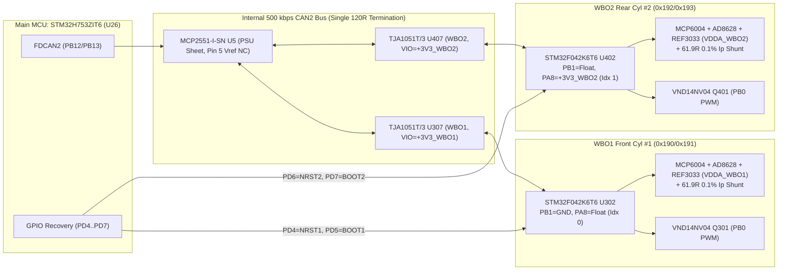

# `fome-mc`: Integrated FOME-Native Motorcycle ECU — Architecture & Design Document

- **Target Board / Project Name**: `fome-mc`
- **Primary Reference Vehicle**: 2007 Suzuki SV650 (K7, Gen 2 dual-plug 90° V-twin, `645 cc`)
- **Main Application Processor**: STMicroelectronics `STM32H753ZIT6` / `STM32H743ZIT6` (480 MHz Cortex-M7, 2 MB Flash, 1 MB RAM, LQFP-144)
- **Dual Onboard Wideband Co-Processors**: `2 × STM32F042K6T6` (48 MHz Cortex-M0, LQFP-32) running `fome-fw/firmware/ext/wideband_firmware` over internal 500 kbps `CAN2`
- **Sealed Harness Interface**: Dual 35-Pin TE Connectivity AMPSEAL Right-Angle PCB Headers (`J1` = `776163-1` Key 1 Black, `J2` = `776163-2` Key 2 Grey; 70 sealed `1.3 mm` contacts total, IP67/IP69K with integral wire-entry mat seal)

---

## 1. Executive Summary: Keep, Change, and Drop

This project adapts our earlier `fome-mc` brain-module work and combines it with the vehicle-facing circuitry of `Polygonus-Universal-112` and two complete `wideband_controller` Rev C circuits into a single, compact (`162.0 mm × 115.0 mm`), 4-layer pottable motorcycle ECU PCB (`fome-mc`).

The owner's planned `Atlas + Universal 112` installation remains a completely separate reference and bring-up path; `fome-mc` does not modify `/home/halbritt/git/Polygonus-Universal-112`, `/home/halbritt/git/Polygonus`, or `/home/halbritt/git/kicad-libraries`, and is not a prerequisite for bringing up the modular reference stack.

| Category | Item | Action (`Keep` / `Change` / `Drop`) | Engineering Rationale |
| :--- | :--- | :--- | :--- |
| **Processor & Core** | `STM32H753ZIT6` / `STM32H743ZIT6` (`U26`), `8 MHz` HSE (`Y1`), fixed `3.30 V` `REF3333`/`REF3033` `VREF+` (`U23`), `LPS25HBTR` baro (`U24` DNP) | **Keep** | Proven FOME H7 architecture with 2 MB dual-bank Flash, hardware `ADC3` oversampling for DSP knock, 2× `FDCAN`, and `SDMMC1` IDMA. Because `VREF+` (`U23`) is a fixed `3.30 V` reference, ADC inputs are not ratiometric to `5V_SENSOR_1/2` and should be scaled by `5V_SENSE_DIVIDED` (`U26.50` / `PA6`) during deep cranking sag. |
| **Power Supply & Keep-Alive (`FOMEMC-13`, `FOMEMC-17`)** | `SMCJ24A` unidirectional TVS (`D1, D22`) -> `D20/D21` (`B340A-13-F`) diode-OR (`+12V_IGN_SW` `J1-26` + `+12V_MR` `J1-27`) -> `AO4485` P-MOSFET reverse-polarity block (`Q1` + `D19` `BZT52C12` + `R124` `47k`) -> `C4` (`4.7 µF 50 V X7R 1210` `GCJ32ER71H475KA12L` `C417122` via `R2 = 2 Ω` RC damper) + `L1/C6` (`2.2 µH` + `47 µF` hybrid-polymer) input filter -> `LMR16020PDDAR` 60V 5V 2A buck (`U3`) -> 2× `TLS115D0E` tracked 5V sensor LDOs (`U1, U2`) + `TLV75733PDBVR` (`TLV757P`) 3.3V 1A LDO (`U6`, `0.25 V` max dropout) + `MIC5205-3.3YM5` (`U41` `VBAT` LDO) + `PE0` `MAIN_RLY` low-side driver (`U1202.6` + `D209` flyback) | **Change (Harden for 60V Load Dump, 50V X7R Derating, Low Dropout & Potting)** | Eliminates the non-functional `U46` (`LM2733`) boost stub, upgrades the 5V buck from 40V `LMR14020` to 60V `LMR16020PDDAR` (`C190006`), replaces series Schottky `D2` (`SS34`) with a `15 mΩ` P-MOSFET (`Q1` `AO4485` `C51499`), replaces `AMS1117-3.3` with `TLV75733PDBVR` (`C485517`), and upgrades `C4` to `4.7 µF 50 V X7R 1210` (`GCJ32ER71H475KA12L` `C417122`), `C2, C5, C7` to `1 µF 50 V X7R 0805` (`GCJ21BR71H105KA01L` `C354368`), `C8` to `10 nF 50 V X7R` (`GCJ188R71H103KA01D` `C344025`), and `C10` to `100 nF 50 V X7R` (`GCJ188R71H104KA12D` `C161115`). With TI `LMR16020`'s **`4.30 V` minimum operating `VIN`** (and precision `EN` UVLO `4.99 V` rising / **`4.50 V`** falling via `R3 = 47 kΩ / R10 = 15 kΩ`), `U3` operates in low-dropout pass-through down to `VIN = 4.50 V` (`V_BATT ≈ 5.0 V`) while `+3V3` stays regulated at `3.30 V` down to `VIN = 4.30 V` (**`V_BATT ≈ 4.8 V` steady-state guaranteed floor**, with `C6` riding through sub-ms cranking dips). |
| **Wideband O2** | `2 × f042_wideband_module` daughterboard headers on `Polygonus-Universal-112` | **Change (Integrate On-Board)** | Replaces the two 13-pin module headers with two complete onboard `wideband_controller` Rev C circuits (`2× STM32F042K6T6` `U302/U402`, `2× MCP6004` `U301/U401`, `2× AD8628` `U305/U405`, `2× REF3033` `U303/U403`, `2× XC6206P332MR` `U309/U409`, `2× VND14NV04` heater FETs `Q301/Q401`, `2× TJA1051T/3` `U307/U407`) connected to internal `CAN2` (`PB12/PB13`, driven on `psu.kicad_sch` by `MCP2551-I-SN` `U5`). Retains unmodified proven wideband firmware. |
| **Wideband Addressing & Recovery** | Unstrapped `SEL_1`/`SEL_2` pins & unrouted `NRST`/`BOOT0` on Universal 112 WBO modules | **Change (Fix in Hardware)** | Hardware-straps `WBO1` (`PB1=GND, PA8=Float` -> `CanIndexOffset=0`, `0x190/0x191`) and `WBO2` (`PB1=Float, PA8=3.3V` -> `CanIndexOffset=1`, `0x192/0x193`) so broadcast `WB_MSG_SET_INDEX` (`0xEF40000`) cannot clobber both sensors to the same ID. Routes `PD4..PD7` from `STM32H753` to `WBO1/2_NRST` and `WBO1/2_BOOT0` for post-potting recovery, freeing `PE2..PE6` and `PC13` for onboard `ATWINC1500-MR210UB` (`U29`) `SPI4` Wi-Fi. |
| **Onboard Wi-Fi (`FOMEMC-2`, `FOMEMC-18`)** | `ATWINC1500-MR210PB` PCB-antenna module on `Atlas` (`SPI4` `PE2..PE6` + `PC13`) | **Keep & Upgrade to `ATWINC1500-MR210UB` (U.FL)** | Integrates **`ATWINC1500-MR210UB`** (`U29`, LCSC `C1558703`, `14.73 × 21.72 mm` `DS70005304F` land pattern with `3.7 × 3.7 mm` `Pad 29` GND paddle & 2×2 thermal/GND vias, plus `C111 = 10 µF` `C96446` & `C112 = 10 nF` `C344025` bypass caps `< 2 mm` from Pin 24 `1P3V_TP`) on `SPI4` (`PE2=SCK`, `PE5=MISO`, `PE6=MOSI`, `PE4=CS`, `PE3=IRQ`, `PC13=RESET_N`) so the RF signal routes outside the CNC aluminum enclosure via a bulkhead U.FL-to-RP-SMA pigtail. Enables wireless TunerStudio (`TCP port 29000`) and built-in `HTTP port 80` web server for `.mlg`/`.zip` log downloads. |
| **`CAN1` Motorsport Telemetry (`FOMEMC-4`)** | `CAN1` (`PD0/PD1`, `U4` `MCP2551-I-SN` -> `J2-28/29`) | **Keep & Enable 50 Hz `FOME_CAN_verbose.dbc` TX + `Bosch MM5.10` IMU RX** | Configures `CAN1` (`500 kbps`) to broadcast `FOME_CAN_verbose.dbc` (`0x200..0x207`) at **`50 Hz` (`20 ms`)** and ingest **Bosch `MM5.10` 5-axis IMU** frames (`0x174`, `0x178`, `0x17C`) into `engine->sensors.accelerometer.{lat,lon,vert,yawRate,rollRate}` for `.mlg` logging and RaceChrono Pro BLE pod integration (see [`docs/TELEMETRY_AND_RACECHRONO.md`](TELEMETRY_AND_RACECHRONO.md)). |
| **Ignition Outputs (`FOMEMC-16`, `FOMEMC-19`)** | 8× IGBTs (`Q1..Q8`) + 12× logic channels across Polygonus + Universal 112 | **Change (Right-Size to 4 IGBT + 4 Logic + `HV_IGN` `0.50 mm` Clearance)** | Provides 4× high-current `FGD3040G2-F085` 400V IGBTs (`Q201..Q204` on `J1-6..9`, driven by `MIC4427` `U42..U45` with `10 kΩ` MCU reset pull-downs and routed in dedicated `HV_IGN` netclass with `0.50 mm` minimum copper clearance and `1.20 mm` track width across all 4 copper layers `F.Cu`, `In1.Cu`, `In2.Cu`, `B.Cu`) **and** 4× dedicated 5V push-pull `MIC4427` (`U9, U10`) logic coil outputs (`IGN1_LOG..4_LOG` on `J2-23..26`) for 2-coil wasted-spark, 4-coil dual-plug twin (Primary + Trailing), or 4-cylinder motorcycles. |
| **Injector & Aux Low-Side (`FOMEMC-14`, `FOMEMC-17`)** | 28× `VNL5090`/`VNLD5090` channels on Polygonus + Universal 112 | **Change (Right-Size to 4 INJ w/ `42 V` Active Clamp DNP + 6 Aux LS + 5V `74HCT125D` Buffers)** | Provides 4× dedicated High-Z injector drivers (`INJ1..4` on `J1-1..4`, `U1001..U1002` with `D201..D204` `B340A-13-F` marked **DNP** so `VNLD5090TR-E` demagnetizes injectors via its internal **`42 V` active Zener clamp** in `~0.83 ms` vs `~4.8 ms` with a `14 V` Schottky clamp), 4× Aux low-side outputs (`AUX_LS1..4` on `J1-10..13`, `U1101..U1102` with populated `D205..D208` `B340A-13-F` and `2.2 kΩ` `+12V_MR` pull-up on `AUX_LS4` for SV650 tachometer), 1× `DASH_TECH` (`J2-27`, `U1201.8` for SV650 7800-baud dash serial), and 1× `MAIN_RLY` (`PE0` -> `U1202.6` -> `J1-14` with populated `D209` `B340A-13-F` flyback diode to `+12V_MR`), all buffered from `3.3 V` MCU pins to `4.9 V` gate drive via `3× 74HCT125D` (`U1003, U1103, U1203`, `C5959`) with `10 kΩ` reset pull-downs (`RN5..RN10` `C29718`). |
| **Idle (`ISC`) & Secondary Throttle (`STVA`) Steppers** | Through-hole Pololu `A1` stepper carrier on Universal 112 + 2× `TLE9201SG` H-bridges on Polygonus | **Change (Integrate SMD `DRV8825PWPR` + Keep 2× `TLE9201SG`)** | Replaces the un-pottable Pololu daughterboard with an onboard SMD `DRV8825PWPR` (`U202`, `C81582`) driving `STEP_1A/1B/2A/2B` (`J1-19..22`) for the SV650 `ISC` 4-wire idle stepper, while keeping the 2× `TLE9201SG` 6A H-bridges (`U201`, `U203`) on `ETB1+/-` & `ETB2+/-` (`J1-15..18`) to drive the SV650 `STVA` 4-wire secondary throttle stepper (or dual DBW throttles). |
| **VR Conditioners** | Universal 112 `MAX9924` (`VR1`) + discrete 3-IC op-amp circuit (`vr_module_poly.kicad_sch` for `VR2`) | **Change (Dual `MAX9924UAUB+`)** | Uses two genuine `MAX9924UAUB+` adaptive differential VR conditioners (`U12`, `U13` in `triggers.kicad_sch`), fixing the Universal 112 Linux filename case bug (`VR Conditioner.kicad_sch`) and eliminating the 26-part discrete op-amp VR2 circuit. |
| **Onboard Logging Storage (`FOMEMC-3`, `FOMEMC-19`)** | Mechanical spring-eject microSD slot (`J10`) only | **Change (Soldered 4 GB SDNAND + Local `VDD` Decoupling + Ring-Buffer Pruning + DNP microSD)** | Integrates a soldered 32 Gbit (`4 GB`) `CSNP32GCR01-AOW` (`U25`, `C2841139`, 394 in stock; pin-compatible with `MKDV32GCL-STH` `C5199868` / `XTSD32GLGEAG` in `6×8 mm` LGA-8) with dedicated **`C113` (`4.7 µF` `0603` `C19666`) + `C114` (`100 nF` `0603` `C14663`)** decoupling `< 2.0 mm` from Pin 4 (`VDD`) on 4-bit `SDMMC1` (`PC8..PC12, PD2`) for 100% pottable, vibration-proof logging (`~161 hrs` @ 50 Hz / `~80 hrs` @ 100 Hz) with automatic oldest-`.mlg` ring-buffer pruning, while retaining an optional DNP `J10` microSD footprint for unpotted bench boards. |
| **Board-to-Board & Molex 112 Headers** | 120-pin 2.54 mm board-to-board headers (`P1..P5`) + Molex CMC 112-pin header (`J2` `64333-0100`, 0 in stock at JLCPCB) | **Drop** | Eliminates all mezzanine headers and replaces the unobtainable 112-pin automotive header with Dual 35-pin TE AMPSEAL right-angle headers (`776163-1` Black `C412117` + `776163-2` Grey, 70 pins total). |

---

## 2. Mandatory Local Reference Repositories & Revision Ledger

All reference repositories were inspected in place and left completely unmodified:

| Repository Path | Git Commit Revision | Branch / Status | Role in `fome-mc` Design |
| :--- | :--- | :--- | :--- |
| `/home/halbritt/git/Polygonus-Universal-112` | `ddcf0f77fecf3ea7f093954ce1becb7c4a26e970` | `main` (clean; `fome-kicad-libs` submodule uninitialized upstream) | Primary electrical basis for carrier-side IGBT outputs (`FGD3040G2-F085C`), low-side protection (`B340A-13-F`), dual wideband integration, and keep-alive power switching. |
| `/home/halbritt/git/kicad-libraries` | `ab9c5f8a1517a04b9cada6880d67d190bfd48c05` | `main` (clean) | Shared KiCad symbol (`Simon.kicad_sym`, `SamacSys_Parts.lib`, `fome_modules.kicad_sym`) and footprint (`Simon.pretty`, `SamacSys_Parts.pretty`, `fome_modules.pretty`, `project_footprints.pretty`, `mx120.pretty`) libraries mapped via `${KIPRJMOD}/../kicad-libraries`. |
| `/home/halbritt/git/Polygonus` | `b3176cb1de7d0f5b9380ecebc1d007e2f365a6de` | `master` (clean) | Source for processor core (`mcu.kicad_sch`), power supply (`psu.kicad_sch`), analog conditioning (`quad_analog*.kicad_sch`), dual `MAX9924` triggers (`triggers.kicad_sch`), dual `TLE9201SG` H-bridges (`etb-9201.kicad_sch`), and `ampseal.pretty`. |
| `/home/halbritt/git/fome-fw` | `6b31ebaec865d7ea856b20a3211c7a0310e29ef2` | `master` (modified with `fome-mc` board target + bug fixes + unit tests) | FOME ECU firmware source tree. |
| `/home/halbritt/git/fome-fw/firmware/ext/wideband_firmware` | `ca2adce4aaea1deee66e459cc8949296763a0ad0` | Submodule (`https://github.com/mck1117/wideband`) | Source for the actual `wideband_controller` Rev C schematic, PCB, BOM (`hardware/board_module/`), and `STM32F042K6T6` wideband firmware (`firmware/`). |
| `/home/halbritt/git/fome-mc` | Active `main` branch | Single-board integrated ECU repository | Active design workspace for `fome-mc` (`0` ERC violations (`0` errors, `0` warnings), `0` DRC errors, `0` `unconnected_items`, `0` `schematic_parity`, `0` `starved_thermal` with `min_resolved_spokes = 2`, `HV_IGN` `0.50 mm` clearance across all 4 layers, `510` schematic components, `505` populated on board after excluding DNP `U24` and `D201..D204`). |

---

## 3. Circuit-Reuse, Adaptation & Upstream Bug Resolution Table

| Functional Block | Source Repo, File & Revision | Destination Sheet in `fome-mc` | What is Preserved | What Changes & Why (Including Upstream Bug Fixes) | Library Dependencies | Required Revalidation |
| :--- | :--- | :--- | :--- | :--- | :--- | :--- |
| **Power Supply, Input Protection, Keep-Alive & Dual CAN Transceivers (`FOMEMC-13`, `FOMEMC-17`)** | `Polygonus` (`b3176cb`) `psu.kicad_sch` + `Polygonus-Universal-112` (`ddcf0f7`) `Keep_Alive.kicad_sch` | `psu.kicad_sch` & `Keep_Alive.kicad_sch` | `L1` (`2.2 µH`) + `C6` (`47 µF`) input filter feeding `VBOOST`, `R5/R6` (`12k/68k`) feedback divider (`5.00 V`), 2× `TLS115D0E` tracked 5V sensor LDOs (`U1, U2` -> `5V_SENSOR_1`, `5V_SENSOR_2`), 2× `MCP2551-I-SN` (`U4` `CAN1`, `U5` `CAN2`, `C7376`) CAN transceivers on `psu.kicad_sch`, `Perm_Live` (`J1-28`) -> `MIC5205-3.3YM5` (`U41`) RTC `VBAT` backup. | **Power, 50V X7R & ERC Remediation**: (1) Removes broken `U46` (`LM2733` on `MIC5205` symbol) + `L3, D18, R122, R123, C107` boost stub; (2) Upgrades `U3` buck from 40V `LMR14020` to 60V **`LMR16020PDDAR`** (`C190006`) for load-dump margin behind `D1` (**`SMCJ24A`** unidirectional TVS `C224045`, sacrificial crowbar with harness fuse); (3) Replaces series Schottky `D2` (`SS34`) with P-MOSFET **`Q1` (`AO4485` `C51499`) + `D19` (`BZT52C12` `C43491`) + `R124` (`47k` `C25819`)**, saving `0.45 V` cranking margin and `~0.7 W` heat; (4) Replaces `U6` (`AMS1117-3.3`) with **`TLV75733PDBVR`** (`TLV757P` `C485517`, `0.25 V` max dropout); (5) Upgrades `C1, C6` to Panasonic **`EEHZC1H470P`** (`C454346`) hybrid-polymer aluminum, `C12` (`+5V` buck output) to Murata **`GCM188R71C106KA64D`** (`10 µF 16 V X7R 0603` AEC-Q200, `C3092605`, `FOMEMC-13`), **`C4`** (`4.7 µF` input RC damper on `/12V_PROT` via `R2 = 2 Ω`) from `16 V X5R 0603` (`C19666`) to **`4.7 µF 50 V X7R 1210` Murata `GCJ32ER71H475KA12L` (`C417122`, soft-term AEC-Q200)**, **`C2, C5`** (`/12V_PROT` input caps on `U1/U2`) and **`C7`** (`/VBOOST` input cap on `U3`) from `0603` (`C15849`) to **`1 µF 50 V X7R 0805` Murata `GCJ21BR71H105KA01L` (`C354368`, soft-term AEC-Q200)**, **`C8`** (`10 nF` soft-start) to **`50 V X7R 0603` `GCJ188R71H103KA01D` (`C344025`)**, and **`C10`** (`100 nF` bootstrap) to **`50 V X7R 0603` `GCJ188R71H104KA12D` (`C161115`)** (`FOMEMC-17`); (6) Adds `D20/D21` (`B340A-13-F` `C8598`) diode-OR from `+12V_IGN_SW` (`J1-26`) and `+12V_MR` (`J1-27`) into `12V_RAW`, connects `12V_SENSE` (`R96/R97` -> `U26.45`) to `+12V_IGN_SW`, and routes `MAIN_RLY` (`PE0` -> `U1202.6` + `D209` -> `J1-14`); (7) Fixes `U4/U5` (`MCP2551`) Pin 5 `Vref` short to `+3V3`. | `lmr14020`, `infineon_psu`, `polygonus-cache`, `Simon.pretty`, `tsdso24.pretty` | Verify `12V_RAW` diode-OR handoff (`J1-26`/`J1-27`), `MAIN_RLY` hold (`J1-14`), `+5V`, `5V_SENSOR_1/2` (`5.00V ± 1%`), `+3.3V` down to **`V_BATT ≈ 4.8 V` steady-state** (`U3` `4.30 V` min operating `VIN`; `EN` UVLO `4.99 V` rising / `4.50 V` falling via `R3 = 47 kΩ / R10 = 15 kΩ`), and `CAN1`/`CAN2` `60–120 Ω` bus resistance. |
| **STM32H753 MCU Core, SDNAND, Wi-Fi, Baro & USB DFU Recovery (`FOMEMC-18`, `FOMEMC-19`)** | `Polygonus` (`b3176cb`) `mcu.kicad_sch` + `fome-mc` (`c43ad7b`) `mcu.kicad_sch` | `mcu.kicad_sch` | `STM32H753ZIT6` (`U26`), `8 MHz` HSE (`Y1`), fixed `3.30 V` `REF3333`/`REF3033` `VREF+` (`U23`), `LPS25HBTR` (`U24`, `C87898` DNP), `USBLC6-2SC6` (`U27`). | (1) Adds soldered 32 Gbit (`4 GB`) `CSNP32GCR01-AOW` (`U25`, `C2841139` LGA-8 SD NAND; pin-compatible with `MKDV32GCL-STH` `C5199868` / `XTSD32GLGEAG`) on 4-bit `SDMMC1` (`PC8..PC12, PD2`) with dedicated **`C113` (`4.7 µF` `0603` `C19666`) + `C114` (`100 nF` `0603` `C14663`)** local decoupling `< 2.0 mm` from Pin 4 (`VDD`, `FOMEMC-19`) in parallel with DNP bench microSD `J10`; (2) Integrates **`ATWINC1500-MR210UB`** (`U29`, `C1558703` U.FL Wi-Fi, `14.73 × 21.72 mm` `DS70005304F` land pattern with `3.7 × 3.7 mm` `Pad 29` GND paddle & 2×2 thermal/GND vias) on `SPI4` (`PE2=SCK`, `PE5=MISO`, `PE6=MOSI`, `PE4=CS`, `PE3=IRQ`, `PC13=RST`) + `R122` (`10k` pull-up) + `C106` (`100n` `VDDIO/VBATT`) + **`C111` (`10 µF` X5R `0603` `C96446`) & `C112` (`10 nF` 50V X7R `0603` `C344025`)** bypass caps `< 2 mm` from Pin 24 (`1P3V_TP`, `/mcu/WIFI_1P3V`, `FOMEMC-18`), and remaps `WBO1_NRST`, `WBO1_BOOT0`, `WBO2_NRST`, `WBO2_BOOT0` to `PD4..PD7`; (3) Adds `J1-35` dual-threshold (`+5V` `USB_VBUS` / `+12V` `6.8V`-Zener `BOOT0` override) for potted DFU recovery; (4) Documents non-ratiometric fixed `3.30 V` `VREF+` (`U23`) and firmware scaling via `5V_SENSE_DIVIDED` (`U26.50` / `PA6`). | `polygonus-cache`, `Simon`, `Simon.pretty`, `ampseal.pretty` | Verify USB DFU enumeration (`0483:df11`), `SDMMC1` FATFS mount/logging + ring-buffer pruning, `SPI4` `ATWINC1500-MR210UB` TCP/HTTP server, external `MT_GM_1_BAR` baro (`J2-6`), and `PD4..PD7` WBO reset control. |
| **Dual Onboard LSU 4.9 Wideband Controllers (`WBO1` & `WBO2`)** | `wideband_firmware` (`ca2adce`) `hardware/board_module/wideband_controller.kicad_sch` Rev C + `Polygonus-Universal-112` (`ddcf0f7`) `wbo-can-trans.kicad_sch` | `wbo1.kicad_sch` & `wbo2.kicad_sch` | Complete Rev C analog front-end (`MCP6004` `U301/U401`, `AD8628` `U305/U405`, `REF3033` `U303/U403` `3.30V` reference, `61.9 Ω` 0.1% `Ip` sense shunt, `10 kΩ` `Nernst` ESR injection, `XC6206P332MR` 3.3V LDO `U309/U409`, `STM32F042K6T6` `U302/U402`, `VND14NV04` `Q301/Q401` protected low-side heater FET, `TJA1051T/3` CAN transceiver `U307/U407`). | (1) Integrates both WBO circuits directly onto the main PCB; (2) **Hardware-straps `SEL1`/`SEL2`**: `WBO1` straps `PB1=GND, PA8=Float` (`case 1` -> `CanIndexOffset=0`, `0x190/0x191`) and `WBO2` straps `PB1=Float, PA8=+3V3_WBO2` (`case 5` -> `CanIndexOffset=1`, `0x192/0x193`); (3) Isolates `VDDA_WBO1` (`U303.2`) and `VDDA_WBO2` (`U403.2`) so the two `REF3033` outputs are not shorted together across sheets; (4) Connects `U307.5`/`U407.5` (`TJA1051T/3` `VIO`) to local `+3V3_WBO1`/`+3V3_WBO2`; (5) Connects `NRST` and `BOOT0` to H7 `PD4..PD7`. | `Simon`, `SamacSys_Parts`, `Simon.pretty` | Verify `1.65V` `Vm` virtual ground, `4.9 kHz` Nernst AC ESR waveform, `500 kbps` `CAN2` telemetry at `0x190..0x193`, and `VND14NV04` heater PWM under `VBatt` CAN control. |
| **4-Ch High-Current Ignition IGBTs + 4-Ch 5V Logic Ignition (`FOMEMC-16`, `FOMEMC-19`)** | `Polygonus-Universal-112` (`ddcf0f7`) `IGBT outputs.kicad_sch` + `Polygonus` (`b3176cb`) `ign4.kicad_sch` | `ign_igbt.kicad_sch` & `ign4.kicad_sch` | `MIC4427` 1.5A push-pull gate drivers (`U42..U45` on `ign_igbt.kicad_sch`, `U9..U10` on `ign4.kicad_sch`), `10 kΩ` pull-downs at MCU pins (`PB3, PG15, PG14, PG13` and `PG12..PG9`) so coils cannot dwell during MCU reset/DFU, `15 Ω` gate resistors (`R201..R204`) + `10 kΩ` gate-emitter bleeders (`R205..R208`), and `FGD3040G2-F085` (`C471989`, 400V, 30A, 250 mJ SCIS) automotive ignition IGBTs (`Q201..Q204`). | Right-sizes from 8 IGBTs + 12 logic channels to **4× `FGD3040G2-F085` IGBT channels (`IGBT1..4` on `J1-6..9`, routed in dedicated `HV_IGN` netclass with `0.50 mm` minimum copper clearance and `1.20 mm` track width across all 4 copper layers `F.Cu`, `In1.Cu`, `In2.Cu`, `B.Cu`)** + **4× 5V push-pull `MIC4427` logic channels (`IGN1_LOG..4_LOG` on `J2-23..26` via `100 Ω` series resistors)**, supporting stock SV650 2-coil wasted-spark, 4-coil independent Primary/Trailing inductive coils, or 4× smart COP coils with zero hardware jumpers. | `Simon`, `polygonus-cache`, `Simon.pretty` | Verify `0V` gate voltage during MCU reset (`BOOT0=1`), `400V` IGBT avalanche clamp on inductive coil turn-off, `> 0.50 mm` `HV_IGN` copper clearance across all 4 layers, and independent primary + trailing spark timing. |
| **4-Ch High-Z Injector + 6-Ch Aux Low-Side & High-Side Drivers (`FOMEMC-14`, `FOMEMC-17`)** | `Polygonus` (`b3176cb`) `lowside_quad.kicad_sch`, `highside_quad.kicad_sch` | `lowside_quad.kicad_sch`, `highside_quad.kicad_sch` & `stepper_etb.kicad_sch` | `6×` dual protected `VNLD5090TR-E` (`U1001..U1202`, `C222209`, 42V active clamp, current limit, thermal shutdown) low-side drivers + `B340A-13-F` (`C8598`, `D201..D204` **DNP**, `D205..D209` populated) Schottky freewheeling diodes to `+12V_MR`; `BTS716G` (`U40`) high-side switch. | (1) Integrates **`3× 74HCT125D` (`U1003, U1103, U1203`, `C5959` + `100 nF` `C1003, C1103, C1203`) `+5V` CMOS level-translating buffers** (`V_IH = 2.0 V` max, `V_OH >= 4.9 V`) between `3.3 V` MCU outputs (`10 kΩ` pull-downs `RN5, RN7, RN9` `4D03WGJ0103T5E` `C29718`) and `1 kΩ` series input resistors (`RN6, RN8, RN10`) so `VNLD5090TR-E` inputs (`V_IH(max) = 3.25 V` at `T_j = 125 °C`) receive a full `4.9 V` gate drive with zero current-limit derating (`FOMEMC-14`); (2) Marks **`D201..D204` (`B340A-13-F` on `INJ1..4` `/LS1../LS4`) DNP (`exclude_from_bom`, `dnp`)** so `U1001/U1002` demagnetize high-Z fuel injectors via their internal **`42 V` active Zener clamps** (`~0.83 ms` turn-off vs `~4.8 ms` with a `14 V` Schottky clamp to `+12V_MR`, preventing nonlinear fuel delivery and cylinder-to-cylinder AFR skew at `10,500 RPM`), while keeping `D205..D209` populated for inductive solenoids/relays (`/LS5../LS8`, `/MAIN_RLY`, `FOMEMC-17`); (3) Adds onboard `2.2 kΩ` pull-up (`R212`) to `+12V_MR` on `AUX_LS4` (`PD3`, `J1-13` SV650 `0–12V` Tachometer), `DASH_TECH` (`PB9` -> `U1201.8`, `J2-27` SV650 `7800-baud` single-wire dash serial), and `MAIN_RLY` (`PE0` -> `U1202.6` + `D209` -> `J1-14`). | `vnld5090`, `Simon.pretty`, `tsdso24.pretty` | Verify `4.9 V` gate drive into `U1001..U1202`, `42V` active Zener flyback clamp (`~0.83 ms` fast turn-off) on `INJ1..4` (`12 Ω` injector load with `D201..D204` DNP), `MAIN_RLY` coil pull-in/drop-out, and `0–12V` square-wave levels on `AUX_LS4` (Tach) and `DASH_TECH`. |
| **Dual H-Bridge (`STVA`) + Onboard `DRV8825` (`ISC`) Stepper Drivers** | `Polygonus` (`b3176cb`) `etb-9201.kicad_sch` + `Polygonus-Universal-112` (`ddcf0f7`) `A1` Pololu stepper header | `stepper_etb.kicad_sch` & `etb-9201.kicad_sch` | 2× `TLE9201SG` (`IFX9201SG` `C112633`, 6A peak, PG-DSO-12 exposed thermal pad) H-bridges (`U201`, `U203`) driving `ETB1_OUT+/-` (`J1-15,16`) and `ETB2_OUT+/-` (`J1-17,18`). | Replaces the un-pottable through-hole Pololu module (`A1`) with an onboard SMD **`DRV8825PWPR` (`U202`, `C81582`, HTSSOP-28 exposed pad)** + `0.20 Ω` sense resistors (`VREF` divider from `+3V3` -> `0.75A` current limit) on `STEP_1A/1B/2A/2B` (`J1-19..22`) for the SV650 `ISC` idle valve (`30 Ω/phase`), and fixes `#PWR0340/#PWR0341/#PWR0850/#PWR0851/#PWR0856` `+3.3V` -> `+3V3` rail naming on `U201/U202/U203`. | `tle9201_2`, `Simon`, `powersso.pretty` | Verify `DRV8825` `0.75A` winding chopper current on `ISC` (`PB4/PB7/PB8`) and `TLE9201SG` bipolar stepping on `STVA` with `STPS` feedback (`PA3`). |
| **Dual Adaptive VR Conditioners + 4× Hall / Switch Inputs** | `Polygonus` (`b3176cb`) `triggers.kicad_sch` + `Polygonus-Universal-112` (`ddcf0f7`) `VR conditioner.kicad_sch` | `triggers.kicad_sch` | 2× `MAX9924UAUB+` (`U12`, `U13`, `C89779`) differential VR conditioners in Mode A1 (adaptive peak threshold + zero-crossing hysteresis) with `10 kΩ` input resistors and `1 nF` differential filters; 4× protected Hall/Digital inputs (`PG1, PG0, PE11, PE10` via `SN74LVC2G17` `U11, U14`) with `4.7 kΩ` pull-ups to `5V_SENSOR_2`. | **Fixes Upstream Universal 112 Linux Case Bug** (`VR Conditioner.kicad_sch` vs `VR conditioner.kicad_sch`) and replaces the discrete 26-part op-amp VR2 block (`vr_module_poly.kicad_sch`) with a second genuine `MAX9924UAUB+` (`U13`). | `max9924`, `polygonus-cache`, `Simon.pretty` | Verify clean `0–3.3V` output edges on `PE14` (`VR1`) and `PE15` (`VR2`) from `50 mVpp` cranking up to `100 Vpp` at `11,000 RPM` (`24-2` wheel = `4.4 kHz`). |
| **Analog, Baro, Thermistor & Knock Conditioning (`FOMEMC-15`)** | `Polygonus` (`b3176cb`) `quad_analog.kicad_sch`, `quad_analog_pullup.kicad_sch`, `knock.kicad_sch` | `quad_analog.kicad_sch`, `quad_analog_pullup.kicad_sch`, `knock.kicad_sch` | `MCP6004` unity-gain op-amp buffers (`U15, U17, U19, U21`) + `SRV05-4` TVS arrays (`U16, U18, U20, U22`) preceded by `100 kΩ` (`R77..R80`) + `1 nF` (`C65..C68`) RC low-pass filters (`R73..R76 = 1 MΩ` bleeders) on `quad_analog.kicad_sch` (`AV5..AV8`) and `2.7 kΩ` `0.1%` thermistor pull-ups on `AT1..AT2` (`quad_analog_pullup.kicad_sch`); 2-channel active bandpass knock amplifier (`knock.kicad_sch` `U7` `MCP6004`) into `PF4` (`U26.14`, `/knock/FILTERED_1`) & `PF5` (`U26.15`, `/knock/FILTERED_2`). | (1) Configures `J2-6` (`AV3_BARO_MAP2` `PA2` / `EFI_ADC_2`) by default for an external automotive 1-bar barometer (`MT_GM_1_BAR` `GM 12614970` / `Delphi PS10150`, `FOMEMC-1`); (2) Populates **`R219 = 1.5 kΩ` `1%` (`C22843`) pull-up to `/5V_SENSOR_1` on `/AV6` (`J2-8`, `PA5`)** (`FOMEMC-15`) ahead of the `R80 = 100 kΩ` non-inverting buffer to bias the passive SV650 K7 6-speed resistor ladder (`560 Ω..15 kΩ`); (3) Replaces OOS `C53175` `3.3 nF` knock capacitors with in-stock `C472819` (`CL21B332KB6WPNC` `3.3 nF` 50V X7R 0805). | `polygonus-cache`, `Simon.pretty` | Verify ADC linearity across `0–5.00V` (and `5V_SENSE_DIVIDED` `U26.50` cranking compensation against fixed `3.30 V` `VREF+`), `J2-6` external baro reading (`10–105 kPa`), SV650 Gear Position voltage steps (`1.36V..4.54V` at `J2-8`, `1.24V..3.30V` at `PA5`), and `ADC3` 250 kSPS knock sampling on `PF4`/`PF5`. |

---

## 4. 2007 Suzuki SV650 (K7 Dual-Plug) Vehicle Interface & Adapter Harness Architecture

All 2007 Suzuki SV650 (K7, California/49-state non-ABS and ABS models) electrical parameters were verified against the **Suzuki SV650/S/A/SA K7 Factory Service Manual (`99501-36140-01E`)** and OEM parts fiche (`MODEL K7`, `E02/E03/E24/E28/E33`).

### 4.1 Critical Finding: K7 Dual-Plug Ignition Coils & Independent Primary/Trailing Spark

1. **Stock K7 OEM Ignition Hardware**:
   - In 2007 (`K7`), Suzuki transitioned the SV650 cylinder heads from 1 spark plug per cylinder (`K3–K6`) to **2 spark plugs per cylinder (`4 spark plugs total`)**: a **Center (Primary)** plug (`33510-17G00` cap) and a **Side (Trailing)** plug (`33510-20E00` cap) in each cylinder head.
   - However, the stock K7 motorcycle uses **two 2-wire, dual-tower (wasted-spark secondary) dumb inductive ignition coils**:
     - Front Cylinder (#1) Dual-Tower Coil: `33410-17GA0` / `33410-44H02` (qty 1; Primary resistance `1.0–5.0 Ω` between `+` and `-`; Secondary resistance `25–40 kΩ` cap-to-cap; wired to stock ECM Pin `l` `W/Bl`).
     - Rear Cylinder (#2) Dual-Tower Coil: `33420-17GA0` / `33420-44H02` (qty 1; Primary resistance `1.0–5.0 Ω`; Secondary resistance `25–40 kΩ` cap-to-cap; wired to stock ECM Pin `c` `B`).
   - Because both high-tension leads on each stock K7 coil share a single magnetic core and secondary winding in series, **the stock 2-coil setup physically fires the Center and Side plugs of a cylinder at the exact same instant**.
2. **How `fome-mc` Supports Both Stock 2-Coil Mode AND True 4-Coil Independent Primary/Trailing Timing**:
   - **`fome-mc` Hardware Capability (Zero PCB Changes Required)**:
     - `fome-mc` provides **4 independent high-current 400V/30A IGBT coil drivers (`IGBT1..4` on `J1-6..9`)** AND **4 independent 5V 1.5A push-pull logic coil drivers (`IGN1_LOG..4_LOG` on `J2-23..26`)**:
       - `IGBT1` (`PB3`, `J1-6`) / `IGN1_LOG` (`PG12`, `J2-23`): `ignitionPins[0]` — **Front Cylinder (#1) Primary (Center Plug)**
       - `IGBT2` (`PG15`, `J1-7`) / `IGN2_LOG` (`PG11`, `J2-24`): `ignitionPins[1]` — **Rear Cylinder (#2) Primary (Center Plug)**
       - `IGBT3` (`PG14`, `J1-8`) / `IGN3_LOG` (`PG10`, `J2-25`): `trailingCoilPins[0]` — **Front Cylinder (#1) Trailing (Side Plug)**
       - `IGBT4` (`PG13`, `J1-9`) / `IGN4_LOG` (`PG9`, `J2-26`): `trailingCoilPins[1]` — **Rear Cylinder (#2) Trailing (Side Plug)**
   - **Mode A — Plug-and-Play Stock K7 Harness (`enableTrailingSpark = false`)**:
     - `J1-6` (`IGBT1`) drives stock ECM Pin `l` (`W/Bl`, Front dual-tower coil) and `J1-7` (`IGBT2`) drives stock ECM Pin `c` (`B`, Rear dual-tower coil). Both plugs in each cylinder fire simultaneously with zero modifications to the motorcycle's coils or main harness.
   - **Mode B — True Independent Primary/Trailing Timing (`enableTrailingSpark = true`)**:
     - Replace the 2 dual-tower coils with **4 single-output coils** (either 4× `K3–K6` SV650 single-tower 2-wire inductive coils driven by `IGBT1..4` on `J1-6..9`, or 4× GSX-R / Hayabusa Denso stick coils / 3-wire smart coils driven by `IGBT1..4` or `IGN1_LOG..4_LOG` on `J2-23..26`) and route a 2-wire trailing-coil sub-harness from `J1-8` (`IGBT3`) and `J1-9` (`IGBT4`) to the Front and Rear Side plug coils.
     - FOME schedules `ignitionPins[0..1]` at the main ignition advance angle and independently schedules `trailingCoilPins[0..1]` retarded by `trailingSparkAngle` (with full overdwell and engine-stop protection fixed in `spark_logic.cpp`).

### 4.2 Crankshaft Trigger (`24-2` VR) & Camless Phase Sync (`VVT_MAP_V_TWIN`)

- **Crankshaft Position Sensor (`CKP`)**: 2-wire Variable Reluctance (`VR`) sensor (`130–240 Ω` coil resistance, `≥ 3.7 Vpp` cranking, up to `80+ Vpp` at `10,500 RPM`) reading a **`24-2` crank rotor** (24 evenly spaced teeth every `15°`, with 2 missing teeth). Wired differentially to `VR1+` (`J2-11`, ECM Pin `R` `G`) and `VR1-` (`J2-12`, ECM Pin `8` `Bl`) feeding `MAX9924UAUB+` #1 (`U13` -> `PE14`).
- **Camless 720° Phase Synchronization**: The 2007 SV650 has **no physical camshaft position sensor (`CMP`)**. Because the 90° V-twin has an uneven `270° / 450°` firing interval, full sequential fuel injection and per-cylinder odd-fire ignition (`timing_offset_cylinder[0] = 0°`, `timing_offset_cylinder[1] = -90°`) require 720° cycle phase identification. `fome-mc` uses FOME's native **`VVT_MAP_V_TWIN`** algorithm (`trigger_central.cpp:469-507`), which samples the Front Cylinder Intake Air Pressure (`MAP1_FRONT` on `J2-5` / `PA0`, wired to stock ECM Pin `3` `G/B`) at `mapCamDetectionAnglePosition = 50°` ATDC to detect the intake stroke vacuum dip and lock 720° engine phase within the first revolution.

### 4.3 Dual 4-Wire Bipolar Steppers (`ISC` Idle Valve & `STVA` Secondary Throttles)

The K7 SV650 throttle body assembly incorporates **two independent 4-wire bipolar stepper motors**:

1. **Idle Speed Control (`ISC`) Stepper Valve (`~30 Ω/phase`, `~400 mA/phase` at `12V`)**:
   - Stock K7 ECM Pins: `g` (`Br/B`, Coil A+), `^` (`Br/W`, Coil A-), `i` (`G/W`, Coil B+), `\` (`G/B`, Coil B-).
   - Driven on `fome-mc` by the onboard SMD **`DRV8825PWPR`** (`U202`, `J1-19..22` `STEP_1A/1B/2A/2B`) controlled by FOME's hardware stepper idle thread (`STEP = PB4`, `DIR = PB7`, `~EN = PB8`, `VREF = 0.38 V` -> `0.75 A` chopper limit).
2. **Secondary Throttle Valve Actuator (`STVA`) Stepper (`~7.0 Ω/phase`, closed-loop with `STPS` pot)**:
   - Stock K7 ECM Pins: `[` (`W/R`, Coil A+), `f` (`R`, Coil A-), `Y` (`P/W`, Coil B+), `d` (`P`, Coil B-), with 0–5V position feedback from the Secondary TPS (`STPS`, ECM Pin `4` `W`, `~4.6 kΩ` total, `0.58 V` closed / `4.38 V` wide open) on `J2-4` (`TPS2_STPS` / `PA3`).
   - Driven on `fome-mc` by the **2× `TLE9201SG` (`IFX9201SG`) 6A H-Bridge drivers** (`U201` `ETB1_OUT+/-` on `J1-15,16` and `U203` `ETB2_OUT+/-` on `J1-17,18`), which can either hold the secondary butterflies wide-open after warm-up, run FOME's dual-H-bridge bipolar stepper controller (`stepper_dual_hbridge.cpp` with our `idle_hardware.cpp` `etb_use_two_wires` fix), or drive dual DC motor electronic throttle bodies on DBW motorcycles.

### 4.4 Gear Position Ladder, Tip-Over Sensor, Tachometer & `7800-Baud` Dash Serial (`TECH`)

- **Gear Position Switch (`GP`, Stock ECM Pin `1` `P` -> `J2-8` `AV6_GEAR` `PA5`, `FOMEMC-15`)**:
  - 6-speed passive resistor ladder to ground (`1st = 560 Ω`, `2nd = 820 Ω`, `3rd = 1.5 kΩ`, `4th = 2.7 kΩ`, `5th = 6.8 kΩ`, `6th = 15 kΩ`, `Neutral = Open` alongside the active-low Neutral switch on `J2-18` `DIN2_NEUTRAL` `PE10`).
  - `fome-mc` populates **`R219 = 1.5 kΩ` `1%` (`C22843`) pull-up to `/5V_SENSOR_1`** on `/AV6` (`J2-8`, `sheets/quad_analog.kicad_sch`) ahead of the `R80 = 100 kΩ` + `C66 = 1 nF` + `R76 = 1 MΩ` input network and unity-gain `MCP6004` buffer (`U19.5 -> U19.7`), producing distinct voltages at `J2-8` (`1.36 V` 1st, `1.77 V` 2nd, `2.50 V` 3rd, `3.21 V` 4th, `4.10 V` 5th, `4.54 V` 6th, `4.99 V` Neutral) and `1.24 V`, `1.61 V`, `2.27 V`, `2.92 V`, `3.30 V` (clamped at op-amp `+3.3 V` rail for `>= 3.63 V` `J2-8` input, with Neutral disambiguated by `PE10` `DIN2_NEUTRAL` or `analogInputDividerCoefficient`) at `PA5` (`U26.41`).
- **Tip-Over Sensor (`TO`, Stock ECM Pin `J` `Br/W` -> `J2-7` `AV5_TIPOVER` `PA4`)**:
  - Internal `19.4 kΩ` resistor + magnetic pendulum (`0.4–1.4 V` normal upright; `3.7–4.4 V` when leaned `> 65°`), used for automatic fuel/ignition safety cutoff.
- **Tachometer Output (Stock ECM Pin `Z` `Y/Bl` -> `J1-13` `AUX_LS4` `PD3`)**:
  - `VNLD5090` low-side switch (`PD3`) with an onboard **`2.2 kΩ` pull-up resistor to `+12V_MR`**, generating the crisp `0–12 V` square wave required by the Suzuki instrument cluster.
- **Instrument Cluster Single-Wire Serial (`TECH`, Stock ECM Pin `U` `B/G` -> `J2-27` `DASH_TECH` `PB9`)**:
  - The K7 SV650 routes the ECT thermistor (`Pin 6` `B/L`) only to the ECU; the ECU transmits coolant temperature and FI warning status to the dash over a single-wire `0–12 V` open-collector `7800 baud` 8-byte serial link (`Pin U` `B/G`). `J2-27` (`PB9` -> `U1203.2/3` `74HCT125D` -> `U1201.3/8` `VNLD5090TR-E`) provides a dedicated low-side driver with an onboard **`R212 = 2.2 kΩ` pull-up to `+12V_MR`** so a FOME Lua script or serial driver can drive the factory SV650 temperature display and FI lamp directly.

---

## 5. Dual Integrated Wideband Controller Architecture (`WBO1` & `WBO2`)

Both wideband channels are physically integrated onto the `fome-mc` PCB using the proven `wideband_controller` Rev C circuit (`fome-fw/firmware/ext/wideband_firmware/hardware/board_module/wideband_controller.kicad_sch` @ `ca2adce4aaea1deee66e459cc8949296763a0ad0`):

1. **Hardware CAN Index Strapping (Immune to Broadcast Clobbering)**:
   - In `wideband_firmware/firmware/boards/f0_module/port.cpp:84-152`, each `STM32F042K6T6` reads `PB1` (`SEL_1`) and `PA8` (`SEL_2`) at startup using a ternary (`0 = GND`, `1 = Float`, `2 = +3.3V`) decoder (`val = sel1 * 3 + sel2`).
   - If both pins float (`case 4`), the controller falls back to `cfg.CanIndexOffset` in Flash, which is overwritten on **both** controllers simultaneously if the user clicks "Set WBO Index" in TunerStudio (`sendWidebandInfo()` broadcasts `WB_MSG_SET_INDEX = 0xEF40000`).
   - On `fome-mc`, we strap:
     - **WBO1 (Front Cylinder #1)**: `PB1` tied to `GND` (`0`), `PA8` floating (`1`) -> `val = 1` (`case 1: CanIndexOffset = 0`) -> fixed at **`0x190` (Standard) / `0x191` (Diag)**.
     - **WBO2 (Rear Cylinder #2)**: `PB1` floating (`1`), `PA8` tied to `+3V3_WBO2` (`2`) -> `val = 5` (`case 5: CanIndexOffset = 1`) -> fixed at **`0x192` (Standard) / `0x193` (Diag)**.
2. **Heater Power & Battery Voltage Sensing**:
   - The `STM32H753` transmits `WB_MSG_ECU_STATUS` (`0xEF50000` Extended ID) at `10 Hz` on `CAN2` containing `VBatt` (`Byte 0` in `0.1 V/LSB`) and `HeaterAllow` (`Byte 1 bit 0`, enabled only when `+12V_MR > 11.0 V` and engine is running). Each `STM32F042K6T6` also monitors `+12V_MR` locally on `PA0` via a `47 kΩ / 10 kΩ` divider and drives its `VND14NV04` (`C62077`) protected Omnifet II low-side heater switch (`WBO1_HTR-` on `J1-23`, `WBO2_HTR-` on `J1-25`) referenced to the dedicated `PGND_HEATER` plane (`J1-33`).
3. **Sequential OpenBLT CAN Firmware Updates & Post-Potting Recovery**:
   - Because `PD4` (`WBO1_NRST`) and `PD6` (`WBO2_NRST`) are independently controlled by the `STM32H753`, the main MCU can hold `WBO2` in reset (`PD6 = LOW`) while updating `WBO1` via FOME's built-in OpenBLT CAN wideband updater (`updateWidebandFirmware()` in `wideband_can.cpp`), and then hold `WBO1` in reset (`PD4 = LOW`) while updating `WBO2` — solving the OpenBLT broadcast address collision when two WBO controllers share `CAN2`!

---

## 6. FOME Firmware Target (`fome-mc`) & Upstream Firmware Bug Fixes

### 6.1 Upstream FOME Bugs Discovered & Fixed in `/home/halbritt/git/fome-fw`

1. **Bug Fix #1 — Trailing Spark Overdwell & Engine-Stop Coil Burnout (`firmware/controllers/engine_cycle/spark_logic.cpp:69-103`)**:
   - **Defect**: In `onIgnitionEvent()`, when `ctx.isOverdwellProtect` was true (`spark_logic.cpp:69-74`) or when `isnan(dwell)` occurred on engine stop (`spark_logic.cpp:80-86`), FOME cancelled `event.sparkCharge` and pulled `enginePins.coils[event.cylinderNumber]` LOW, **but never cancelled `event.trailingSparkCharge` / `event.trailingSparkFire` or pulled `enginePins.trailingCoils[event.cylinderNumber]` LOW**. If an engine stalled while a trailing coil was dwelling, the trailing IGBT/coil remained stuck HIGH indefinitely.
   - **Fix**: Added `event.trailingSparkCharge.Cancel()`, `event.trailingSparkFire.Cancel()`, and `enginePins.trailingCoils[event.cylinderNumber].setLow()` in both the `ctx.isOverdwellProtect` and `isnan(dwell)` paths.
2. **Bug Fix #2 — Dual H-Bridge Bipolar Stepper `etb_use_two_wires` Hardcode (`firmware/controllers/actuators/idle_hardware.cpp:96-114`)**:
   - **Defect**: When `useHbridgesToDriveIdleStepper` was enabled, `initIdleHardware()` called `initDcMotor(..., /*useTwoWires*/ true)` with a hardcoded `true` instead of `engineConfiguration->etb_use_two_wires`. Because `TLE9201SG` (`IFX9201SG`) uses `ThreeWirePwm` (`PWM + DIR + DIS`, `etb_use_two_wires = false`), `TwoWire` mode left the `DIR` pin unclocked.
   - **Fix**: Replaced hardcoded `true` with `engineConfiguration->etb_use_two_wires`.
3. **Unit Tests Added (`unit_tests/tests/ignition_injection/test_ignition_scheduling.cpp`)**:
   - Added `trailingSparkTwoCylinderOddFireSV650` (verifies independent primary and trailing spark dwell/fire scheduling across both cylinders of an odd-fire 2-cylinder engine when `enableTrailingSpark = true` and transition from cranking to running) and `trailingSparkOverdwellProtection` (verifies `trailingCoils` is forced LOW on overdwell protection).

### 6.2 `fome-mc` Board Configuration (`firmware/config/boards/fome-mc/`)

- Created dedicated board directory `/home/halbritt/git/fome-fw/firmware/config/boards/fome-mc/` (`board.mk`, `compile_fome-mc.sh`, `board_configuration.cpp`, `knock_config.h`, `trigger_scope_config.h`, `prepend.txt`, and `connectors/{analog,digital_in,outputs,can}.yaml`).
- Pre-configured defaults in `setBoardDefaultConfiguration()` target the 2007 Suzuki SV650:
  - Engine & triggers: `cylindersCount = 2`, `FO_1_2`, `timing_offset_cylinder[1] = -90.0f`, `TT_TOOTHED_WHEEL` `24-2`, `VVT_MAP_V_TWIN`, `useStepperIdle = true` on `PB4/PB7/PB8`, and dual internal `FOMEInternal` CAN widebands on `CAN2` Bus 1 Indices 0 and 1 (`WBO1 = 0x190/0x191`, `WBO2 = 0x192/0x193`, `PD4..PD7` reset/boot).
  - **`FOMEMC-1` External Barometer**: `baroSensor.hwChannel = EFI_ADC_2` (`PA2` / `J2-6` `AV3_BARO_MAP2`), `baroSensor.type = MT_GM_1_BAR` (`GM 12614970` / `Delphi PS10150` `10–105 kPa`), `lps25BaroSensorScl/Sda = Gpio::Unassigned`.
  - **`FOMEMC-2` & `FOMEMC-18` Onboard U.FL Wi-Fi (`ATWINC1500-MR210UB` `U29`)**: `USE_WIFI = yes` in `board.mk` (`SPI4` on `PE2=SCK`, `PE5=MISO`, `PE6=MOSI`, `PE4=CS`, `PE3=IRQ`, `PC13=RESET_N`), with `U29` footprint matching Microchip `DS70005304F` `Figure 2-2` & `Figure 10-1` (`14.73 × 21.72 mm`, `1.9 × 0.8 mm` / `0.8 × 1.9 mm` pads at `1.016 mm` pitch, `3.7 × 3.7 mm` `Pad 29` GND paddle with 2×2 thermal/GND vias) and `C111` (`10 µF` X5R `0603` `C96446`) + `C112` (`10 nF` 50 V X7R `0603` `C344025`) bypass caps `< 2 mm` from Pin 24 (`1P3V_TP`), enabling wireless TunerStudio (`TCP port 29000`) and built-in HTTP web server (`HTTP port 80`) for `.mlg`/`.zip` downloads.
  - **`FOMEMC-3` & `FOMEMC-19` 4 GB Soldered SD NAND (`CSNP32GCR01-AOW` `U25`)**: 4-bit `SDMMC1` (`PC8..PC12, PD2`) with dedicated `C113` (`4.7 µF` `0603` `C19666`) and `C114` (`100 nF` `0603` `C14663`) local decoupling `< 2.0 mm` from Pin 4 (`VDD`), plus automatic oldest-`.mlg` ring-buffer pruning (`sd_log_ring_buffer.h` / `sd_file_log.cpp`).
  - **`FOMEMC-4` `CAN1` 50 Hz Telemetry & Bosch `MM5.10` IMU**: `enableVerboseCanTx = true`, `canWritePeriodMs = 20` (`50 Hz` `FOME_CAN_verbose.dbc` `0x200..0x207` on `CAN1` `J2-28/29`), `imuType = IMU_MM5_10` (`0x174/0x178/0x17C` RX into `accelerometer.{lat,lon,vert,yawRate,rollRate}`).

### 6.3 Power Supply, Keep-Alive, Cranking Brownout Margin & Non-Ratiometric `VREF+` Architecture (`FOMEMC-13`, `FOMEMC-17`)

1. **Input Protection, Reverse-Polarity Block & Keep-Alive Diode-OR (`psu.kicad_sch` & `Keep_Alive.kicad_sch`)**:
   - **Main Relay & Ignition Diode-OR**: `+12V_IGN_SW` (`J1-26`) and `+12V_MR` (`J1-27`) are diode-OR'd through `D20` and `D21` (`B340A-13-F`, 40 V 3 A Schottky, LCSC `C8598`) in `sheets/Keep_Alive.kicad_sch` onto `12V_RAW`. On key-on, `+12V_IGN_SW` powers `12V_RAW` so the `STM32H753` boots and pulls `MAIN_RLY` (`J1-14`) low via `PE0` -> `U1202` (`VNLD5090TR-E` channel 2 `IN2`/`D2`, `lowside_quad4` `IN3`/`OUT3`, protected by flyback Schottky `D209` `B340A-13-F` to `+12V_MR`). When the rider turns the key off, `+12V_IGN_SW` drops to `0 V` (detected via `12V_SENSE` `R96 = 82 kΩ / R97 = 10 kΩ` on `U26.45` `PC5` upstream of `D20`) while `+12V_MR` continues supplying `12V_RAW` through `D21` until the ECU finishes flushing `.mlg` logs (`f_sync()`) and parks steppers before releasing `PE0`.
   - **RTC / Backup Domain Keep-Alive**: `Perm_Live` (`J1-28`) feeds `D16` (`B5819W`) -> `R118` (`4.7 kΩ`) -> `U41` (`MIC5205-3.3YM5` 3.3 V LDO) -> `D17` -> `D15` diode-OR into `U26.6` (`VBAT`).
   - **Sacrificial Crowbar TVS (`D1` & `D22` `SMCJ24A`, `C224045`)**: Unidirectional 1500 W SMC TVS (`V_RWM = 24 V`, `V_C = 38.9 V` @ `38.6 A`; `D1` on `12V_RAW` and `D22` on `12V_MR`, Anodes on `GND`). Clamps positive load dumps and inductive transients below `38.9 V` (protecting `Q1` `AO4485` `40 V`, `U201/U203` `TLE9201SG` `40 V`, `D20/D21/D205..D209` `B340A` `40 V`, `U1001..U1202` `VNLD5090` `42 V`, and `U202` `DRV8825PWPR` `45 V`); if a motorcycle shunt regulator fails over-voltage continuously, `D1`/`D22` fails short and opens the external harness fuse.
   - **P-Channel MOSFET Reverse-Polarity Block (`Q1` `AO4485`, `C51499`)**: Replaces series Schottky `D2` (`SS34`) with a `-40 V`, `-10 A`, `15 mΩ` (at `V_GS = -10 V`) SOIC-8 P-MOSFET (`Drain Pins 5–8` on `12V_RAW`, `Source Pins 1–3` on `12V_PROT`, `Gate Pin 4` protected by `D19` `BZT52C12` `C43491` 12 V Gate-Source Zener and `R124` `47 kΩ` `C25819` pull-down to `GND`). Eliminates `~0.45 V` forward drop during cranking and `~0.7 W` continuous heat inside the potted enclosure.
2. **60 V Buck (`LMR16020PDDAR`), Low-Dropout 3.3 V LDO (`TLV75733PDBVR`) & Potting-Safe 50 V X7R Capacitors (`FOMEMC-13`, `FOMEMC-17`)**:
   - **No Boost Pre-Regulator**: The non-functional `U46` (`LM2733XMFX` on an LDO symbol) and its unconnected passives (`L3, D18, R122, R123, C107`) were removed. `12V_PROT` passes through the `L1` (`2.2 µH`) + `C6` (`47 µF`) LC filter directly into `VBOOST` (`U3` `VIN`).
   - **60 V 2 A Step-Down Buck (`U3` `LMR16020PDDAR`, `C190006`)**: Replaces the 40 V `LMR14020` so `U3` has full 60 V headroom above `D1`'s clamping voltage. Uses `L2 = 10 µH` (`C408412`) and `D3` (`SS34` `C8678`).
   - **3.3 V 1 A Low-Dropout Regulator (`U6` `TLV75733PDBVR` / `TLV75733PDRV`, `C485517`)**: Replaces `AMS1117-3.3` (`~1.1 V` dropout) with `TLV757P` (`0.25 V` max dropout), keeping `+3V3` in regulation (`3.30 V`) until `+5V` drops below `3.55 V`.
   - **Hybrid-Polymer Bulk, `16 V` X7R `+5V` Output & Soft-Terminated 50 V X7R MLCCs (`FOMEMC-13`, `FOMEMC-17`)**:
     - `C1` (`fome-mc.kicad_sch`) and `C6` (`psu.kicad_sch`) are Panasonic `EEHZC1H470P` (`47 µF 50 V` hybrid-polymer aluminum `8×10.5 mm`, `C454346`).
     - **`C4`** (`4.7 µF` input RC damper on `/12V_PROT` via `R2 = 2 Ω`) is upgraded from `16 V X5R 0603` (`C19666`) to **`4.7 µF 50 V X7R 1210` Murata `GCJ32ER71H475KA12L` (`LCSC C417122`, soft-terminated AEC-Q200)** to withstand up to `33 V` `SMCJ33A` / `38.9 V` `SMCJ24A` clamping transients without voltage overstress or severe Class-II DC-bias derating (`FOMEMC-17`).
     - **`C2`, `C5`** (`/12V_PROT` input caps on `U1/U2` `TLS115D0EJ`) and **`C7`** (`/VBOOST` input cap on `U3` `LMR16020PDDAR`) are upgraded from `0603` (`C15849`) to **`1 µF 50 V X7R 0805` Murata `GCJ21BR71H105KA01L` (`LCSC C354368`, soft-terminated AEC-Q200)** (`FOMEMC-17`).
     - **`C8`** (`10 nF` soft-start cap on `U3`) is upgraded to **`50 V X7R 0603` Murata `GCJ188R71H103KA01D` (`LCSC C344025`)**, and **`C10`** (`100 nF` bootstrap cap on `U3`) is upgraded to **`50 V X7R 0603` Murata `GCJ188R71H104KA12D` (`LCSC C161115`)** (`FOMEMC-17`).
     - **`C12`** (`+5V` buck output capacitor on `psu.kicad_sch`) is upgraded from `6.3 V` X5R to Murata **`GCM188R71C106KA64D` (`10 µF 16 V X7R 0603` automotive AEC-Q200, LCSC `C3092605`)** (`FOMEMC-13`), providing `3.2×` DC voltage margin on the `+5V` rail.
3. **Reconciled `U3` (`LMR16020PDDAR`) Cranking Brownout Margin (`FOMEMC-17`)**:
   - TI `LMR16020` specifies a **`4.30 V` minimum operating `VIN`** (with internal `VIN` UVLO rising threshold `4.0 V` typ / `4.3 V` max and falling threshold `3.8 V` typ), and `R3 = 47 kΩ` / `R10 = 15 kΩ` programs precision `EN` UVLO rising at `4.99 V` and falling at **`4.50 V`** (`3.6 V` rising / `3.22 V` falling at `EN`).
   - With `+5V` regulated to `4.95 V` (`R8 = 51 kΩ`, `R9 = 10 kΩ` / `R5 = 12 kΩ, R6 = 68 kΩ` `5.00 V`) and the `L1 + D21` (`D20/D21` + `Q1` + `L1`) series drop (`~0.50 V`), `U3` operates in low-dropout pass-through down to `VIN = 4.50 V` (`V_BATT ≈ 5.0 V`), while `+3V3` (`U4` `TLV75733PDRV` / `U6` `TLV75733PDBVR`, dropout `0.25 V` max) stays fully regulated at **`3.30 V`** until `U3` reaches its **`4.30 V` minimum operating `VIN`** (**`V_BATT ≈ 4.8 V` steady-state guaranteed floor**, with `C6 = 100 µF` / `47 µF` bulk capacitance riding through sub-millisecond cranking dips):
     $$V_{\text{BATT,steady-floor}} \approx V_{\text{IN,min(LMR16020)}} (4.30\text{ V}) + \Delta V_{\text{L1+D21}} (0.50\text{ V}) \approx \mathbf{4.80\text{ V}} \quad (\text{EN UVLO falling at } V_{\text{IN}} = 4.50\text{ V} / V_{\text{BATT}} \approx 5.0\text{ V})$$
4. **Non-Ratiometric `VREF+` (`U23` `REF3333`/`REF3033`) & Firmware Cranking Compensation**:
   - `U23` supplies `VREF+` on `U26` from `+5V` with a **fixed `3.30 V` precision reference** (`REF3333AIDBZR` / `REF3033`), whereas external 5 V automotive sensors (`MAP`, `TPS`, `STPS`, gear-position divider) are powered from `5V_SENSOR_1` / `5V_SENSOR_2` (`TLS115D0E` tracking `+5V`).
   - Consequently, **analog inputs are NOT ratiometric to `5V_SENSOR_x`**. During normal operation (`V_BATT >= 5.5 V`), `+5V` and `5V_SENSOR_1/2` are tightly regulated. However, if a deep cold-cranking sag pulls `V_BATT` into the low-dropout pass-through window (`~5.5 V` down to `4.8 V`) so that `+5V` and `5V_SENSOR_x` droop below nominal while `VREF+` remains fixed at `3.30 V`, ratiometric sensor voltages will read proportionally low unless compensated.
   - **Firmware Recommendation**: Scale ratiometric 5 V sensor readings in firmware by `5.00f / Sensor::get(SensorType::Sensor5vVoltage)` sampled from the hardware **`5V_SENSE_DIVIDED`** ADC channel (`U26.50` / `PA6`, fed from `+5V` via the `R94 = 10 kΩ / R95 = 10 kΩ` divider on `psu.kicad_sch`).

---

## 7. Packaging, Connector System, Thermal Budget, Storage, Baro & Potting Strategy

### 7.1 Sealed Connector System: Dual 35-Pin TE AMPSEAL (`70 Pins Total`)

| Component Role | Manufacturer & Part Number | LCSC Code & Stock (2026-10-16) | Notes |
| :--- | :--- | :--- | :--- |
| **`J1` PCB Header (Power, Drivers, Steppers, WBO Heaters)** | TE Connectivity `776163-1` (35-Pos Right-Angle Header, Key 1 **Black**) | `C412117` (282 in stock at JLCPCB) | Footprint `ampseal:TE_776163-1` (`77.6 mm` width, `50.2 mm` total combined width for `J1 + J2` on `135 mm` board edge). |
| **`J2` PCB Header (Sensors, Triggers, WBO Cells, Logic Coils, CAN, USB)** | TE Connectivity `776163-2` (35-Pos Right-Angle Header, Key 2 **Grey**) | Mouser `571-776163-2` / DigiKey `A114205-ND` (or `C412117` Key 1 with colour label) | Mechanical key polarization prevents swapping `J1` and `J2` plugs during installation. |
| **Mating Plug Housings** | TE `776164-1` (35-Pos Plug, Key 1 Black) + TE `776164-2` (35-Pos Plug, Key 2 Grey) | Mouser `571-776164-1` / `571-776164-2` | Integral silicone wire-entry mat seal (`1.7–2.7 mm` insulation OD, IP67/IP69K) — no individual wire seals required! |
| **Crimp Socket Terminals (`1.3 mm`, `16–20 AWG`)** | TE `770520-1` (Tin) or `770520-3` (Gold — recommended for VR, Analog, and LSU 4.9 cell signals) | Mouser `571-770520-1` / `571-770520-3` | Rated `17 A` max (`8–11 A` continuous in 35-pos housing). |
| **Unused Cavity Sealing Plugs** | TE `770678-1` (`1.3 mm` white nylon sealing plug) | Mouser `571-770678-1` | Inserts into any unpopulated harness cavities to preserve IP67 seal. |
| **Crimp Tooling** | TE `58529-1` Pro-Crimper III or Rennsteig `624 071 3 0` / IWISS `IWD-1620` | Standard `1.3 mm` AMPSEAL die | Standard F-crimp for `16–20 AWG` TXL/GXL automotive wire. |

### 7.2 Worst-Case & Continuous Thermal Dissipation Budget (`FOMEMC-11`, `FOMEMC-12`, `FOMEMC-16`, `FOMEMC-17`, `FOMEMC-19`)

| Subsystem | Active Devices | Continuous Operating Power (`W`) | Cold-Start Peak Power (`W`, `< 20 s`) | Verified Thermal & Copper Mitigation on `fome-mc` PCB |
| :--- | :--- | :--- | :--- | :--- |
| **Dual LSU 4.9 Heaters (`Q301`, `Q401`)** | `2 × VND14NV04` (`Rds(on) ≈ 50 mΩ` hot) + `2 × B340A-13-F` PWM freewheeling | `0.80 W` (`1.6 A` RMS/ch @ 50% duty) | `4.10 W` (`5.5 A` peak/ch @ 90% duty) | DPAK drain tab (`Pad 2`) bonded via `ZONE_CONNECTION_FULL` to dedicated `F.Cu` and `B.Cu` copper heat-spreader zones (`7.6 × 6.9 mm` = `52.4 mm²` per layer, `> 104 mm²` combined `F.Cu + B.Cu` per FET) stitched by `7 × Ø0.60/0.30 mm` thermal vias per FET on `/WBO1_H-` (`[165.8..173.4, 65.5..72.4]`) and `/WBO2_H-` (`[165.8..173.4, 98.5..105.4]`), plus `1.20 mm` traces to `J1-23` / `J1-25` (`FOMEMC-16`). |
| **4-Channel Ignition IGBTs (`Q201..Q204`)** | `4 × FGD3040G2-F085C` (`Vce(sat) ≈ 1.55 V` @ `6.5 A`, `3.2 ms` dwell @ `10,500 RPM`) + `MIC4427` | `4.25 W` (`1.06 W` per IGBT at `10,500 RPM` redline; `1.4 W` total at cruise) | `1.60 W` (cranking RPM) | Each DPAK collector tab (`Pad 2`) has `7 × Ø0.60/0.30 mm` thermal vias, **`1.20 mm` wide copper routing** across `/IGN1_COIL../IGN4_COIL` to `J1-6..J1-9`, a dedicated **`HV_IGN` netclass (`0.50 mm` minimum copper clearance, `1.20 mm` track width)** across all 4 copper layers (`F.Cu`, `In1.Cu`, `In2.Cu`, `B.Cu`) (`FOMEMC-19`), and `F.Cu` rule-area keepouts enforcing `>= 1.20 mm` clearance around the `380–400 V` collector tabs (`FOMEMC-16`). |
| **4× Injectors + 6× Aux/Relay Low-Sides** | `6 × VNLD5090TR-E` + `3 × 74HCT125D` (`U1003, U1103, U1203`) + `B340A-13-F` flyback diodes (`D201..D204` **DNP**, `D205..D209` populated) | `0.78 W` | `0.90 W` | `74HCT125D` `+5V` CMOS buffers (`FOMEMC-14`) drive `VNLD5090TR-E` gates to `4.9 V` (`Rds(on)` minimized); `D201..D204` marked **DNP** (`FOMEMC-17`) so `U1001/U1002` demagnetize high-Z injectors in `~0.83 ms` via their internal `42 V` active Zener clamps (`D205..D209` remain populated for inductive solenoids/relays); SOIC-8 substrate ground pins connected with `>= 2` resolved spokes / `ZONE_CONNECTION_FULL` to the continuous `GND` planes (`FOMEMC-11`). |
| **`ISC` & `STVA` Stepper Bridges** | `1 × DRV8825PWPR` (`ISC`) + `2 × TLE9201SG` (`STVA`) | `1.12 W` | `2.35 W` | Exposed bottom thermal pads (`EP`) soldered to `GND` via `Ø0.30 mm` thermal via arrays and full multi-spoke plane ties. |
| **Power Supply (`Keep_Alive` + `5V` Buck + LDOs)** | `D20/D21` (`B340A-13-F`) + `Q1` (`AO4485`) + `LMR16020PDDAR` + `2 × TLS115D0E` + `TLV75733PDBVR` + `2 × XC6206P332MR` | `2.15 W` | `2.45 W` | `AO4485` removes `~0.7 W` series Schottky loss; exposed pads on `LMR16020PDDAR` and `TLS115D0E` stitched to `GND` plane with `9+` thermal vias each. |
| **3× MCUs, Wi-Fi, SDNAND & CAN/Analog ICs** | `STM32H753ZIT6` (480 MHz) + `2 × STM32F042K6T6` (48 MHz) + `ATWINC1500-MR210UB` (`U29`) + `CSNP32GCR01-AOW` (`U25`) + `2 × MCP2551-I-SN` + `2 × TJA1051T/3` | `1.34 W` | `1.34 W` | Distributed across `162.0 mm × 115.0 mm` 4-layer board with continuous `L2` (`In1.Cu`) ground plane, `U29` `Pad 29` (`3.7 × 3.7 mm`) stitched with 2×2 thermal/GND vias (`FOMEMC-18`), `0` starved thermals (`min_resolved_spokes = 2`, `FOMEMC-11`), and `91` filled `padvia` teardrop zones (`FOMEMC-12`). |
| **TOTAL ECU DISSIPATION** | **All Subsystems Combined** | **`10.44 W` Continuous (Redline)** (`~6.8 W` Cruise) | **`12.74 W` Transient (`< 15 s`)** | Conducted through thermally conductive soft polyurethane potting (`k ≥ 0.85 W/m·K`, e.g., Electrolube `UR5634` or MG Chemicals `832TC`) into the aluminum enclosure (`ΔT_internal < +9 °C`). |

### 7.3 Barometric Sensing: Default External GM/Delphi 1-Bar Sensor (`J2-6` `PA2`), Optional Bench `LPS25HBTR` (`U24`) & FOME Pre-Cranking MAP Behavior

1. **Primary Default (`FOMEMC-1`) — External Automotive GM `12614970` / Delphi `PS10150` 1-Bar Sensor on `J2-6` (`AV3_BARO_MAP2` / `PA2` / `EFI_ADC_2`)**:
   - To eliminate the cylindrical potting dam (`baro.dam.id` / `baro.dam.od` removed from `fome-mc.kicad_pcb`), enclosure lid penetrations, and bond-line capillary wicking risk, `fome-mc` defaults in `board_configuration.cpp` to an external automotive 0–5 V absolute barometric sensor on **`J2-6` (`AV3_BARO_MAP2` -> `PA2` / `EFI_ADC_2`)**, powered by **`J1-29` (`5V_SENSOR_1`)** and **`J1-31` (`SGND`)**, buffered through a `5.6 kΩ / 10 kΩ` divider + `100 nF` RC filter + unity-gain `MCP6004` op-amp:
     - **Default Part (FOME Built-In Enum `MT_GM_1_BAR`)**: **GM / ACDelco `12614970` (Delphi `PS10150`)** 1-Bar Absolute Pressure Sensor (`10–105 kPa`, `5.00 V ± 0.25 V` supply, `< 10 mA` supply current, `≥ 51 kΩ` minimum load impedance). Configured by default in `setBoardDefaultConfiguration()` (`engineConfiguration->baroSensor.hwChannel = EFI_ADC_2; engineConfiguration->baroSensor.type = MT_GM_1_BAR;`), verified against `fome-fw/firmware/init/sensor/init_map.cpp:62-63` (`case MT_GM_1_BAR: return { 0.0, 10, 5.0, 105 };` -> `10.0 kPa` at `0.00 V`, `105.0 kPa` at `5.00 V`, `19.0 kPa/V` slope).
     - **Alternative Part (Custom Linear `MT_CUSTOM`)**: **Bosch `0 261 230 146`** 1-Bar Barometric Pressure Sensor (`15–115 kPa`, `0.40 V @ 15 kPa` to `4.65 V @ 115 kPa`, `23.53 kPa/V`, `5.0 V` supply, `≥ 50 kΩ` load impedance).
2. **Optional Unpotted Bench Sensor — Onboard `LPS25HBTR` (`U24`, DNP on Potted Builds)**:
   - STMicroelectronics **`LPS25HBTR`** (`U24`, LCSC `C87898`, `260–1260 hPa`, HLGA-10L `2.5 × 2.5 × 0.76 mm`) remains on `sheets/mcu.kicad_sch` (`I2C2` `PB10 = SCL`, `PB11 = SDA`) marked DNP for potted production builds (`lps25BaroSensorScl = Gpio::Unassigned; lps25BaroSensorSda = Gpio::Unassigned;` by default). For unpotted bench development boards, `U24` can be populated and enabled in TunerStudio (`PB10/PB11`).
3. **Actual FOME Pre-Cranking MAP Barometric Fallback Behavior (`firmware/controllers/sensors/impl/map.cpp:24-39`)**:
   - Inspection of `initMap()` in `fome-fw/firmware/controllers/sensors/impl/map.cpp:24-39` establishes the exact firmware behavior when `useFixedBaroCorrFromMap = true`:
     - Only if `!Sensor::hasSensor(SensorType::BarometricPressure)` is true at boot does `initMap()` read `Sensor::get(SensorType::MapSlow)` **once** during `initMap()` startup (`storedInitialBaroPressure`).
     - If `validateBaroMap(storedInitialBaroPressure)` passes (`!cisnan(map) && map >= 60 && map <= 110`, `map.cpp:17-22`), FOME calls `Sensor::setMockValue(SensorType::BarometricPressure, storedInitialBaroPressure)`.
     - **Consequences**: (a) The value is **never updated after `initMap()`**—climbing from sea level (`101.3 kPa`) to a `2,500 m` mountain pass (`~74.7 kPa`) without keying off leaves barometric compensation frozen at `101.3 kPa` (`~26%` barometric error); (b) if the rider stalls and re-keys while cranking or while residual intake vacuum (`< 60 kPa`) is present, `validateBaroMap()` either rejects the reading (leaving no baro sensor) or captures a depressed manifold pressure as ambient baro. Therefore, pre-cranking MAP sampling is treated strictly as a last-resort fallback, and continuous live barometric measurement via the external `MT_GM_1_BAR` sensor on `J2-6` (`PA2`) is configured by default.

### 7.4 Soldered Onboard Logging Storage (`CSNP32GCR01-AOW` / `MKDV32GCL-STH` 32 Gbit / 4 GB LGA-8 SD NAND, `FOMEMC-3`, `FOMEMC-19`)

1. **Selected Part & Footprint (`U25` in `mcu.kicad_sch`, `ampseal:LGA-8_6x8mm_P1.25mm`)**:
   - **Primary Part (`FOMEMC-3`)**: **CS Semiconductor `CSNP32GCR01-AOW`** (`LCSC C2841139`, 394 in stock at JLCPCB; 32 Gbit = **`4 GB` raw / `~3.72 GiB` (`3,995 MB`) usable FAT32/exFAT**, pottable LGA-8 SD NAND with integrated SD 2.0 controller, hardware bad-block management, dynamic/static wear leveling, and sudden power-off recovery, `-40 °C to +85 °C`, `6.0 × 8.0 × 0.8 mm` LGA-8).
   - **Pin-for-Pin Drop-In Alternatives (`6×8 mm` LGA-8, 1.25 mm pitch)**: **MK Founder `MKDV32GCL-STH`** (`LCSC C5199868`, 32 Gbit = `4 GB`), **XTX `XTSD32GLGEAG`** (32 Gbit = `4 GB`), **XTX `XTSD04GLGEAG`** (`LCSC C558840`, 4 Gbit = `512 MB`), and **MK Founder `MKDV4GIL-AST`** (`LCSC C726727`, 4 Gbit = `512 MB`).
   - **Datasheet Pinout, Local Decoupling & Bus Termination (`mcu.kicad_sch` `U25`, `FOMEMC-19`)**:
     - `Pin 1 (DAT2)` -> `SD_D2` (`PC10`, `R129 = 47 kΩ` pull-up to `+3.3V`)
     - `Pin 2 (CD/DAT3)` -> `SD_D3` (`PC11`, `R130 = 47 kΩ` pull-up to `+3.3V`)
     - `Pin 3 (CMD)` -> `SD_CMD` (`PD2`, `R131 = 47 kΩ` pull-up to `+3.3V`)
     - `Pin 4 (VDD)` -> `+3.3V` (`2.7–3.6 V`, decoupled by dedicated **`C113` (`4.7 µF` `0603`, `LCSC C19666`)** + **`C114` (`100 nF` `0603`, `LCSC C14663`)** placed `< 2.0 mm` from `Pin 4`, `FOMEMC-19`)
     - `Pin 5 (CLK)` -> `SD_CLK` (`PC12`, `R132 = 22 Ω` series damping resistor)
     - `Pin 6 (VSS)` & `Pad 9 (EP)` -> `GND`
     - `Pin 7 (DAT0)` -> `SD_D0` (`PC8`, `R127 = 47 kΩ` pull-up to `+3.3V`)
     - `Pin 8 (DAT1)` -> `SD_D1` (`PC9`, `R128 = 47 kΩ` pull-up to `+3.3V`)
2. **Card-Detect Verification & Recording Duration at Actual FOME `.mlg` Frame Size**:
   - **Zero `SD_CD` Pin Dependency**: Verified in `fome-fw/firmware/hw_layer/mmc_card_attach.cpp:88-104` that when `STM32_SDC_USE_SDMMC1 == TRUE`, FOME calls `sdcStart(&SDCD1, &sdccfg)` and `sdcConnect(&SDCD1)` directly over the 4-bit SDMMC peripheral with **no hardware card-detect GPIO pin**. A permanently soldered LGA-8 SD NAND initializes identically to a removable card.
   - **Recording Duration (`TS_TOTAL_OUTPUT_SIZE = 1380 B` + `4 B` record header = `1,384 B/frame` in `sd_file_log.cpp`)**:
     - At `10 Hz` (`13.84 KB/s` = `49.8 MB/hr`): **`~802 hours`** on `32 Gbit (4 GB)` (`CSNP32GCR01-AOW`/`MKDV32GCL-STH`) / `~101 hours` on `4 Gbit`.
     - At `50 Hz` (`69.20 KB/s` = `249.1 MB/hr`): **`~160.5 hours`** on `32 Gbit (4 GB)` / `~20.2 hours` on `4 Gbit`.
     - At `100 Hz` (`138.4 KB/s` = `498.2 MB/hr`): **`~80.2 hours`** on `32 Gbit (4 GB)` / `~10.1 hours` on `4 Gbit`.
     - At `250 Hz` (`346.0 KB/s` = `1.25 GB/hr`): **`~32.1 hours`** on `32 Gbit (4 GB)` / `~4.0 hours` on `4 Gbit`.
   - **Automatic Oldest-`.mlg` Ring-Buffer Pruning (`sd_file_log.cpp`)**:
     - Before creating a new log file at boot (`ensureSdFreeSpace()`), `sd_file_log.cpp` checks available free space via `f_getfree()`. Whenever free space is below `64 MiB` (or `25%` of volume capacity on smaller cards), or if `f_write()` encounters disk-full at runtime (`bytesWritten < count`), the logger automatically locates and unlinks the oldest `fome_*.mlg` / `fome_*.teeth` file (comparing numeric index order for root `fome_<N>.mlg` files and chronological order for `20YY/MM/DD/fome_YYMMDD_HHMMSS.mlg` files, while never touching `index.txt` or the active open log file).
   - **Power-Interruption Resilience**: `fome-mc`'s `Keep_Alive` diode-OR (`+12V_IGN_SW` `J1-26` + `+12V_MR` `J1-27` -> `D20/D21` -> `12V_RAW`) and `PE0` `MAIN_RLY` (`J1-14`) hold main power during normal ignition key-off, and `sd_file_log.cpp:43` (`F_SYNC_PERIOD_SEC = 2`) executes `f_sync(&logFile)` every `2 seconds`, bounding worst-case un-flushed data loss on a sudden battery terminal disconnect to `< 2 seconds` while preserving prior committed FAT32 clusters.

### 7.5 Log Retrieval, Single-Owner Filesystem Handoff & Post-Potting Firmware Recovery (`FOMEMC-2`, `FOMEMC-18`)

1. **Controlled Engine-Stopped `FatFs` -> `USB Mass Storage` Handoff (`mmc_card_mount.cpp` & `sd_file_log.cpp`)**:
   - **Upstream Concurrency Hazard Fixed**: In upstream FOME (`mmc_card_mount.cpp:179-189`), `mountMmc()` called `usb_msd_driver_start(&USBMSD1, ...)` unconditionally right after `f_mount(&MMC_FS, "/", 1)`, allowing a USB host (`WRITE_10` / FAT table cache) and the ECU's `FatFs` logger (`writeSdLogLine()`) to concurrently access `SDCD1`.
   - **Implemented Single-Owner State Machine**:
     - If USB VBUS (`PA9` `isUsbVoltageDetected()`) is present at boot while the engine is stopped (`rpm == 0`), `mountMmc()` attaches `SDCD1` exclusively to `USBMSD1` (`SD_STATE_PC_CONNECTED`) and skips `f_mount()`.
     - Otherwise, `mountMmc()` mounts `FatFs` (`SD_STATE_MOUNTED`) **without** starting `USBMSD1`.
     - When a laptop USB cable is plugged in later while the engine is stopped (`rpm == 0`), `onUsbConnectedNotifyMmc()` sets an atomic `usbHandOffRequested` flag (`mmc_card_mount.cpp:69-101`). On the next logger iteration (`sd_file_log.cpp:200-217`), `tryHandOffActiveLogToUsb()` flushes and closes the active `.mlg` file (`closeLogFile()`), unmounts `FatFs` (`f_mount(nullptr, "", 0)`), and attaches `SDCD1` to `USBMSD1` (`SD_STATE_PC_CONNECTED`). While `SD_STATE_PC_CONNECTED` is active, `writeSdLogLine()` is a no-op, preventing dual-mount corruption.
2. **Wireless Wi-Fi Tuning & Browser Log Download (`FOMEMC-2`, `FOMEMC-18`, `ATWINC1500-MR210UB` `U29` on `SPI4`)**:
   - **Why `ATWINC1500-MR210UB` (U.FL) Instead of `-MR210PB` (PCB Antenna)**: Because `fome-mc` is housed inside a CNC-machined 6061-T6 aluminum enclosure, an internal PCB trace antenna (`-MR210PB`) would be RF-shielded by the metal enclosure. `U29` uses the pin-compatible **`ATWINC1500-MR210UB`** (`LCSC C1558703`) with an integral U.FL coaxial receptacle connected via an IP67 bulkhead U.FL-to-RP-SMA pigtail to an external 2.4 GHz whip/puck antenna.
   - **Datasheet Footprint Land Pattern & `1P3V_TP` Bypass Network (`FOMEMC-18`)**: `U29` uses the verified `ampseal:ATWINC1500-MR210UB` land pattern matching Microchip `DS70005304F` `Figure 2-2` & `Figure 10-1` (`14.73 × 21.72 mm`, `1.9 × 0.8 mm` / `0.8 × 1.9 mm` perimeter pads at `1.016 mm` pitch with exact physical pin-group gaps around the RF shield/keep-out and a `3.7 × 3.7 mm` ground paddle `Pad 29` with a 2×2 thermal/ground via array). Pin 24 (`1P3V_TP`, internal `1.3 V` core regulator bypass node `/mcu/WIFI_1P3V`) is decoupled by **`C111` (`10 µF` X5R `0603`, `LCSC C96446`)** and **`C112` (`10 nF` 50 V X7R `0603`, `LCSC C344025`)** placed `< 2 mm` from Pin 24 per `DS70005304F` Table 3-1 / Section 5.1.
   - **Potting Keep-Out / Dam Note**: Per Microchip `DS70005304F` Section 12.4, the `ATWINC1500-MR210UB` tin-plated steel (SPTE) RF shield and U.FL receptacle are not hermetically sealed; on flood-potted builds, snap the U.FL pigtail onto `U29` and apply a bead of neutral-cure silicone (`Dow Dowsil 3145`) around the `U29` shield perimeter and U.FL collar before pouring polyurethane.
   - **Native FOME Firmware Services (`USE_WIFI = yes`)**:
     - **Wireless TunerStudio (`TCP port 29000`, `wifi_console.cpp`)**: Full-speed wireless tuning and live gauge streaming over 802.11b/g/n Wi-Fi without opening any USB connector cap.
     - **Built-In HTTP Log & `.ini` Web Server (`HTTP port 80`, `http_file_server.cpp`)**: Serves an HTML directory listing of `U25` (`CSNP32GCR01-AOW` 4 GB SD NAND) at `http://<ecu-ip>/`, individual `.mlg` downloads, streaming multi-file `.zip` archive downloads (`zip.cpp`), and `/fome.ini` download directly to any phone or laptop browser.
3. **Post-Potting Firmware Recovery for All 3 MCUs**:
   - **Main `STM32H753ZIT6` (`U26`)**:
     - *Primary Updates*: OpenBLT over `CAN1` (`J2-28/29`) or `USB` (`J2-34/35`).
     - *Hardware ROM DFU Recovery (`0483:df11`)*: `J1-35` (`USB_VBUS_DFU`) provides a dual-threshold circuit: normal `+5.0V` USB VBUS asserts `PA9` (`USB_VBUS` sense) while keeping `BOOT0 = 0V` (`10 kΩ` pull-down); applying `+12V` to `J1-35` on a bench recovery adapter conducts the `6.8V` Zener + `R209` (`10 kΩ` in `stepper_etb.kicad_sch`) to drive `BOOT0 = 3.3V` (`HIGH`), forcing the STM32H7 hardware ROM DFU bootloader over `J2-34/35` (`USB_D+/D-`) even if Flash is blank or bricked.
   - **Both Onboard `STM32F042K6T6` Wideband MCUs (`U302` & `U402`)**:
     - `STM32H753` pins `PD4` (`WBO1_NRST`), `PD5` (`WBO1_BOOT0`), `PD6` (`WBO2_NRST`), and `PD7` (`WBO2_BOOT0`) are routed directly to `U302` and `U402` (`wbo1.kicad_sch` / `wbo2.kicad_sch`). Holding `PD6 = LOW` resets `WBO2` off `CAN2` while `updateWidebandFirmware()` flashes `WBO1` via OpenBLT (`0x7E0`/`0x7E8`), and holding `PD4 = LOW` resets `WBO1` while flashing `WBO2`.

### 7.6 Encapsulation, Enclosure & Pre-/Post-Potting Verification Gate

1. **Selected Encapsulation Strategy (`FOMEMC-1`) — Conformal-Coated PCB + Single-Pour Soft Polyurethane Flood Potting in Unvented Aluminum Tub**:
   - **Why Rigid Epoxy Full-Potting Is Rejected**: High-modulus rigid epoxy (`Shore D > 75`, `CTE ≈ 55–70 ppm/°C` vs FR-4 `14–17 ppm/°C`) exerts severe shear stress on fine-pitch `0.5 mm` `LQFP-144` gull-wing leads (`U26`) and `0402` MLCCs across `-40 °C .. +105 °C` thermal cycling.
   - **Selected Material System**:
     - *Base Layer*: Acrylic conformal coat (**`Electrolube HPA`** or **`Humiseal 1B31`**, `25–50 µm` thickness) over the entire PCBA to provide a compliant strain-relief barrier around `LQFP-144` leads.
     - *Encapsulant*: 2-part thermally conductive, low-hardness polyurethane (**`Electrolube UR5634`** or **`MG Chemicals 832TC`**, `Shore A 55–65`, thermal conductivity `k ≥ 0.85 W/m·K`, `Tg < -40 °C`) flood-potted in a **single uniform pour** to a `10–12 mm` depth inside a single-ended anodized aluminum enclosure (`166 × 120 × 32 mm`) with **no barometer chimney dam and no ePTFE lid vent hole**.
     - *Connector Flange Sealing*: Both `J1` and `J2` TE AMPSEAL 35-pin right-angle headers sit along the North edge (`x = 68.0` and `148.0, y = 43.0`) and seal against the front faceplate with peripheral silicone gaskets (`TE 776163` flange + `Dow Dowsil 3145`).
2. **Pre-Encapsulation vs Post-Encapsulation Test Sequence**:
   - **Pre-Encapsulation Bench Gate (Mandatory Before Applying Potting Resin)**:
     1. Power-rail, keep-alive & cranking brownout check (`+12V_IGN_SW` `J1-26` + `+12V_MR` `J1-27` + `Perm_Live` `J1-28` at `13.8V`, `6.0V` cranking sag, and down to the **`V_BATT ≈ 4.8 V` steady-state guaranteed floor** (`U3` `4.30 V` minimum operating `VIN`, `EN` UVLO `4.99 V` rising / `4.50 V` falling via `R3 = 47 kΩ / R10 = 15 kΩ`): verify `D20/D21` diode-OR handoff, `PE0` -> `J1-14` `MAIN_RLY` hold, `+5V` regulation above `5.5V` input and low-dropout pass-through down to `VIN = 4.50 V` (`V_BATT ≈ 5.0 V`), `5V_SENSOR_1/2 = 5.00V ± 1%`, `+3.3V = 3.30V ± 1%` down to `VIN = 4.30 V` (`V_BATT ≈ 4.8 V`), and quiescent current `< 250 mA`).
     2. Flash `deliver/fome.bin` (`OpenBLT` + `fome-mc` application) onto `U26` and `wideband_firmware` onto `U302` (`WBO1`) and `U402` (`WBO2`); verify `CAN2` telemetry at `0x190/0x191` (`WBO1`) and `0x192/0x193` (`WBO2`).
     3. Verify external `MT_GM_1_BAR` barometric reading on `J2-6` (`PA2` / `EFI_ADC_2`, `95–103 kPa` ambient) and `U25` (`CSNP32GCR01-AOW` 4 GB SD NAND) `SDMMC1` mount + `.mlg` write + ring-buffer pruning + engine-stopped USB MSD handoff (`J2-34/35` + `J1-35`).
     4. Verify `J1-35` `+12V` `BOOT0` Zener override enters STM32H7 ROM DFU (`0483:df11`).
     5. Verify all 4 IGBT coil channels (`J1-6..9`), 4 logic coil channels (`J2-23..26`), 4 injector channels (`J1-1..4`, verifying `42 V` internal active Zener clamp turn-off with `D201..D204` DNP), `DRV8825` stepper (`J1-19..22`), and 2× `TLE9201SG` H-bridges (`J1-15..18`).
   - **Post-Encapsulation Acceptance Gate (After Cure)**:
     1. Repeat external `J2-6` (`PA2`) barometric response check across `0–5.00 V` (`10–105 kPa`).
     2. Repeat `SDMMC1` `.mlg` logging + engine-stopped USB MSD log retrieval + `CAN1`/`USB` OpenBLT ping.
     3. Run a 30-minute thermal soak with dual LSU 4.9 heaters and 4× coil dummy loads (`~10.4 W`), verifying internal MCU/board temperature rise `< +15 °C` above enclosure ambient.

---

## 8. Prototype BOM & Cost Model (2-Unit and 5-Unit Builds, Verified 2026-10-17)

All active and passive SMT components (`510` schematic components, `505` populated on board after excluding DNP `U24` and `D201..D204`) were verified against live JLCPCB / LCSC stock (full line-by-line BOM in [`export/BOM-fome-mc.csv`](file:///home/halbritt/git/fome-mc/export/BOM-fome-mc.csv) and synchronized centroid file in [`export/CPL-fome-mc.csv`](file:///home/halbritt/git/fome-mc/export/CPL-fome-mc.csv)).

| Cost Category | 2-Unit Build (Total / Per-ECU) | 5-Unit Build (Total / Per-ECU) | Notes & Sourcing Breakdown |
| :--- | :--- | :--- | :--- |
| **4-Layer PCB Fabrication (`162 × 115 mm`, ENIG, 1 oz / 0.5 oz `JLC04161H-7628`)** | `$46.00` (`$23.00` / ECU) | `$54.00` (`$10.80` / ECU) | JLCPCB 4-layer controlled-impedance stackup (`0.127 mm / 5 mil` min trace, `0.1524 mm / 6 mil` min space, `0.50 mm` `HV_IGN` clearance across all 4 layers, `0.45/0.20 mm` min via — well inside JLCPCB 4-layer `0.09 mm / 3.5 mil` and `0.15 mm` drill capability). |
| **Main MCU (`STM32H753ZIT6` / `STM32H743ZIT6` `C404073` / `C114329`)** | `$46.20` (`$23.10` / ECU) | `$115.50` (`$23.10` / ECU) | 19 units of `STM32H743ZIT6` (`C114329`) + 10 units of `STM32H753ZIT6` (`C404073`) in stock at JLCPCB (`$22.25–$23.90`). |
| **Dual WBO Subsystem (`2× STM32F042K6T6` `C81000`, `2× VND14NV04` `C62077`, `2× AD8628` `C528629`, `2× MCP6004`, `2× REF3033`, `2× TJA1051T/3` `C38695`)** | `$41.60` (`$20.80` / ECU) | `$98.50` (`$19.70` / ECU) | 100% in stock at JLCPCB (`C81000` 8,857 in stock; `C62077` 1,861 in stock; `C528629` 75 in stock; `C38695` 33,210 in stock). |
| **Power, Triggers, Stepper, Wi-Fi & Output Drivers (`2× SMCJ24A` `C224045`, `AO4485` `C51499`, `LMR16020PDDAR` `C190006`, `2× TLS115D0E` `C3747428`, `TLV75733PDBVR` `C485517`, `2× MCP2551-I-SN` `C7376`, `2× MAX9924UAUB+` `C143633`, `4× FGD3040G2-F085` `C606124`, `6× VNLD5090` `C222209`, `3× 74HCT125D` `C5959`, `2× TLE9201SG` `C112633`, `DRV8825PWPR` `C50506`, `CSNP32GCR01-AOW` `C2841139`, `ATWINC1500-MR210UB` `C1558703`, `LPS25HBTR` `C87898` DNP)** | `$123.60` (`$61.80` / ECU) | `$289.00` (`$57.80` / ECU) | 100% in stock at JLCPCB (`CSNP32GCR01-AOW` 394 in stock; `ATWINC1500-MR210UB` `C1558703` in stock; `74HCT125D` `C5959` 54,000+ in stock; `LMR16020PDDAR` 30,115 in stock; `AO4485` 62,966 in stock; `SMCJ24A` 2,755 in stock; `TLV75733PDBVR` 64,245 in stock). |
| **Passives, Protection, Hybrid-Polymer & Soft-Term MLCCs (`EEHZC1H470P` `C454346`, `GCM188R71C106KA64D` `C3092605` 16V X7R, Murata `GCJ` 50V X7R `C417122`/`C354368`/`C344025`/`C161115`, `B340A-13-F` `C8598` w/ `D201..D204` DNP)** | `$34.40` (`$17.20` / ECU) | `$46.50` (`$9.30` / ECU) | Includes `EEHZC1H470P` (`C454346`, 1,102 in stock), `C12` `GCM188R71C106KA64D` (`C3092605`), `C4` `GCJ32ER71H475KA12L` (`C417122` `4.7 µF 50V X7R 1210`), `C2/C5/C7` `GCJ21BR71H105KA01L` (`C354368` `1 µF 50V X7R 0805`), `C8/C112` `GCJ188R71H103KA01D` (`C344025` `10 nF 50V X7R`), `C10` `GCJ188R71H104KA12D` (`C161115` `100 nF 50V X7R`), `C111` (`C96446` `10 µF`), `C113` (`C19666` `4.7 µF`), `C114` (`C14663` `100 nF`), `BZT52C12` (`C43491`), and `B340A-13-F` (`D205..D209` populated, `D201..D204` DNP). |
| **Sealed Connectors (`J1` `776163-1` `C412117` + `J2` `776163-2` + Mating Plugs `776164-1/2` + `70×` `770520-3` Terminals)** | `$74.00` (`$37.00` / ECU) | `$175.00` (`$35.00` / ECU) | `J1` in stock at JLCPCB (`C412117`, `$8.39`); `J2` and mating harness plugs/terminals from Mouser/DigiKey (`~$28.60`/set). |
| **JLCPCB PCBA Setup, Stencil, Extended Part Loading Fees & DHL Shipping** | `$98.00` (`$49.00` / ECU) | `$112.00` (`$22.40` / ECU) | ~26 extended feeder fees (`$3.00` ea) amortized across the batch + `$1.50` stencil + shipping. |
| **Enclosure & Potting Resin (`UR5634` / `832TC`, Optional)** | `$56.00` (`$28.00` / ECU) | `$125.00` (`$25.00` / ECU) | Potting resin (`~$14`/ECU for `200 mL`) + CNC/extruded unvented aluminum tub. |
| **TOTAL ASSEMBLED PROTOTYPE COST** | **`$519.80` (`$259.90` / ECU)** | **`$1,015.50` (`$203.10` / ECU)** | Compares against `~$1,100–$1,650` for commercial motorsport ECUs with dual internal LSU 4.9 wideband controllers. |

