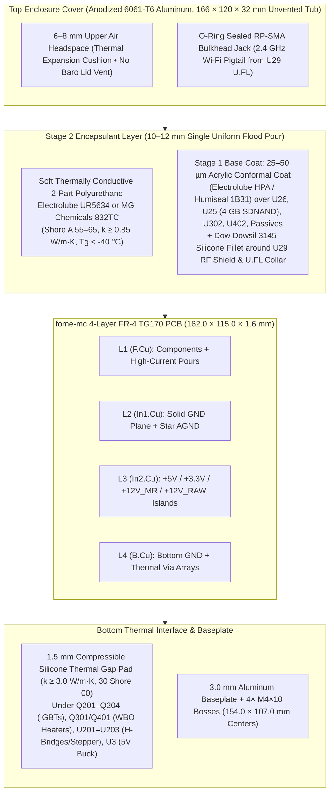
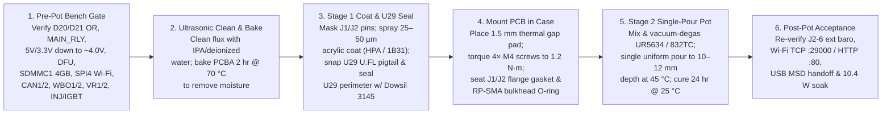

# Enclosure, Thermal Stackup & Encapsulation (Potting) Guide

This guide specifies the mechanical enclosure, `10.44 W` continuous (`12.74 W` peak) thermal dissipation path, and two-stage single-pour flood encapsulation process for **`fome-mc`** (`FOMEMC-1`, `FOMEMC-2`, `FOMEMC-3`).

---

## 1. Enclosure & Mechanical Stackup Diagram

---

## 2. Worst-Case Thermal Dissipation Budget (`10.44 W` Continuous / `12.74 W` Peak)

| Subsystem | Active Devices | Continuous Cruise (`4,000 RPM`) | Continuous Redline (`10,500 RPM`) | Cold-Start Peak (`< 15 s`) | Primary Heat Path |
| :--- | :--- | :---: | :---: | :---: | :--- |
| **Dual Wideband Heaters** | `Q301`, `Q401` (`VND14NV04`) + freewheeling diodes | `0.60 W` | `0.80 W` | `4.10 W` | Thermal vias under DPAK tabs $\to$ `B.Cu` $\to$ `1.5 mm` gap pad |
| **4× Ignition IGBTs** | `Q201..Q204` (`FGD3040G2-F085`) + `U42, U43` (`MIC4427`) | `1.40 W` (`0.7 W` in 2-coil mode) | `4.25 W` | `1.60 W` | Left-wing DPAK copper pours + thermal vias $\to$ `B.Cu` $\to$ gap pad |
| **Injectors, Aux & Main Relay LS** | `U1001..U1202` (`6× VNLD5090`) + `D201..D209` (`B340A-13-F`) | `0.65 W` | `0.78 W` | `0.90 W` | `In1.Cu`/`B.Cu` `GND` planes + polyurethane top conduction |
| **Stepper (`ISC`) & Dual H-Bridge (`STVA`)** | `U202` (`DRV8825PWPR`) + `U201, U203` (`TLE9201SG`) | `1.00 W` | `1.12 W` | `2.35 W` | Exposed thermal pads (`HTSSOP-28` / `PG-DSO-12`) $\to$ `B.Cu` $\to$ gap pad |
| **Power Supply & Keep-Alive** | `D20/D21` (`B340A-13-F`), `Q1` (`AO4485`), `U3` (`LMR16020PDDAR`), `U1, U2` (`TLS115D0E`), `U6` (`TLV75733PDBVR`), `U41` (`MIC5205`), `U309, U409` (`XC6206`) | `1.85 W` | `2.15 W` | `2.45 W` | `Q1` (`AO4485` `15 mΩ`) eliminates `~0.7 W` series Schottky loss; exposed pads on `U3, U1, U2` stitched to `GND` |
| **3× MCUs, Wi-Fi, SDNAND & CAN** | `U26` (`STM32H753`), `U302, U402` (`STM32F042`), `U29` (`ATWINC1500-MR210UB`), `U25` (`CSNP32GCR01-AOW` 4 GB), `U4, U5` (`MCP2551-I-SN`), `U307, U407` (`TJA1051T/3`) | `1.30 W` | `1.34 W` | `1.34 W` | `In1.Cu` `GND` plane + top polyurethane conduction |
| **Total Board Dissipation** | **All Subsystems** | **`6.80 W`** | **`10.44 W`** | **`12.74 W`** | **Max $\Delta T_{\text{internal-case}} < 9\,^\circ\text{C}$ across `1.5 mm` pad + potting** |

---

## 3. Single-Pour Flood Potting (`FOMEMC-1`) & Wi-Fi Pigtail Sealing (`FOMEMC-2`)

1. **Default Potted Production Build (`FOMEMC-1` — Single-Pour Flood Potting + External GM/Delphi 1-Bar Sensor)**:
   - Wire an external **GM `12614970` / Delphi `PS10150` 1-bar sensor** (`MT_GM_1_BAR`, `10–105 kPa`) to `J1-29` (`5V_SENSOR_1`), `J1-31` (`SGND`), and `J2-6` (`AV3_BARO_MAP2` / `PA2` `EFI_ADC_2`).
   - Leave `U24` (`LPS25HBTR`) unpopulated (`DNP`) and flood-pot the entire enclosure in a **single uniform pour** with **no cylindrical barometer dam and no ePTFE lid vent hole**, achieving a 100% solid encapsulated assembly with zero bond-line capillary wicking risk.
2. **`U29` (`ATWINC1500-MR210UB`) U.FL Coaxial Pigtail & Shield Perimeter Sealing (`FOMEMC-2`)**:
   - Because the CNC 6061-T6 aluminum enclosure blocks internal 2.4 GHz RF, `U29` uses the **`ATWINC1500-MR210UB`** (`LCSC C1558703`) with an integral U.FL receptacle routed via an O-ring-sealed U.FL-to-RP-SMA bulkhead pigtail through the enclosure wall.
   - Per Microchip `DS70005304C` Section 12.4, the `ATWINC1500-MR210UB` metal RF shield and U.FL connector are not hermetically sealed. Before pouring Stage 2 polyurethane, snap the U.FL pigtail onto `U29`, strain-relieve the coax lead, and apply a continuous fillet of neutral-cure alkoxy silicone (**`Dow Dowsil 3145`** or **`Momentive RTV162`**) around the `U29` shield perimeter and U.FL mating collar.
3. **Optional Unpotted Bench Build**:
   - Populate `U24` (`LPS25HBTR`, `C87898` at `121.62, 100.61 mm` on `I2C2` `PB10/PB11`) and assign `PB10/PB11` in TunerStudio when running an unpotted board on the bench without an external barometer.

---

## 4. Step-by-Step Encapsulation Workflow

