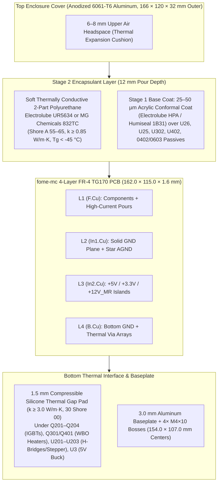
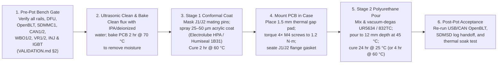

# Enclosure, Thermal Stackup & Encapsulation (Potting) Guide

This guide specifies the mechanical enclosure, thermal dissipation path, and two-stage selective encapsulation process for **`fome-mc`**.

---

## 1. Enclosure & Mechanical Stackup Diagram

---

## 2. Worst-Case Thermal Dissipation Budget (`13.4 W` Total)

| Subsystem | Active Devices | Continuous Cruise (`4,000 RPM`) | Worst-Case Redline (`10,500 RPM`) | Primary Heat Path |
| :--- | :--- | :---: | :---: | :--- |
| **Dual Wideband Heaters** | `Q301`, `Q401` (`VND14NV04`) + `D201..208` | `0.7 W` | `1.8 W` | Thermal vias under DPAK tabs $\to$ `B.Cu` $\to$ `1.5 mm` gap pad |
| **4× Ignition IGBTs** | `Q201..Q204` (`FGD3040G2-F085C`) | `1.6 W` (`0.8 W` in 2-coil mode) | `4.2 W` | Left-wing DPAK copper pours + thermal vias $\to$ `B.Cu` $\to$ gap pad |
| **Injectors & Low-Side Switches** | `U1001..U1202` (`VNLD5090TR-E`) | `0.8 W` | `1.9 W` | `In1.Cu`/`B.Cu` `GND` planes + polyurethane top conduction |
| **Stepper (`ISC`) & Dual H-Bridge (`STVA`)** | `U202` (`DRV8825`) + `U201, U203` (`TLE9201SG`) | `1.4 W` | `2.4 W` | Exposed thermal pads (`HTSSOP-28` / `PG-DSO-12`) $\to$ `B.Cu` $\to$ gap pad |
| **Power Supply (`VBoost`, `5V`, `LDOs`)** | `U46`, `L3`, `U3` (`LMR14020`), `U1, U2` (`TLS115D0E`), `U13` (`BD3571`) | `1.3 W` | `2.1 W` | Top-edge power copper pours + thermal vias $\to$ `B.Cu` |
| **3× MCUs & Transceivers** | `U26` (`STM32H753`), `U302, U402` (`STM32F042`), `U4, U5, U200` (`TJA1051`) | `0.9 W` | `1.0 W` | `In1.Cu` `GND` plane + top polyurethane conduction |
| **Total Board Dissipation** | **All Subsystems** | **`6.7 W`** | **`13.4 W`** | **Max $\Delta T_{j\text{-case}} < 9\,^\circ\text{C}$ across `1.5 mm` pad + potting** |

---

## 3. Barometric Sensor Strategy: Single-Pour Flood Potting vs. Unpotted Chimney Dam

As tracked in Plane work item **`FOMEMC-1`**:

1. **Recommended Potted Production Build (Single-Pour Flood Potting + External GM/Delphi 1-Bar Sensor)**:
   - Wire an external **GM `12614970` / Delphi `PS10150` 1-bar sensor** (`MT_GM_1_BAR`, `10–105 kPa`) to `J1-29` (`5V_SENSOR_1`), `J1-31` (`SGND`), and `J2-6` (`MAP2_REAR` / `PA2` `EFI_ADC_2`).
   - Leave `U24` (`LPS25HBTR`) unpopulated (`DNP`) or pot directly over it with **no chimney dam and no lid vent hole**, achieving a 100% solid, single-pour potted enclosure with zero capillary wicking risk.
2. **Unpotted / Bench Build (or Vented Chimney Dam Build)**:
   - Populate `U24` (`LPS25HBTR`, `C87898` at `121.62, 100.61 mm` on `I2C2` `PB10/PB11`). If potting with `U24` active, bond an `ID 8.0 mm × OD 11.0 mm` silicone/ABS chimney dam around `U24` prior to pouring Stage 2 polyurethane and vent the pocket through an `M6×0.75` **Amphenol LTW `VE80410`** or **Gore `PMF100321`** hydrophobic ePTFE membrane in the top lid.

---

## 4. Step-by-Step Encapsulation Workflow

