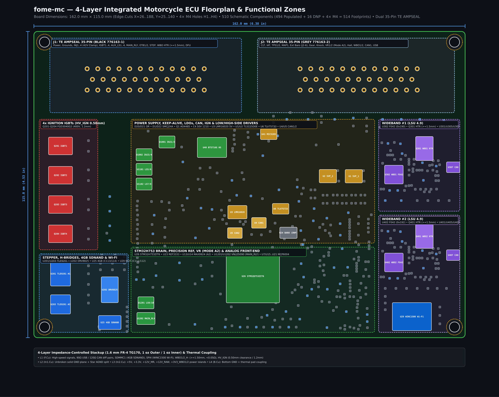
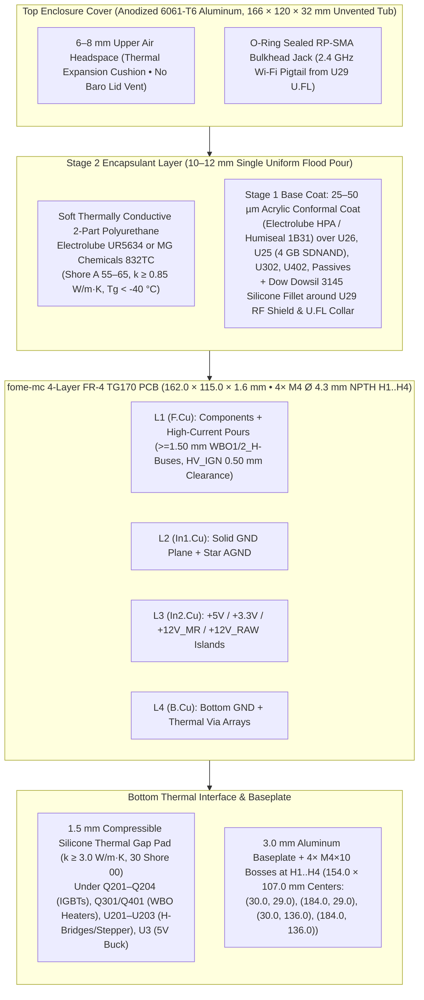
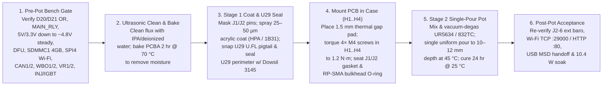

# Enclosure, Thermal Stackup & Encapsulation (Potting) Guide

This guide specifies the mechanical enclosure, `10.44 W` continuous (`12.74 W` peak) thermal dissipation path, and two-stage single-pour flood encapsulation process for **`fome-mc`** (`FOMEMC-1`, `FOMEMC-2`, `FOMEMC-3`).

---

## 1. Enclosure & Mechanical Stackup Diagram

---

## 2. Worst-Case Thermal Dissipation Budget (`10.44 W` Continuous / `12.74 W` Peak)

| Subsystem | Active Devices | Continuous Cruise (`4,000 RPM`) | Continuous Redline (`10,500 RPM`) | Cold-Start Peak (`< 15 s`) | Primary Heat Path |
| :--- | :--- | :---: | :---: | :---: | :--- |
| **Dual Wideband Heaters (`FOMEMC-16`, `FOMEMC-26`)** | `Q301`, `Q401` (`VND14NV04`) + freewheeling diodes + wide (`>= 1.50 mm`) `/WBO1_H-` & `/WBO2_H-` copper buses | `0.60 W` | `0.80 W` | `4.10 W` | Thermal vias under DPAK tabs $\to$ `F.Cu`/`B.Cu` heat-spreader zones + wide (`>= 1.50 mm`, `< 0.05 Ω`/ch) copper buses to `J1-23`/`J1-25` (`< 0.13 W` trace loss @ `1.6 A RMS`, `< 0.45 W` @ `3.0 A` peak) $\to$ `1.5 mm` gap pad |
| **4× Ignition IGBTs** | `Q201..Q204` (`FGD3040G2-F085` `C606124` in `/ign_igbt/`) + `U42, U43` (`MIC4427` `C171845` in `/ign1/`) | `1.40 W` (`0.7 W` in 2-coil mode) | `4.25 W` | `1.60 W` | Left-wing DPAK copper pours (`HV_IGN` `0.50 mm` clearance netclass across all 4 layers) + thermal vias $\to$ `B.Cu` $\to$ gap pad |
| **Injectors, Aux & Main Relay LS** | `U1001..U1202` (`6× VNLD5090` `C222209`) + `3× 74HCT125D` (`C5947`) + `D201..D204` (**DNP**) + `D205..D209` (`B340A-13-F` `C64982`) | `0.65 W` | `0.78 W` | `0.90 W` | `In1.Cu`/`B.Cu` `GND` planes + polyurethane top conduction (`INJ1..4` demagnetize via `42 V` internal active Zener clamp in `~0.83 ms`) |
| **Stepper (`ISC`) & Dual H-Bridge (`STVA`)** | `U202` (`DRV8825PWPR` `C50506`, `0.77 A`) + `U201, U203` (`TLE9201SG` `C112633`) | `1.00 W` | `1.12 W` | `2.35 W` | Exposed thermal pads (`HTSSOP-28` / `PG-DSO-12`) $\to$ `B.Cu` $\to$ gap pad |
| **Power Supply & Keep-Alive** | `D20/D21` (`B340A-13-F` `C64982`), `Q1` (`AO4485` `C51499`), `U3` (`LMR16020PDDAR` `C190006`), `U1, U2` (`TLS115D0E` `C3747428`), `U6` (`TLV75733PDBVR` `C485517`), `U41` (`MIC5205` `C5370979`), `U309, U409` (`XC6206` `C5446`) | `1.85 W` | `2.15 W` | `2.45 W` | `Q1` (`AO4485` `15 mΩ`) eliminates `~0.7 W` series Schottky loss; exposed pads on `U3, U1, U2` stitched to `GND`; Murata `GCJ` soft-term 50 V X7R MLCCs (`C4` `1210` `4.7 µF`, `C2/C5/C7` `0805` `1 µF`, `C8` `10 nF`, `C10` `100 nF`) prevent potting flex cracks |
| **3× MCUs, Wi-Fi, SDNAND & CAN** | `U26` (`STM32H753`), `U302, U402` (`STM32F042`), `U29` (`ATWINC1500-MR210UB` + `C111/C112`), `U25` (`CSNP32GCR01-AOW` 4 GB + `C113/C114`), `U4, U5` (`MCP2551-I-SN`), `U307, U407` (`TJA1051T/3`) | `1.30 W` | `1.34 W` | `1.34 W` | `In1.Cu` `GND` plane + `U29` `Pad 29` (`3.7 × 3.7 mm`) 2×2 thermal/GND vias + top polyurethane conduction |
| **Total Board Dissipation** | **All Subsystems** | **`6.80 W`** | **`10.44 W`** | **`12.74 W`** | **Max $\Delta T_{\text{internal-case}} < 9\,^\circ\text{C}$ across `1.5 mm` pad + potting** |

---

## 3. Single-Pour Flood Potting (`FOMEMC-1`), `H1..H4` Corner Mounting (`FOMEMC-27`) & Wi-Fi Pigtail Sealing (`FOMEMC-2`, `FOMEMC-18`)

1. **Default Potted Production Build (`FOMEMC-1` — Single-Pour Flood Potting + External GM/Delphi 1-Bar Sensor)**:
   - Wire an external **GM `12614970` / Delphi `PS10150` 1-bar sensor** (`MT_GM_1_BAR`, `10–105 kPa`) to `J1-29` (`5V_SENSOR_1`), `J1-31` (`GND`), and `J2-6` (`AV3_BARO_MAP2` / `PA2` `EFI_ADC_2`).
   - Leave `U24` (`LPS25HBTR`) unpopulated (`DNP`) and flood-pot the entire enclosure in a **single uniform pour** with **no cylindrical barometer dam and no ePTFE lid vent hole**, achieving a 100% solid encapsulated assembly with zero bond-line capillary wicking risk.
2. **4× `M4` Corner Mounting Holes `H1..H4` (`FOMEMC-27`)**:
   - `fome-mc.kicad_pcb` includes 4× `M4` (`Ø 4.3 mm` NPTH) corner mounting holes **`H1..H4`** at `(30.0, 29.0)`, `(184.0, 29.0)`, `(30.0, 136.0)`, and `(184.0, 136.0)` (`154.0 × 107.0 mm` centers on the `162.0 × 115.0 mm` board, `4.0 mm` inset from the `Edge.Cuts` outline `X = 26.0..188.0`, `Y = 25.0..140.0`). These align directly with the 4× `M4×10` standoffs machined into the `3.0 mm` aluminum baseplate and compress the `1.5 mm` silicone thermal gap pad uniformly under `Q201..Q204`, `Q301/Q401`, `U201..U203`, and `U3`.
   - **Enclosure Cutout & Potting Resin Volume**: Machine a `127.0 × 27.5 mm` front wall aperture (`4× M3` flange mount holes) on the north (`Y = 25.0 mm`) wall for the dual `J1/J2` 70-pin header (`776267-1` + `776267-2`, centered at `X = 103.5 mm`, `Y = 39.2 mm`) and a `Ø 6.5 mm` (`1/4-36 UNS` D-flat) bulkhead hole on the south/east wall for the O-ring-sealed RP-SMA jack (`110 mm` `1.13 mm` coax pigtail). A single-pour polyurethane fill to `10–12 mm` depth above `F.Cu` requires **`~160–190 mL` (`~240–285 g`)** of mixed resin (`Electrolube UR5634` or `MG Chemicals 832TC`).
3. **`U29` (`ATWINC1500-MR210UB`) Placement (`166.0, 131.5 mm`, Rotated `90°`), U.FL Pigtail & Shield Sealing (`FOMEMC-2`, `FOMEMC-18`, `FOMEMC-27`)**:
   - Because the CNC 6061-T6 aluminum enclosure blocks internal 2.4 GHz RF, `U29` uses the **`ATWINC1500-MR210UB`** (`LCSC C1558703`, placed at **`(166.0, 131.5 mm)` rotated `90°`** to provide `> 4.0 mm` clearance to `H4` at `(184.0, 136.0)`, `14.73 × 21.72 mm` `DS70005304F` land pattern with `3.7 × 3.7 mm` `Pad 29` ground paddle, 2×2 thermal/GND vias, and `C111 = 10 µF` / `C112 = 10 nF` bypass caps `< 2 mm` from Pin 24 `1P3V_TP`) with an integral U.FL receptacle routed via an O-ring-sealed U.FL-to-RP-SMA bulkhead pigtail through the enclosure wall.
   - Per Microchip `DS70005304F` Section 12.4, the `ATWINC1500-MR210UB` metal RF shield and U.FL connector are not hermetically sealed. Before pouring Stage 2 polyurethane, snap the U.FL pigtail onto `U29`, strain-relieve the coax lead, and apply a continuous fillet of neutral-cure alkoxy silicone (**`Dow Dowsil 3145`** or **`Momentive RTV162`**) around the `U29` shield perimeter and U.FL mating collar.
4. **Optional Unpotted Bench Build**:
   - Populate `U24` (`LPS25HBTR`, `C87898` at `121.62, 100.61 mm` on `I2C2` `PB10/PB11`) and assign `PB10/PB11` in TunerStudio when running an unpotted board on the bench without an external barometer.

---

## 4. Step-by-Step Encapsulation Workflow

