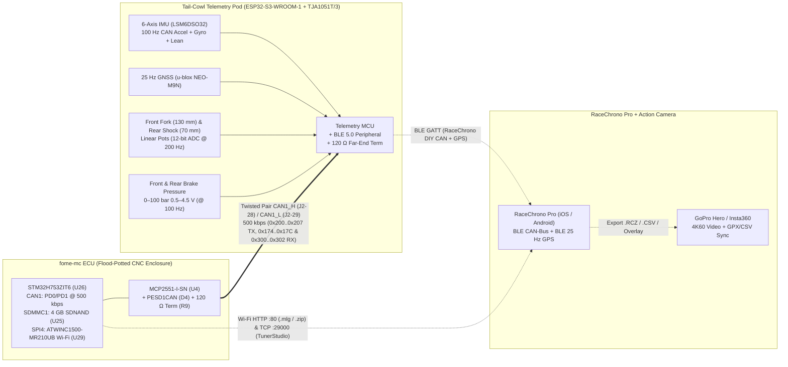

# CAN1 Motorsport Telemetry Pod, RaceChrono Pro & Action Camera Integration (`fome-mc`)

The pod requirements are fixed by [telemetry-pod/REQUIREMENTS.md](../telemetry-pod/REQUIREMENTS.md), revision 2 (2026-10-18), sha256 `09e02c8d9471aabfa5d25935c87f436370cf1be367a96425b35305a53ce93493`.

This guide defines the bidirectional **`CAN1` (`J2-28` / `J2-29`, 500 kbps)** motorsport telemetry architecture for **`fome-mc`** on a 2007 Suzuki SV650 (K7), linking:

1. **`fome-mc` ECU (`CAN1` Bus 0)** — broadcasts `FOME_CAN_verbose.dbc` (`0x200..0x207`) at **50 Hz (`20 ms`)** and records full-rate **100–500 Hz** `.mlg` logs to the onboard 4 GB soldered SDNAND (`U25`).
2. **Tail-Cowl Chassis Telemetry Pod (`CAN1` Node)** — samples a 6-axis MEMS IMU (`AccelLat`, `AccelLon`, `AccelVert`, `YawRate`, `RollRate`, `LeanAngle`), a **25 Hz** multi-constellation GNSS receiver (u-blox NEO-M9N), **200 Hz** front fork (`130 mm`) & rear shock (`70 mm`) linear potentiometers, and **100 Hz** front & rear hydraulic brake pressure transducers (`0–100 bar`), publishing them onto `CAN1` for both the ECU (`.mlg` SD logging) and **RaceChrono Pro** (via BLE CAN-Bus + BLE GPS).
3. **RaceChrono Pro & Action Cameras (GoPro / Insta360)** — synchronizes 25 Hz GPS lap timing, 50–100 Hz ECU + chassis CAN channels, and high-frame-rate onboard video overlays.

---

## 1. System Topology & Physical Bus Wiring

`fome-mc` separates its two high-speed CAN buses (`MCP2551-I-SN`, `U4` and `U5` on `sheets/psu.kicad_sch`) by function:

- **`CAN1` (Bus 0, `PD0/PD1`, `U4` `MCP2551-I-SN`)** on **`J2-28` (`CAN1_H`)** and **`J2-29` (`CAN1_L`)**: Dedicated external **500 kbps** motorsport telemetry, dash, and OpenBLT (`0x667`) bus. Protected by `D4` (`PESD1CAN-UX`) with an onboard `120 Ω` termination resistor (`R9`) at the ECU end of the harness.
- **`CAN2` (Bus 1, `PB12/PB13`, `U5` `MCP2551-I-SN`)**: Dedicated **internal 500 kbps** PCB bus connecting `U26` (`STM32H753ZIT6`) to the two onboard `STM32F042K6T6` LSU 4.9 wideband controllers (`WBO1` Front `0x190/0x191` via `U307` `TJA1051T/3`, `WBO2` Rear `0x192/0x193` via `U407` `TJA1051T/3`) with single `120 Ω` termination (`R10`).



### Harness Pinout for the Tail-Cowl Telemetry Pod

| Signal | `fome-mc` Reference / Harness Tap | Wire Color / Gauge | Destination / Notes |
|---|---|---|---|
| `CAN1_H` | `J2-28` | White / 20–22 AWG | Twisted pair (`30–40 twists/m`) to Telemetry Pod `CAN_H` |
| `CAN1_L` | `J2-29` | Blue / 20–22 AWG | Twisted pair (`30–40 twists/m`) to Telemetry Pod `CAN_L` (`120 Ω` resistor at Pod end) |
| `+12V_MR` (Switched 12 V Relay Splice) | Harness splice on `R/Y` main relay circuit (circuit that also feeds `J1-27` ECU input; **never draw from ECU**) | Red/Yellow / 20 AWG | **"Harness splice on the relay circuit, own 2 A fuse"** (owner decision, 2026-10-18): switched `+12 V` supply for Telemetry Pod & GNSS (`J1-27` is an ECU input into `D21` OR `12V_RAW`) |
| `CHASSIS_ECU_GND` | Chassis ground shared with `J1-34` (`CHASSIS_ECU_GND`) | Black/White / 20 AWG | Telemetry Pod power & logic ground returned to chassis ground with the ECU (`J1-34` is `CHASSIS_ECU_GND`) |
| `5V_SENSOR_2` / `SGND` (Not Used by Pod) | `J1-30` / `J1-31` (Unused by Telemetry Pod) | — | **Not connected to Telemetry Pod**: the pod never draws from the ECU and regulates its own local `5.00 V ± 1%` (`200 mA`) ratiometric sensor supply and return for the `130 mm` front fork pot, `70 mm` rear shock pot, and front/rear brake pressure transducers |

> **Owner Decision (2026-10-18, `FOMEMC-31` / `pod-45`)**: Power source: **"Harness splice on the relay circuit, own 2 A fuse"**; travel ranges: **"130 and 70 mm"** (**"Harness splice on the relay circuit, own 2 A fuse; 130 and 70 mm"**). Because `J1-27` (`+12V_MR`) is an ECU power input (`D21` `B340A-13-F` Schottky OR into `12V_RAW`), the telemetry pod taps the switched 12 V main relay output (`R/Y` circuit that also feeds `J1-27`) on the harness side through its own `2 A` fuse and grounds to chassis with the ECU (`CHASSIS_ECU_GND`, `J1-34`); the pod never draws from the ECU (`J1-27` or `J1-30` `5V_SENSOR_2`). Suspension potentiometer travel ranges are **130 mm** front fork and **70 mm** rear shock (`0x300`).

---

## 2. ECU -> Telemetry Pod / RaceChrono (`CAN1` TX: `0x200..0x207`)

By default in `firmware/config/boards/fome-mc/board_configuration.cpp`, `fome-mc` enables **50 Hz (`20 ms`)** `FOME_CAN_verbose.dbc` broadcast on `CAN1` (`Bus 0`):

- `engineConfiguration->canBaudRate = B500KBPS;`
- `engineConfiguration->enableVerboseCanTx = true;`
- `engineConfiguration->canBroadcastUseChannelTwo = canBroadcast_e::first;`
- `engineConfiguration->verboseCanBaseAddress = 0x200;` (`512` decimal)
- `engineConfiguration->canSleepPeriodMs = 20;` (`50 Hz`)

### Complete `CAN1` ECU Broadcast Frame Map (`0x200..0x207`, Little-Endian / Intel)

| CAN ID (Hex / Dec) | Frame Name | Byte Offset | Bit Start / Length | Type | Scale / Offset | Units | Channel & RaceChrono Equation |
|---|---|---|---|---|---|---|---|
| `0x200` (`512`) | `BASE0` (`Status`) | `0..1` | `0 \| 16` | `uint16` | `1.0` | count | `WarningCounter`: `bytesToUIntLe(raw, 0, 2)` |
| `0x200` (`512`) | `BASE0` (`Status`) | `2..3` | `16 \| 16` | `uint16` | `1.0` | code | `LastError`: `bytesToUIntLe(raw, 2, 2)` |
| `0x200` (`512`) | `BASE0` (`Status`) | `4` | `32..39 \| 1` | `bitfield` | `1` | bool | Bit 0: `RevLimAct`, Bit 1: `MainRelay`, Bit 2: `FuelPump`, Bit 3: `CEL`, Bit 4: `EGOHeat`, Bit 5: `LambdaProtect`, Bit 6: `Fan1`, Bit 7: `Fan2` |
| `0x200` (`512`) | `BASE0` (`Status`) | `5` | `40 \| 8` | `uint8` | `1.0` | gear | **`CurrentGear`** (`0=N, 1..6=Gear`): `bytesToUInt(raw, 5, 1)` |
| `0x200` (`512`) | `BASE0` (`Status`) | `6..7` | `48 \| 16` | `uint16` | `0.1` | `km` | `DistanceTraveled`: `bytesToUIntLe(raw, 6, 2) * 0.1` |
| `0x201` (`513`) | `BASE1` (`Speeds`) | `0..1` | `0 \| 16` | `uint16` | `1.0` | `RPM` | **`RPM`**: `bytesToUIntLe(raw, 0, 2)` |
| `0x201` (`513`) | `BASE1` (`Speeds`) | `2..3` | `16 \| 16` | `int16` | `0.02` | `deg` | **`IgnitionTiming` (BTDC)**: `bytesToIntLe(raw, 2, 2) * 0.02` |
| `0x201` (`513`) | `BASE1` (`Speeds`) | `4` | `32 \| 8` | `uint8` | `0.5` | `%` | **`InjDuty`**: `bytesToUInt(raw, 4, 1) * 0.5` |
| `0x201` (`513`) | `BASE1` (`Speeds`) | `5` | `40 \| 8` | `uint8` | `0.5` | `%` | `IgnDuty`: `bytesToUInt(raw, 5, 1) * 0.5` |
| `0x201` (`513`) | `BASE1` (`Speeds`) | `6` | `48 \| 8` | `uint8` | `1.0` | `km/h` | **`VehicleSpeed` (Front Wheel VSS)**: `bytesToUInt(raw, 6, 1) / 3.6` (m/s in RaceChrono) |
| `0x202` (`514`) | `BASE2` (`PedalAndTps`) | `2..3` | `16 \| 16` | `int16` | `0.01` | `%` | **`TPS1` (Primary Throttle)**: `bytesToIntLe(raw, 2, 2) * 0.01` |
| `0x202` (`514`) | `BASE2` (`PedalAndTps`) | `4..5` | `32 \| 16` | `int16` | `0.01` | `%` | **`TPS2` (Secondary Throttle `STPS`)**: `bytesToIntLe(raw, 4, 2) * 0.01` |
| `0x203` (`515`) | `BASE3` (`Sensors1`) | `0..1` | `0 \| 16` | `uint16` | `1/30` (`0.03333`) | `kPa` | **`MAP` (Front IAP/MAP)**: `bytesToUIntLe(raw, 0, 2) / 30.0` |
| `0x203` (`515`) | `BASE3` (`Sensors1`) | `2` | `16 \| 8` | `uint8` | `1.0`, offset `-40` | `°C` | **`CoolantTemp` (`CLT`)**: `bytesToUInt(raw, 2, 1) - 40` |
| `0x203` (`515`) | `BASE3` (`Sensors1`) | `3` | `24 \| 8` | `uint8` | `1.0`, offset `-40` | `°C` | **`IntakeTemp` (`IAT`)**: `bytesToUInt(raw, 3, 1) - 40` |
| `0x203` (`515`) | `BASE3` (`Sensors1`) | `6` | `48 \| 8` | `uint8` | `1.0`, offset `-40` | `°C` | **`MCUTemp` (`STM32H753`)**: `bytesToUInt(raw, 6, 1) - 40` |
| `0x204` (`516`) | `BASE4` (`Sensors2`) | `2..3` | `16 \| 16` | `uint16` | `1/30` (`0.03333`) | `kPa` | `OilPress`: `bytesToUIntLe(raw, 2, 2) / 30.0` |
| `0x204` (`516`) | `BASE4` (`Sensors2`) | `6..7` | `48 \| 16` | `uint16` | `0.001` | `V` | **`BattVolt` (`VBatt`)**: `bytesToUIntLe(raw, 6, 2) * 0.001` |
| `0x205` (`517`) | `BASE5` (`Fueling`) | `0..1` | `0 \| 16` | `uint16` | `1.0` | `mg` | `CylAM` (Cylinder Airmass): `bytesToUIntLe(raw, 0, 2)` |
| `0x205` (`517`) | `BASE5` (`Fueling`) | `4..5` | `32 \| 16` | `uint16` | `1/300` (`0.003333`) | `ms` | **`InjPW` (Injector PulseWidth)**: `bytesToUIntLe(raw, 4, 2) / 300.0` |
| `0x205` (`517`) | `BASE5` (`Fueling`) | `6..7` | `48 \| 16` | `uint16` | `1.0` | count | **`KnockCt` (Knock Count)**: `bytesToUIntLe(raw, 6, 2)` |
| `0x206` (`518`) | `BASE6` (`Fueling2`) | `4..5` | `32 \| 16` | `int16` | `0.01` | `%` | `FuelTrim1` (Front STFT): `bytesToIntLe(raw, 4, 2) * 0.01` |
| `0x206` (`518`) | `BASE6` (`Fueling2`) | `6..7` | `48 \| 16` | `int16` | `0.01` | `%` | `FuelTrim2` (Rear STFT): `bytesToIntLe(raw, 6, 2) * 0.01` |
| `0x207` (`519`) | `BASE7` (`Fueling3`) | `0..1` | `0 \| 16` | `uint16` | `0.0001` | `λ` | **`Lam1` (Front Cyl #1 LSU 4.9 `WBO1`)**: `bytesToUIntLe(raw, 0, 2) * 0.0001` |
| `0x207` (`519`) | `BASE7` (`Fueling3`) | `2..3` | `16 \| 16` | `uint16` | `0.0001` | `λ` | **`Lam2` (Rear Cyl #2 LSU 4.9 `WBO2`)**: `bytesToUIntLe(raw, 2, 2) * 0.0001` |

---

## 3. Telemetry Pod -> ECU & RaceChrono (`CAN1` RX: `0x174..0x17C` & `0x300..0x302`)

To ensure that **both** the ECU's internal `.mlg` SDNAND logs and **RaceChrono Pro** capture the exact same chassis dynamics, the Tail-Cowl Telemetry Pod transmits two groups of frames on `CAN1`:

### 3.1 Native FOME 6-Axis IMU Frames (`0x174`, `0x178`, `0x17C` @ 100 Hz)

`fome-mc` sets `engineConfiguration->imuType = IMU_MM5_10` by default (`can_imu.cpp:168-176`), which natively decodes the standard Bosch Motorsport MM5.10 CAN IDs into FOME's built-in `AccelLat`, `AccelLon`, `AccelVert`, and `YawRate` sensors with zero Lua overhead:

| CAN ID (Hex / Dec) | Frame Rate | Byte `0..1` (`uint16_le - 0x8000`) | Byte `4..5` (`uint16_le - 0x8000`) | FOME Internal Sensor | RaceChrono Equation |
|---|---|---|---|---|---|
| `0x174` (`372`) | `100 Hz` | `YawRate`: `(raw_u16 - 32768) * 0.005` (`°/s`) | `AccelLat` (Y): `(raw_u16 - 32768) * 0.0001274` (`G`) | `SensorType::YawRate`, `SensorType::AccelLat` | Yaw: `(bytesToUIntLe(raw,0,2)-32768)*0.005`<br/>LatG: `(bytesToUIntLe(raw,4,2)-32768)*0.0001274` |
| `0x178` (`376`) | `100 Hz` | `RollRate`: `(raw_u16 - 32768) * 0.005` (`°/s`) | `AccelLon` (X): `(raw_u16 - 32768) * 0.0001274` (`G`) | `SensorType::AccelLon` | RollRate: `(bytesToUIntLe(raw,0,2)-32768)*0.005`<br/>LonG: `(bytesToUIntLe(raw,4,2)-32768)*0.0001274` |
| `0x17C` (`380`) | `100 Hz` | `PitchRate`: `(raw_u16 - 32768) * 0.005` (`°/s`) | `AccelVert` (Z): `(raw_u16 - 32768) * 0.0001274` (`G`) | `SensorType::AccelVert` | PitchRate: `(bytesToUIntLe(raw,0,2)-32768)*0.005`<br/>VertG: `(bytesToUIntLe(raw,4,2)-32768)*0.0001274` |

### 3.2 Chassis Suspension, Brake Pressure & Lean Angle Frames (`0x300..0x302`)

Because `fome-mc`'s six 0–5 V analog inputs on `J2-3..J2-8` (`TPS1` `PA1`, `TPS2_STPS` `PA3`, `MAP1_FRONT` `PA0`, `AV3_BARO_MAP2` `PA2` external 1-bar barometer, `AV5_TIPOVER` `PA4`, and `AV6_GEAR` `PA5`) are dedicated to engine and SV650 chassis sensors, wiring the rear shock linear potentiometer, front fork linear potentiometer, and front/rear hydraulic brake pressure transducers to the tail-cowl `CAN1` telemetry pod keeps high-rate chassis analog wiring short and feeds both RaceChrono Pro and the ECU over `CAN1`:

| CAN ID (Hex / Dec) | Rate | Bytes `0..1` (`int16_le`) | Bytes `2..3` (`int16_le`) | Bytes `4..5` (`int16_le`) | Bytes `6..7` (`int16_le`) |
|---|---|---|---|---|---|
| `0x300` (`768`) | `200 Hz` | **`FrontForkTravel`** (`0.01 mm/LSB`, `0..130.00 mm`) | **`RearShockTravel`** (`0.01 mm/LSB`, `0..70.00 mm`) | `FrontForkVel` (`1 mm/s/LSB`) | `RearShockVel` (`1 mm/s/LSB`) |
| `0x301` (`769`) | `100 Hz` | **`FrontBrakePress`** (`0.01 bar/LSB`, `0..100.00 bar`) | **`RearBrakePress`** (`0.01 bar/LSB`, `0..100.00 bar`) | **`LeanAngle`** (`0.01 deg/LSB`, `-65..+65°`) | **`PitchAngle`** (`0.01 deg/LSB`, `-45..+45°`) |
| `0x302` (`770`) | `25 Hz` | **`GpsSpeedKph`** (`0.01 km/h/LSB`) | `GpsHeadingDeg` (`0.01 deg/LSB`) | `GpsAltitudeM` (`0.1 m/LSB`) | `GpsSatsAndFix` (low byte sats, high byte fix) |

### 3.3 FOME Lua Script for Ingesting `0x300..0x301` into ECU `.mlg` Logs

Paste the following script into TunerStudio (**Scripting -> Lua Scripting**) to log Front/Rear Brake Pressure (`AuxLinear1`, `AuxLinear2`), Front Fork (`0..130.00 mm`) / Rear Shock (`0..70.00 mm`) Travel (`AuxLinear3`, `AuxLinear4`), and Lean / Pitch Angle (`LuaGauge1`, `LuaGauge2`) inside the ECU's `.mlg` SDNAND logs alongside engine RPM, TPS, Lambda, and Knock:

```lua
-- FOME-MC CAN1 Telemetry Pod Receiver (0x300 Suspension Travel [130 and 70 mm], 0x301 Brake Pressure & Lean/Pitch Angle)
local sForkTravel  = Sensor.new("AuxLinear3") -- mm (Front Fork Travel, 0..130.00 mm)
local sShockTravel = Sensor.new("AuxLinear4") -- mm (Rear Shock Travel, 0..70.00 mm)
local sFrontBrake  = Sensor.new("AuxLinear1") -- bar (Front Brake Pressure, 0..100.00 bar)
local sRearBrake   = Sensor.new("AuxLinear2") -- bar (Rear Brake Pressure, 0..100.00 bar)
local sLeanAngle   = Sensor.new("LuaGauge1")  -- deg (Lean Angle, -65..+65 deg)
local sPitchAngle  = Sensor.new("LuaGauge2")  -- deg (Pitch Angle, -45..+45 deg)

sForkTravel:setTimeout(250)
sShockTravel:setTimeout(250)
sFrontBrake:setTimeout(250)
sRearBrake:setTimeout(250)
sLeanAngle:setTimeout(250)
sPitchAngle:setTimeout(250)

local function getInt16Le(data, offset)
  local v = data[offset] + (data[offset + 1] * 256)
  if v >= 32768 then v = v - 65536 end
  return v
end

function onCanSuspension(bus, id, dlc, data)
  if dlc >= 4 then
    sForkTravel:set(getInt16Le(data, 1) * 0.01)
    sShockTravel:set(getInt16Le(data, 3) * 0.01)
  end
end

function onCanBrakesAndLean(bus, id, dlc, data)
  if dlc >= 4 then
    sFrontBrake:set(getInt16Le(data, 1) * 0.01)
    sRearBrake:set(getInt16Le(data, 3) * 0.01)
  end
  if dlc >= 6 then
    sLeanAngle:set(getInt16Le(data, 5) * 0.01)
  end
  if dlc >= 8 then
    sPitchAngle:set(getInt16Le(data, 7) * 0.01)
  end
end

canRxAdd(1, 0x300, onCanSuspension)
canRxAdd(1, 0x301, onCanBrakesAndLean)

function onTick() end
```

> **Bench verification obligation (pod acceptance criterion 8 / `POD-AC-8`, `FOMEMC-31`)**: Load the updated Lua script above on the bench ECU. The `FOMEMC-31` Lua change decodes `0x301` bytes `4..5` into `LuaGauge1` (`LeanAngle`, 1-based offset `5`) and bytes `6..7` into `LuaGauge2` (`PitchAngle`, offset `7`). No C++ firmware change is included in this repository. Verify that the deployed firmware supports these Lua sensors and records lean angle, brake pressure (`AuxLinear1..2`) and suspension travel (`AuxLinear3..4`, 130 mm fork / 70 mm shock) in the ECU's `.mlg` file. Also measure all six required CAN frame rates within 5% of the rates in [revision 2, acceptance criterion 8](../telemetry-pod/REQUIREMENTS.md#acceptance-criteria). This document change does not satisfy the built-board bench criterion.

---

## 4. RaceChrono Pro Configuration

### 4.1 BLE CAN-Bus + 25 Hz GPS Connection

RaceChrono Pro supports two simultaneous data streams from the Tail-Cowl Telemetry Pod (or an off-the-shelf CAN-to-BLE adapter such as **RejsaCAN-ESP32** / **Autosport Labs** / **OBDLink MX+** connected to `J2-28`/`J2-29` + a **RaceBox Mini 25 Hz**):

1. **Add BLE DIY / CAN-Bus Device**:
   - In RaceChrono Pro -> **Settings -> Add other device -> RaceChrono DIY -> Bluetooth LE** (GATT Service `0x00001ff8-0000-1000-8000-00805f9b34fb`, CAN-Bus main characteristic `0x0001`, filter characteristic `0x0002`, GPS characteristic `0x0003` + `0x0004`).
2. **Add Custom CAN-Bus Channels in RaceChrono Pro** (**Vehicle Profile -> CAN-Bus Channels**):

| RaceChrono Channel | PID / CAN ID | Equation |
|---|---|---|
| **Engine RPM** (`rpm`) | `0x201` (`513`) | `bytesToUIntLe(raw, 0, 2)` |
| **Throttle Position** (`throttle_pos`) | `0x202` (`514`) | `bytesToIntLe(raw, 2, 2) * 0.01` |
| **Secondary Throttle (`STPS`)** (`custom`) | `0x202` (`514`) | `bytesToIntLe(raw, 4, 2) * 0.01` |
| **Gear** (`gear`) | `0x200` (`512`) | `bytesToUInt(raw, 5, 1)` |
| **Ignition Advance** (`timing_advance`) | `0x201` (`513`) | `bytesToIntLe(raw, 2, 2) * 0.02` |
| **Manifold Pressure (`MAP`)** (`intake_manifold_pressure`) | `0x203` (`515`) | `bytesToUIntLe(raw, 0, 2) / 30.0` |
| **Coolant Temp (`CLT`)** (`coolant_temp`) | `0x203` (`515`) | `bytesToUInt(raw, 2, 1) - 40` |
| **Intake Air Temp (`IAT`)** (`intake_air_temp`) | `0x203` (`515`) | `bytesToUInt(raw, 3, 1) - 40` |
| **Battery Voltage** (`battery_voltage`) | `0x204` (`516`) | `bytesToUIntLe(raw, 6, 2) * 0.001` |
| **Lambda 1 (Front Cyl)** (`lambda_1`) | `0x207` (`519`) | `bytesToUIntLe(raw, 0, 2) * 0.0001` |
| **Lambda 2 (Rear Cyl)** (`lambda_2`) | `0x207` (`519`) | `bytesToUIntLe(raw, 2, 2) * 0.0001` |
| **Front Fork Travel (mm)** (`suspension_travel_fl`) | `0x300` (`768`) | `bytesToIntLe(raw, 0, 2) * 0.01` |
| **Rear Shock Travel (mm)** (`suspension_travel_rl`) | `0x300` (`768`) | `bytesToIntLe(raw, 2, 2) * 0.01` |
| **Front Brake Pressure (bar)** (`brake_pressure_front`) | `0x301` (`769`) | `bytesToIntLe(raw, 0, 2) * 0.01` |
| **Rear Brake Pressure (bar)** (`brake_pressure_rear`) | `0x301` (`769`) | `bytesToIntLe(raw, 2, 2) * 0.01` |
| **Lean Angle (deg)** (`lean_angle`) | `0x301` (`769`) | `bytesToIntLe(raw, 4, 2) * 0.01` |

---

## 5. Action Camera (GoPro / Insta360) Synchronization & Video Overlay

### 5.1 Direct GoPro Remote Control & Sync in RaceChrono Pro
1. Pair your **GoPro Hero (8 / 9 / 10 / 11 / 12 / 13)** under **RaceChrono Pro -> Settings -> Add camera -> GoPro**.
2. RaceChrono Pro automatically starts/stops recording when the session starts and embeds sub-frame synchronization markers linking the `.MP4` video chapters to the **25 Hz GNSS + 50/100 Hz CAN1** telemetry timeline.
3. Configure gauges in RaceChrono Pro's built-in video exporter (RPM bar, Gear indicator, TPS vs. Front/Rear Brake Pressure trace, Lean Angle gauge, Front/Rear Lambda, and Fork/Shock travel histograms) and render the overlaid `.MP4` directly on phone/tablet or export `.CSV` / `.VBO` / `.GPX` for desktop **Telemetry Overlay** / **MoTeC i2** / **MegaLogViewer HD**.

### 5.2 Insta360 (X3 / X4 / Ace Pro) & Standalone GoPro Sync Workflow
1. Before riding, connect the camera once to the **Insta360** or **GoPro Quik** mobile app (or scan a GoPro Labs UTC time QR code) so the camera's internal RTC matches smartphone GPS/UTC time within `< 50 ms`.
2. After the session, export the RaceChrono session as **CSV v3** (`.csv`) or **VBOX** (`.vbo`), or download the high-rate `.mlg` log from `fome-mc` over Wi-Fi (`http://192.168.10.1/`) and convert it to `.csv` in MegaLogViewer HD.
3. Import the `.MP4` / `.INSV` video and `.csv` telemetry into **Telemetry Overlay** (or RaceChrono Pro after importing the video files) and lock sync on the first sharp throttle blip (`TPS1` spike + exhaust audio peak) or front wheel liftoff (`VehicleSpeed > 0`).
