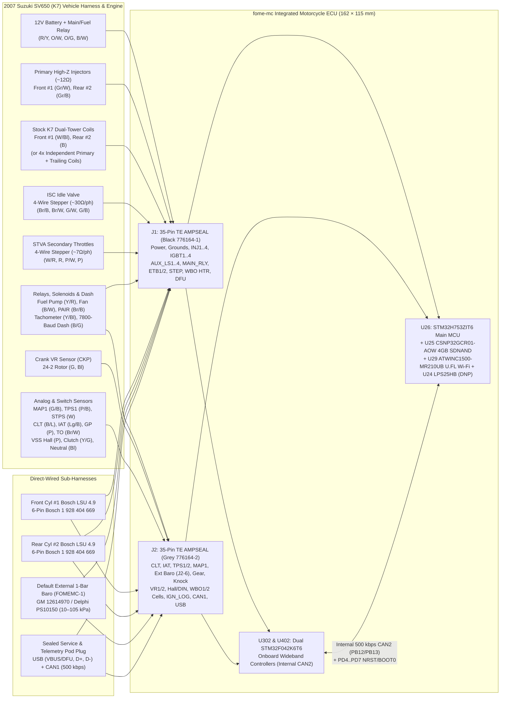
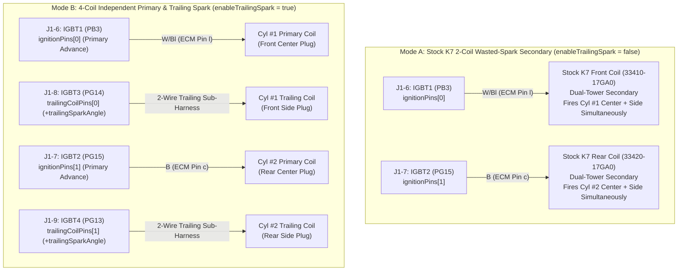

# 2007 Suzuki SV650 (K7 Dual-Plug) Wiring & Adapter Harness Guide

This document specifies the complete adapter harness, sensor, actuator, dual Bosch LSU 4.9 wideband, and ignition coil wiring between a **2007 Suzuki SV650 / SV650S / SV650A / SV650SA (`K7`, Gen 2 dual-plug 90° V-twin)** and **`fome-mc`** (`J1` 35-pin Black `776163-1` and `J2` 35-pin Grey `776163-2`).

---

## 1. Vehicle System Interconnect Diagram

---

## 2. Mating Connector & Crimp BOM (ECU Side of Adapter Harness)

| Ref | Description | TE Connectivity MPN | Qty | Notes |
| :---: | :--- | :--- | :---: | :--- |
| `J1` Plug | 35-Pos AMPSEAL Plug Housing, **Key 1 Black** | `776164-1` | 1 | Mates with PCB header `776163-1` (`J1`) |
| `J2` Plug | 35-Pos AMPSEAL Plug Housing, **Key 2 Grey** | `776164-2` | 1 | Mates with PCB header `776163-2` (`J2`) |
| Contacts | AMPSEAL `1.3 mm` Gold-Plated Receptacle Crimp Terminals (16–20 AWG) | `770520-3` (strip) / `770854-3` (loose) | 70 | Rated `17 A` max single contact / `8–11 A` continuous in housing |
| Cavity Plugs | AMPSEAL Sealing Plugs for unused cavities | `770678-1` | 20 | Required in every unpopulated cavity to maintain IP67/IP69K seal |
| Strain Relief | AMPSEAL 35-Pos Back-Shell Wire Dress Cover | `776463-1` | 2 | Protects wire exit bundle and mat seal |

---

## 3. Complete SV650 K7 Stock ECM-to-`fome-mc` Pin Cross-Reference

### 3.1 `J1` (35-Pin Black `776164-1`) — Power, Grounds & Actuators

| `J1` Pin | `fome-mc` Signal | `STM32H753` Pin | Stock K7 SV650 Function | Stock K7 Wire Color & ECM Pin | Wire Gauge |
| :---: | :--- | :---: | :--- | :--- | :---: |
| `J1-1` | `INJ1` | `PG5` | Front Cyl #1 Primary Fuel Injector `-` | `Gr/W` (ECM Pin `a`) | 20 AWG |
| `J1-2` | `INJ2` | `PG6` | Rear Cyl #2 Primary Fuel Injector `-` | `Gr/B` (ECM Pin `b`) | 20 AWG |
| `J1-3` | `INJ3` | `PG7` | Spare / Staged Front Injector 3 `-` | Plug with `770678-1` on stock K7 | — |
| `J1-4` | `INJ4` | `PG8` | Spare / Staged Rear Injector 4 `-` | Plug with `770678-1` on stock K7 | — |
| `J1-5` | `PGND_INJ` | `GND` | Injector & Low-Side Power Ground Return | `B/W` (ECM Pin `p`/`q` splice) | 16 AWG |
| `J1-6` | `IGBT1` | `PB3` | Front Cyl #1 Primary Center Coil `-` (or K7 Dual-Tower Front Coil `-`) | `W/Bl` (ECM Pin `l`) | 18 AWG |
| `J1-7` | `IGBT2` | `PG15` | Rear Cyl #2 Primary Center Coil `-` (or K7 Dual-Tower Rear Coil `-`) | `B` (ECM Pin `c`) | 18 AWG |
| `J1-8` | `IGBT3` | `PG14` | Front Cyl #1 Trailing Side Coil `-` (4-Coil Split Mode) | Sub-harness to Front Side Coil `-` | 18 AWG |
| `J1-9` | `IGBT4` | `PG13` | Rear Cyl #2 Trailing Side Coil `-` (4-Coil Split Mode) | Sub-harness to Rear Side Coil `-` | 18 AWG |
| `J1-10` | `AUX_LS1` | `PC6` | Fuel Pump Relay Coil `-` | `Y/R` (ECM Pin `W`) | 20 AWG |
| `J1-11` | `AUX_LS2` | `PC7` | Cooling Fan Relay Coil `-` | `B/W` or `Y/G` (ECM Pin `V`) | 20 AWG |
| `J1-12` | `AUX_LS3` | `PA15` | PAIR Air Injection Solenoid Valve `-` | `Br/B` (ECM Pin `e`) | 20 AWG |
| `J1-13` | `AUX_LS4` | `PD3` | Tachometer Pulse Output (`0–12 V` w/ onboard 2.2 kΩ pull-up) | `Y/Bl` (ECM Pin `Z`) | 20 AWG |
| `J1-14` | `MAIN_RLY` | `PE0` | ECU Main Relay Low-Side Hold (`U1202.6` + `D209` `B340A-13-F`) | Main Relay Coil `-` (Adapter / Harness) | 20 AWG |
| `J1-15` | `ETB1_OUT+` | `PD12/10/11` | `STVA` Secondary Throttle Stepper Phase A+ | `W/R` (ECM Pin `[`) | 20 AWG |
| `J1-16` | `ETB1_OUT-` | `PD12/10/11` | `STVA` Secondary Throttle Stepper Phase A- | `R` (ECM Pin `f`) | 20 AWG |
| `J1-17` | `ETB2_OUT+` | `PD13/9/8` | `STVA` Secondary Throttle Stepper Phase B+ | `P/W` (ECM Pin `Y`) | 20 AWG |
| `J1-18` | `ETB2_OUT-` | `PD13/9/8` | `STVA` Secondary Throttle Stepper Phase B- | `P` (ECM Pin `d`) | 20 AWG |
| `J1-19` | `STEP_1A` | `PB4/7/8` | `ISC` Idle Speed Control Stepper Phase A+ | `Br/B` (ECM Pin `g`) | 20 AWG |
| `J1-20` | `STEP_1B` | `PB4/7/8` | `ISC` Idle Speed Control Stepper Phase A- | `Br/W` (ECM Pin `^`) | 20 AWG |
| `J1-21` | `STEP_2A` | `PB4/7/8` | `ISC` Idle Speed Control Stepper Phase B+ | `G/W` (ECM Pin `i`) | 20 AWG |
| `J1-22` | `STEP_2B` | `PB4/7/8` | `ISC` Idle Speed Control Stepper Phase B- | `G/B` (ECM Pin `\`) | 20 AWG |
| `J1-23` | `WBO1_HTR-` | `WBO1:PB0` | Front Cyl #1 Bosch LSU 4.9 Pin 3 (`Heater -`) | White (LSU 4.9 #1 Pin 3) | 18 AWG |
| `J1-24` | `WBO_HTR+` | `+12V_MR` | Bosch LSU 4.9 #1 & #2 Pin 4 (`Heater +12V`) | Grey (LSU 4.9 #1 & #2 Pin 4 splice) | 18 AWG |
| `J1-25` | `WBO2_HTR-` | `WBO2:PB0` | Rear Cyl #2 Bosch LSU 4.9 Pin 3 (`Heater -`) | White (LSU 4.9 #2 Pin 3) | 18 AWG |
| `J1-26` | `+12V_IGN_SW` | `PC5` (`ADC_15`) | Ignition / Kill Switch Run `+12V` Input (`D20` OR + `R96/R97` Sense) | `O/W` (ECM Pin `D`) | 20 AWG |
| `J1-27` | `+12V_MR` | `PF11` (`ADC_16`)| Main Relay Switched `+12V` Power Input (`D21` OR -> `12V_RAW`) | `R/Y` (ECM Pins `A` & `B`) | 16 AWG |
| `J1-28` | `+12V_BATT_KEEPALIVE`| — | Unswitched Battery `+12V` Keep-Alive (`U41` `MIC5205` -> `VBAT`) | `O/G` (ECM Pin `H`) | 20 AWG |
| `J1-29` | `5V_SENSOR_1` | `PA6` (`ADC_17`) | Regulated `+5.00V` Sensor Supply #1 (`U1` `TLS115D0E`) | `R` (ECM Pin `C`: TPS, STPS, MAP1, Ext Baro, GP) | 20 AWG |
| `J1-30` | `5V_SENSOR_2` | `PF14` (`PG`) | Regulated `+5.00V` Sensor Supply #2 (`U2` `TLS115D0E`) | Aux / Telemetry Pod `+5.00V` | 20 AWG |
| `J1-31` | `SGND` | `VSSA` | Dedicated Analog & Sensor Ground Return | `Br/B` (ECM Pin `9` + Ext Baro GND) | 20 AWG |
| `J1-32` | `PGND_IGN` | `GND` | Ignition IGBT Emitter Power Ground Return | `B/W` (ECM Pins `p` & `q`) | 16 AWG |
| `J1-33` | `PGND_HEATER` | `GND` | Wideband Heater & H-Bridge Ground Return | Direct to Battery `-` / Frame Ground | 16 AWG |
| `J1-34` | `CHASSIS_ECU_GND` | `VSS` | Main ECU Logic Ground Reference | `B/W` (ECM Pin `r`) | 18 AWG |
| `J1-35` | `USB_VBUS_DFU` | `PA9` + `BOOT0` | Service USB `VBUS` (`+5V`) / Force DFU (`+12V`) | Service USB Connector Pin 1 (`VBUS`) | 20 AWG |

---

### 3.2 `J2` (35-Pin Grey `776164-2`) — Sensors, Wideband Cells, Logic Coils, CAN1 & USB

| `J2` Pin | `fome-mc` Signal | `STM32H753` Pin | Stock K7 SV650 Function | Stock K7 Wire Color & ECM Pin | Wire Gauge |
| :---: | :--- | :---: | :--- | :--- | :---: |
| `J2-1` | `CLT` | `PC1` (`ADC_11`) | Engine Coolant Temp (`ECT`, 2.7 kΩ pull-up) | `B/L` (ECM Pin `6`) | 20 AWG |
| `J2-2` | `IAT` | `PC2` (`ADC_12`) | Intake Air Temp (`IAT`, 2.7 kΩ pull-up) | `Lg/B` (ECM Pin `7`) | 20 AWG |
| `J2-3` | `TPS1` | `PA1` (`ADC_1`) | Primary Throttle Position Sensor (`TPS`) | `P/B` (ECM Pin `5`) | 20 AWG |
| `J2-4` | `TPS2_STPS` | `PA3` (`ADC_3`) | Secondary Throttle Position Sensor (`STPS`) | `W` (ECM Pin `4`) | 20 AWG |
| `J2-5` | `MAP1_FRONT` | `PA0` (`ADC_0`) | Front Cyl #1 Intake Air Pressure (`IAP1`) + Cam Sync | `G/B` (ECM Pin `3`) | 20 AWG |
| `J2-6` | `AV3_BARO_MAP2` | `PA2` (`ADC_2`) | Default External 1-Bar Baro (`GM 12614970` / `Delphi PS10150`, `MT_GM_1_BAR`) | External Baro Signal (`10–105 kPa`, powered by `J1-29` & `J1-31`) | 20 AWG |
| `J2-7` | `AV5_TIPOVER` | `PA4` (`ADC_4`) | Tip-Over Pendulum Sensor (`TO`) | `Br/W` (ECM Pin `J`) | 20 AWG |
| `J2-8` | `AV6_GEAR` | `PA5` (`ADC_5`) | 6-Speed Gear Position Switch (`GP`, 1.5 kΩ pull-up) | `P` (ECM Pin `1`) | 20 AWG |
| `J2-9` | `KNOCK1` | `PF4` (`ADC3_9`) | Front Cyl #1 Piezo Knock Sensor | Optional Knock 1 (`RG-174` / twisted) | 20 AWG |
| `J2-10` | `KNOCK2` | `PF5` (`ADC3_4`) | Rear Cyl #2 Piezo Knock Sensor | Optional Knock 2 (`RG-174` / twisted) | 20 AWG |
| `J2-11` | `VR1+` | `PE14` | Crankshaft Position Sensor `CKP+` (`24-2` Rotor) | `G` (ECM Pin `R`) | 20 AWG (Twisted) |
| `J2-12` | `VR1-` | — | Crankshaft Position Sensor `CKP-` Return | `Bl` (ECM Pin `8`) | 20 AWG (Twisted) |
| `J2-13` | `VR2+` | `PE15` | Secondary / Cam VR+ (Unused on camless K7) | Plug with `770678-1` on stock K7 | — |
| `J2-14` | `VR2-` | — | Secondary / Cam VR- (Unused on camless K7) | Plug with `770678-1` on stock K7 | — |
| `J2-15` | `HALL1_CAM` | `PG1` | Aux Hall Input 1 (4.7 kΩ pull-up) | Plug with `770678-1` on stock K7 | — |
| `J2-16` | `HALL2_VSS` | `PG0` | Vehicle Speed Sensor (`VSS` 3-Wire Hall) | `P` (ECM Pin `K`) | 20 AWG |
| `J2-17` | `DIN1_CLUTCH` | `PE11` | Clutch Lever Switch (Active-Low to GND) | `Y/G` (ECM Pin `M`) | 20 AWG |
| `J2-18` | `DIN2_NEUTRAL` | `PE10` | Neutral / Sidestand Switch (Active-Low to GND) | `Bl` (ECM Pin `N`) | 20 AWG |
| `J2-19` | `WBO1_VM` | `WBO1:PA2/6` | Front Cyl #1 Bosch LSU 4.9 Pin 2 (`Vm`) | Yellow (LSU 4.9 #1 Pin 2) | 20 AWG |
| `J2-20` | `WBO1_IP` | `WBO1:PA1/5` | Front Cyl #1 Bosch LSU 4.9 Pin 1 (`Ip`) | Red (LSU 4.9 #1 Pin 1) | 20 AWG |
| `J2-21` | `WBO1_RCAL` | — | Front Cyl #1 Bosch LSU 4.9 Pin 5 (`Rcal`) | Green (LSU 4.9 #1 Pin 5) | 20 AWG |
| `J2-22` | `WBO1_UN` | `WBO1:PA3/7/9` | Front Cyl #1 Bosch LSU 4.9 Pin 6 (`Un / Vs`) | Black (LSU 4.9 #1 Pin 6) | 20 AWG |
| `J2-23` | `IGN1_LOG` | `PG12` | 5 V Push-Pull Smart Coil 1 Trigger | Optional Smart Coil 1 | 20 AWG |
| `J2-24` | `IGN2_LOG` | `PG11` | 5 V Push-Pull Smart Coil 2 Trigger | Optional Smart Coil 2 | 20 AWG |
| `J2-25` | `IGN3_LOG` | `PG10` | 5 V Push-Pull Smart Coil 3 Trigger | Optional Smart Coil 3 | 20 AWG |
| `J2-26` | `IGN4_LOG` | `PG9` | 5 V Push-Pull Smart Coil 4 Trigger | Optional Smart Coil 4 | 20 AWG |
| `J2-27` | `DASH_TECH` | `PB9` | SV650 K7 7800-Baud Dash Serial (2.2 kΩ `+12V_MR`) | `B/G` (ECM Pin `U`) | 20 AWG |
| `J2-28` | `CAN1_H` | `PD0/PD1` | External `CAN1_H` (500 kbps, `120 Ω`, 50 Hz `0x200..0x207` TX + IMU RX + OpenBLT) | Telemetry Pod / Dash / Service `CAN_H` | 20 AWG (Twisted) |
| `J2-29` | `CAN1_L` | `PD0/PD1` | External `CAN1_L` (500 kbps, `120 Ω`, 50 Hz `0x200..0x207` TX + IMU RX + OpenBLT) | Telemetry Pod / Dash / Service `CAN_L` | 20 AWG (Twisted) |
| `J2-30` | `WBO2_VM` | `WBO2:PA2/6` | Rear Cyl #2 Bosch LSU 4.9 Pin 2 (`Vm`) | Yellow (LSU 4.9 #2 Pin 2) | 20 AWG |
| `J2-31` | `WBO2_IP` | `WBO2:PA1/5` | Rear Cyl #2 Bosch LSU 4.9 Pin 1 (`Ip`) | Red (LSU 4.9 #2 Pin 1) | 20 AWG |
| `J2-32` | `WBO2_RCAL` | — | Rear Cyl #2 Bosch LSU 4.9 Pin 5 (`Rcal`) | Green (LSU 4.9 #2 Pin 5) | 20 AWG |
| `J2-33` | `WBO2_UN` | `WBO2:PA3/7/9` | Rear Cyl #2 Bosch LSU 4.9 Pin 6 (`Un / Vs`) | Black (LSU 4.9 #2 Pin 6) | 20 AWG |
| `J2-34` | `USB_D+` | `PA12` | Service / Tuning USB Full-Speed `D+` | Service USB Connector Pin 3 (`D+`, Green)| 20 AWG (Twisted) |
| `J2-35` | `USB_D-` | `PA11` | Service / Tuning USB Full-Speed `D-` | Service USB Connector Pin 2 (`D-`, White)| 20 AWG (Twisted) |

---

## 4. Ignition Coil Topologies (2-Coil Stock vs. 4-Coil Independent Primary/Trailing)

---

## 5. Dual Bosch LSU 4.9 Wideband Sub-Harness Pinout

Each Bosch LSU 4.9 sensor (`0 258 017 025`) uses a 6-pin connector that mates with a harness-side Bosch `1 928 404 669` plug:

| LSU 4.9 Sensor Pin | Signal | Wire Color | Front Cyl #1 (`WBO1`) Destination | Rear Cyl #2 (`WBO2`) Destination |
| :---: | :--- | :--- | :---: | :---: |
| **Pin 1** | `Ip` (Pump Current) | Red | `J2-20` (`WBO1_IP`) | `J2-31` (`WBO2_IP`) |
| **Pin 2** | `Vm` (Virtual Ground `1.65V`) | Yellow | `J2-19` (`WBO1_VM`) | `J2-30` (`WBO2_VM`) |
| **Pin 3** | `H-` (Heater Low-Side PWM) | White | `J1-23` (`WBO1_HTR-`) | `J1-25` (`WBO2_HTR-`) |
| **Pin 4** | `H+` (Heater `+12V` Supply) | Grey | `J1-24` (`WBO_HTR+` / Switched `+12V_MR`) | `J1-24` (`WBO_HTR+` / Switched `+12V_MR`) |
| **Pin 5** | `Rcal` (Calibration Resistor) | Green | `J2-21` (`WBO1_RCAL`) | `J2-32` (`WBO2_RCAL`) |
| **Pin 6** | `Un / Vs` (Nernst Cell) | Black | `J2-22` (`WBO1_UN`) | `J2-33` (`WBO2_UN`) |
