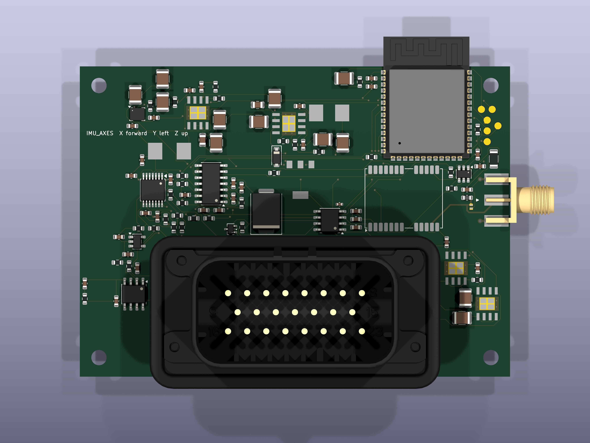
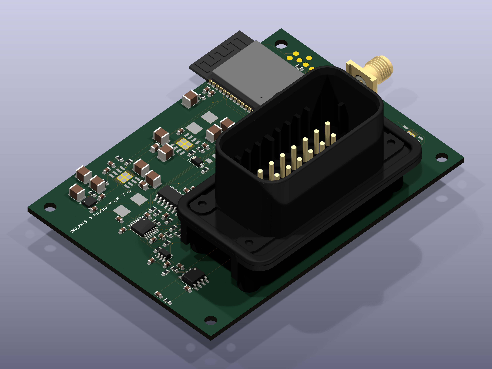
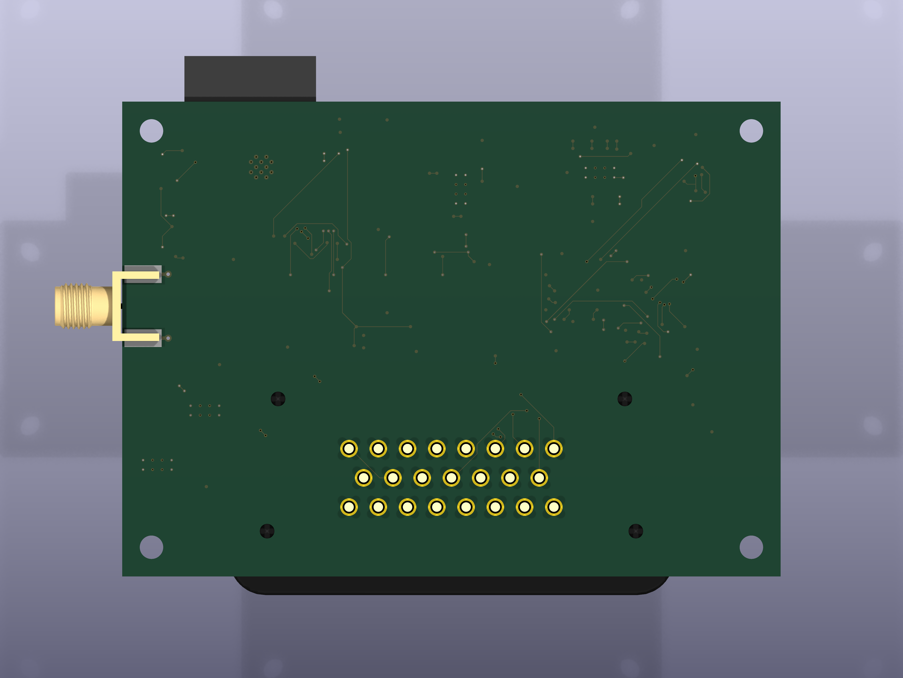
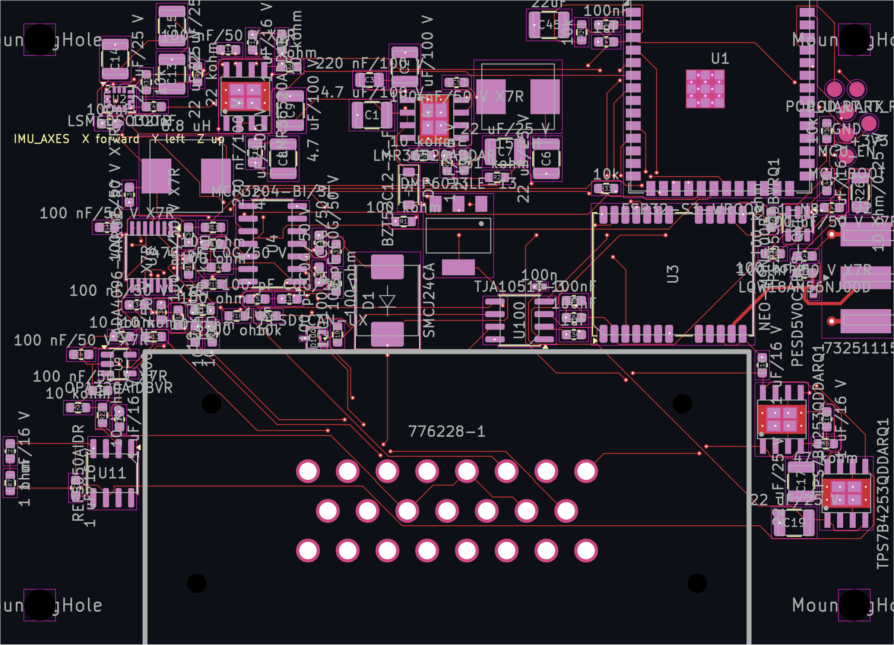
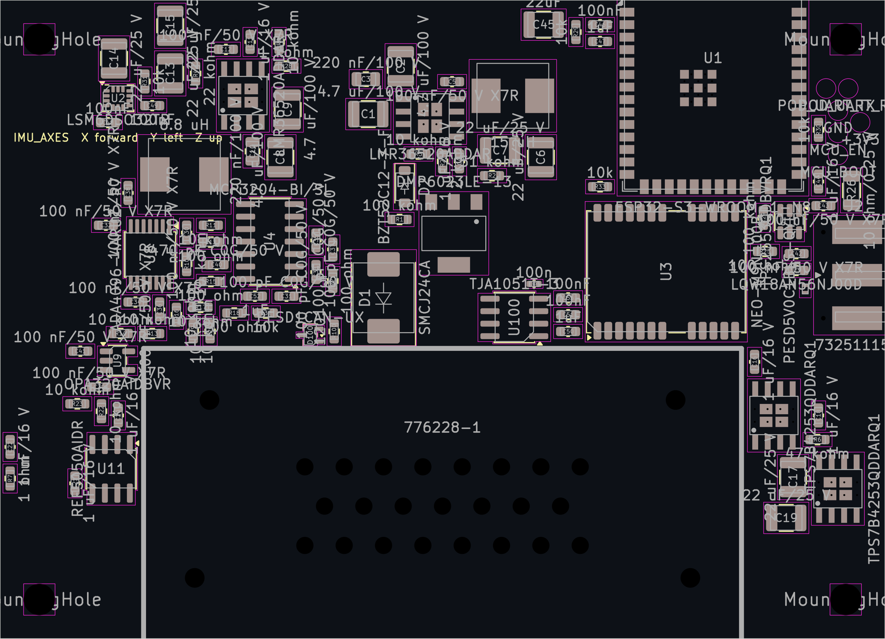
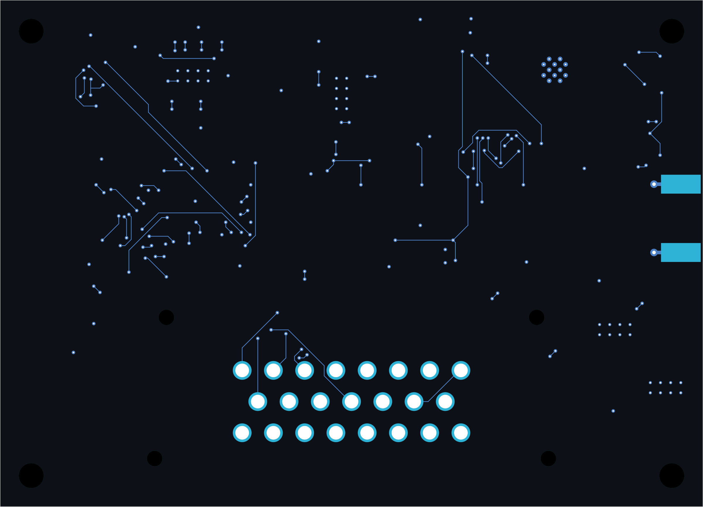
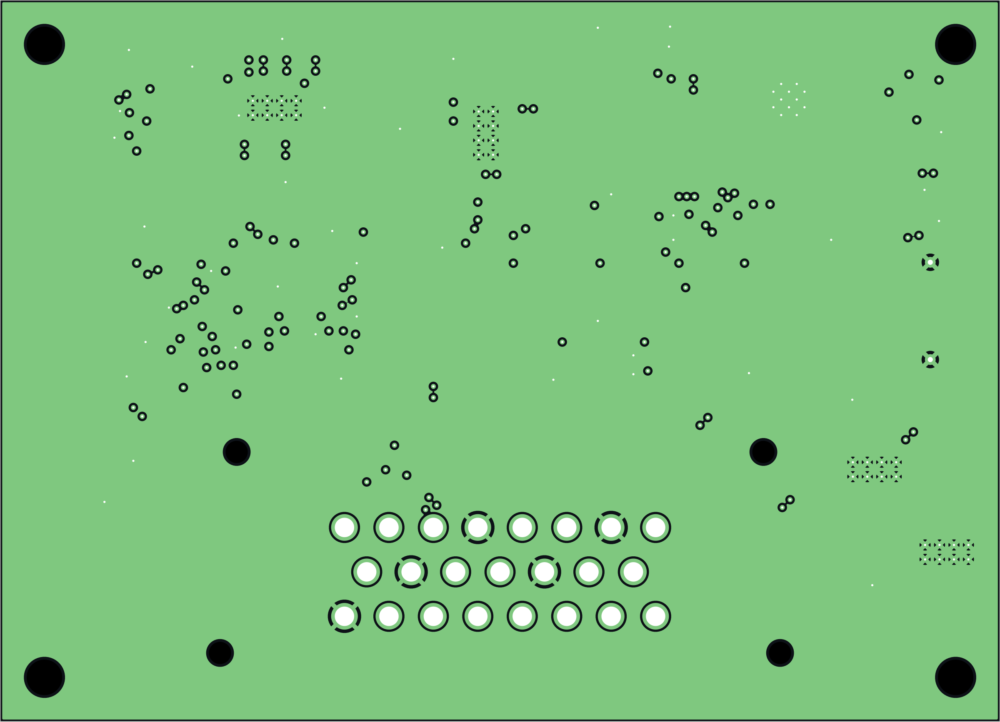
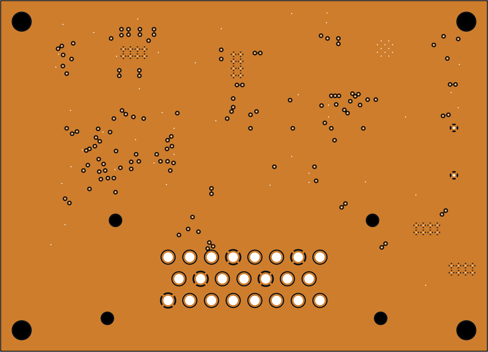
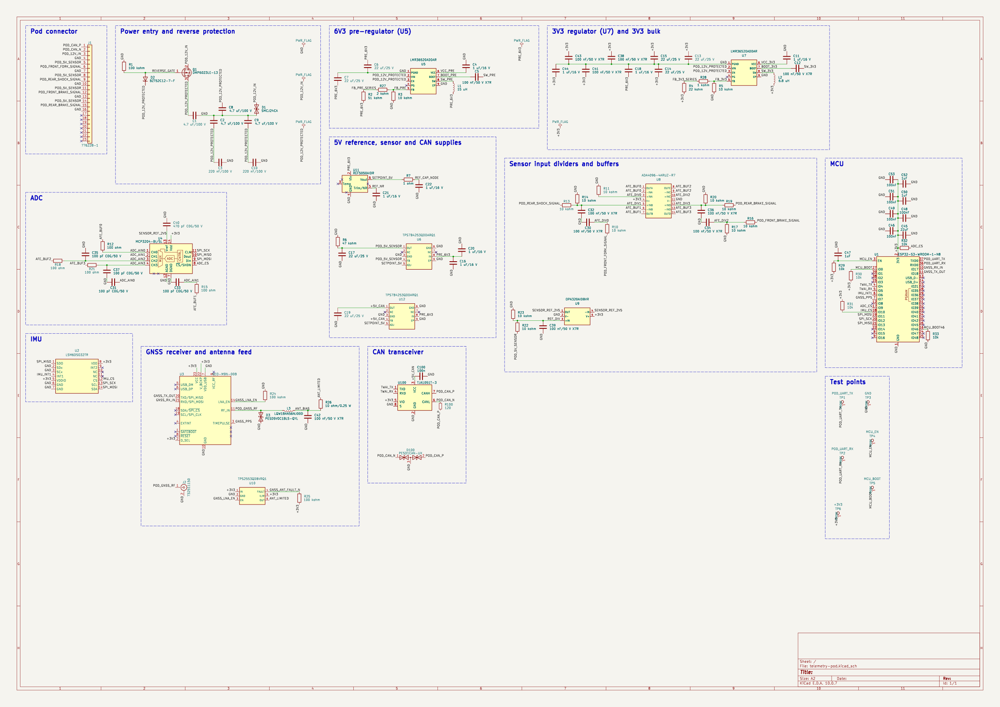

# telemetry-pod (`FOMEMC-28`)

> **Project files (2026-10-22, AGENTEE-207 j6 / AGENTEE-445): the production Rev-3 microSD pod, emitted, not
> yet placed or routed.** `telemetry-pod.kicad_sch` is the production schematic emitted by agent-ee
> `7d5b0d4d` (j6b2, the AGENTEE-466 runtime; byte-identical to the j6 `81e387ee` emission) from the bound production intent (305 components, 235 nets), and `telemetry-pod.kicad_pcb` is its
> forward-annotated generation seed: the envelope's fixed parts (J1, J2, J3, U1, U2, H1-H4) posed, every other
> footprint unplaced, nothing routed. Inputs, receipts and the bounded two-iteration preparation it came from
> are retained in [`expansion/production-capture/evidence/emission-7d5b0d4d/`](expansion/production-capture/evidence/emission-7d5b0d4d/)
> (`retain.py --check`); the library tables point at the retained captured libraries, and the bound J1 and U3
> 3D models resolve from `inputs/models/` (j6b, FOMEMC-34). This is generation
> input, not a design result: native DRC reports the unrouted connections and the unplaced-part overlaps as
> findings, and no placement, routing, fabrication or bench acceptance exists.

> **Historical v9 pilot snapshot.** Everything below, including the renders, describes the earlier v9 pilot
> (commit `13c0bfb`, `driver-preparation-v9-90x65`), whose schematic and board files are retained in git
> history only. Its emitter inputs were lost, so it could not be re-emitted (AGENTEE-445).

## Pilot Provenance & Open Requalification Items

- **Status:** Pilot snapshot (`driver-preparation-v9-90x65`, board SHA256 `2938ee1ee2cae459c869ee5c4c8443e66322034736fe3fcbf4b5e56377ea1cfa`). Not a fabrication release.
- **`agent-ee` Source SHA:** `a02c952` (`main`).
- **Router Provenance:** Routed with the validated fix content from the rejected runtime prototypes `kr63` (`d7ceadf`, multi-point pad weld stub layer mapping) and `kr64` (`670f5c6`, non-rectangular pad perimeter weld stub filtering). The runtime patching mechanism was superseded by owner decision in favor of pinning the fork `halbritt/KiCadRoutingTools` (`branch kicad-route-fixes` based on `v0.23.1` `295f9ee1`, tracked under `KICADROUTE-65`) and filing the two defects upstream.
- **Stage 7 (`agent-ee` 18-Check Review Gate) Status:**
  - **Raw `agent-ee` `a02c952`:** `12/18` checks `pass` (`erc`, `interface`, `package-nc`, `power-interface`, `intent-parity`, `parts`, `part-bindings`, `pinout-electrical`, `placement-drc`, `net-constraint-assignment`, `routing-drc`, `drc`), `2/18` `info` (`netlist`, `geometry`), `4/18` non-pass (`fab_package`, `pinout-ble`, `assembly`, `severity`).
  - **With `AGENTEE-275` (`fab_package` delegated parameter & `board_only` mounting-hole fix):** `15/18` checks `pass`/`info` (including `fab_package: pass` with 11 plots, PTH/NPTH drills, 43 BOM rows, 101 CPL rows, 1 rule-excluded connector `J1`, and 8 sealed artifacts `452630826d34`).
  - **Open Software / Library Items Being Landed for Clean-`main` Requalification:**
    1. **`AGENTEE-275`:** `fab_package` delegated parameters (`probe_manifest`, `assembly_exclusion`, `bom_variant`, `model_libraries`) and `fab_export` support for `board_only` mechanical mounting holes (`H1..H4`).
    2. **`AGENTEE-276`:** Geometry/policy handling for silkscreen (`H1..H4` reference silk over drill, reference labels outside courtyards, `IMU_AXES` obstacle, `J1`/`U1` overhanging edge silk) and inner-plane layer types (`In1.Cu` `power`, `In2.Cu` `mixed`).
    3. **`KICADROUTE-65`:** Pin `halbritt/KiCadRoutingTools` (`kicad-route-fixes`) in `kicad-route` and re-pin in `agent-ee`.
    4. **Upstream `ublox_NEO` 3D Model Gap:** `RF_GPS.3dshapes/ublox_NEO.step` is 404 in upstream `kicad-packages3D` (`10.0.7`); tracked as an explicit upstream library gap rather than silently passing.
    5. **`U3` (`NEO-M9N-00B`, `C2843985`) JLCPCB Stock Gate:** `stock_count: 0` at JLCPCB (`assembly_readiness: unknown`), pending restock or owner hand-fit authorization.
- **`fome-mc` Native Toolchain Check Results (`make check PROJECT=telemetry-pod` / `make verify-io PROJECT=telemetry-pod`):**
  - `erc`: **PASS** (`Design clean: True`, `0` violations across 1 sheet).
  - `drc`: **PASS** (`Design clean: True`, `0` violations, `0` unconnected items, `0` schematic parity issues).
  - `netlist`: **PASS** (`108` components, `116` nets).
  - `analyze` (`kicad-happy`): **PASS** (`108` schematic components, `112` PCB footprints, `routing_complete: true`).
  - `export` (KiBot): **FAIL** (KiBot `1.9.1` exits `22` when parsing `agent-ee`'s JSON `bare-copper-probe/1` metadata property on `TP1..TP6` as a colon-delimited footprint string; native `kicad-cli` fab export passes).
  - `verify-io`: **FAIL** (`contracts/telemetry-pod.interface.json` intentionally fails closed per `FOMEMC-29` until `AGENTEE-188` generates the root contract).

---

## 3D Ray-Traced Board Renders (`4096 × 3072`)

### Top View (`F.Cu`)

### Isometric View

### Bottom View (`B.Cu`)

---

## 2D Layer & Schematic Renders

### Top Copper & Silkscreen (`F.Cu`)

### Top Assembly & Courtyards

### Bottom Copper & Silkscreen (`B.Cu`)

### Inner Layer 1 (`In1.Cu` — `GND` Plane)

### Inner Layer 2 (`In2.Cu` — `+3V3` Plane)

### Schematic (`telemetry-pod.kicad_sch`)

- Multi-layer PCB PDF: [`renders/telemetry-pod-pcb-layers.pdf`](renders/telemetry-pod-pcb-layers.pdf)
- Schematic PDF: [`renders/telemetry-pod-schematic.pdf`](renders/telemetry-pod-schematic.pdf)

---

## Directory Contents

| Path | Description |
|---|---|
| `telemetry-pod.kicad_sch` | Production schematic emitted by agent-ee `7d5b0d4d` (j6b2; byte-identical to the j6 `81e387ee` emission; `305` components, `235` nets); the v9 pilot schematic is in history at `13c0bfb` |
| `telemetry-pod.kicad_pcb` | Forward-annotated generation seed (fixed parts posed, the rest unplaced, unrouted); the v9 pilot board is in history at `13c0bfb` |
| `telemetry-pod.kicad_pro` | KiCad 10 project written by the emission (production board setup and net classes) |
| `telemetry-pod.kicad_dru` | Production custom design rules (`expansion/design-rules/telemetry-pod.kicad_dru`) |
| `telemetry-pod.net-constraints.record.json` | (v9 pilot, historical) Provenance record for assigned net classes and RF/differential constraints |
| `sym-lib-table`, `fp-lib-table` | The emitted candidate's tables, relocated to the retained captured libraries under `expansion/production-capture/evidence/emission-7d5b0d4d/design/` |
| `inputs/models/` | (j6b, FOMEMC-34) The two bound project-local 3D models the board names as `${KIPRJMOD}/inputs/models/`: the J1 TE 1-776163-1 rev T header STEP and the U3 NEO-M9N datasheet-derived visualization, installed by `retain.py` and recorded in `expansion/production-capture/composition/project-models.json`. These are visual/mechanical models only |
| `captured-symbols/`, `captured-footprints/` | (v9 pilot, historical) KiCad-library-derived and project-authored symbols and footprints |
| `kicad-libraries/` | Shared FOME AMPSEAL-23 footprint and 3D STEP model (`c-1-776228-1-e-3d.STEP`) |
| `renders/` | (v9 pilot, historical) 2D layer SVGs/PNGs/PDFs, schematic SVG/PNG/PDF, and 4K 3D ray-traced views (`renders/3d/`) |
| `io-map.csv`, `IO_MAP.md`, `verify_io_map.py`, `io-map-cross-check.txt` | Proposed harness, radio, antenna, and factory UART interface input and spec-ID cross-check |
| `REQUIREMENTS.md` | Captured hardware requirements and owner design decisions |
