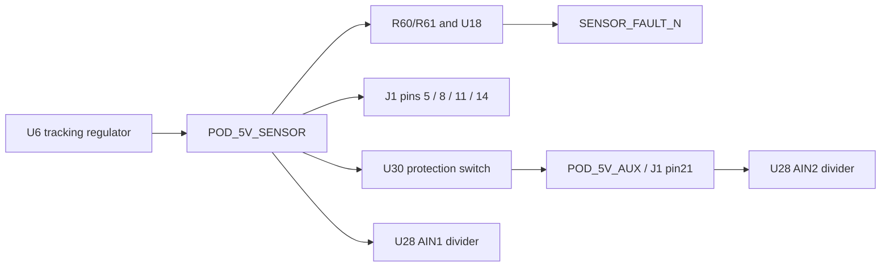

# Supply-monitor coverage in the expanded source

`SENSOR_FAULT_N` is a local upstream-rail alarm. It does not indicate that all
external sensor supplies are valid. This matters both for R60 selection and
for the future firmware validity policy.

The current component-fit intent connects U6 OUT1 and FB4, R60 pin1, the original
sensor supply connector pins and U30 IN1 to **POD_5V_SENSOR**. R60/R61 feed U18
SENSE1. U18 RESET6 connects through SENSOR_FAULT_N to U1 module pin25 (GPIO48).
U30 OUT10 is the separate **POD_5V_AUX** node. Its series drop, current limiting,
reverse fault or shutdown is not directly observed by U18 while U6 stays healthy.



The Hall and tire branches come separately from PRE_6V3 through U23–U25.
They also have no direct path to U18 SENSE. Their output faults can affect U18
indirectly through shared-source loading, but that is not reliable detection of
a branch fault.

## Extracted ADC map

| ADC input | Sensed node | J1 pins at that board node |
| --- | --- | --- |
| U27 AIN0 | POD_12V_PROTECTED | none |
| U27 AIN1 | PRE_6V3 | none |
| U27 AIN2 | +3V3 | none |
| U28 AIN0 | EMMC_VCC_3V3 | none |
| U28 AIN1 | POD_5V_SENSOR | 5, 8, 11, 14 |
| U28 AIN2 | POD_5V_AUX | 21 |
| U28 AIN3 | THERM_EXC_2V495 | none |
| U29 AIN0 | POD_WHEEL_FRONT_SUPPLY | 23 |
| U29 AIN1 | POD_WHEEL_REAR_SUPPLY | 26 |
| U29 AIN2 | POD_TIRE_SUPPLY | 31 |

All ten paths use three series 499 kohm resistors and a 4.99 kohm bottom
resistor: nominal 301:1 division. The source checker follows each series junction
to the ADC input and ground, rather than inferring a connection from names.
`report.json` records the exact intent hash. The ADC pin mapping follows the
existing captured ADS1119 library. This is source graph evidence, not a native
schematic or an operational measurement.

## Consequences for the design

For R60, compare the supervisor's release threshold to the healthy voltage at
**U6's sensed output node**. Do not subtract the U30 or external cable voltage
drop from this upstream-node calculation. The earlier auxiliary study's
conditional reference-plus-tracking-only minimum of 4.9844 V would leave
82.599 mV above the 31.6 kohm candidate's conditional 4.901801 V maximum release
threshold. This remains an incomplete error budget: shared load, headroom,
thermal operation, remaining reference errors, noise and aging are not closed.
The original illustrative 4.95 V comparison remains a separate assumption.

For sensor validity, neither a deasserted SENSOR_FAULT_N nor a healthy upstream
ADC reading proves a downstream rail healthy. The branch ADCs provide separate
board-node observations. Their error, settling, conversion scheduling and stale
sample handling must be part of a firmware validity contract. They do not certify
the owner's ±1% sensor-supply requirement. Existing diagnostic error and settling
holds remain; no threshold or firmware policy is implemented by this document.

Even a healthy board connector node does not prove voltage at the remote sensor:
cable/contact resistance, broken wires and sensor return offsets are beyond this
sensing boundary. A branch-specific fault policy and sensor operating limits are
needed when selecting the external sensors. No firmware source is modified here.

## Replay

```sh
python3 telemetry-pod/expansion/supply-monitor-coverage/check_coverage.py
```

The output must match `report.json`. Current design inputs remain unchanged.
